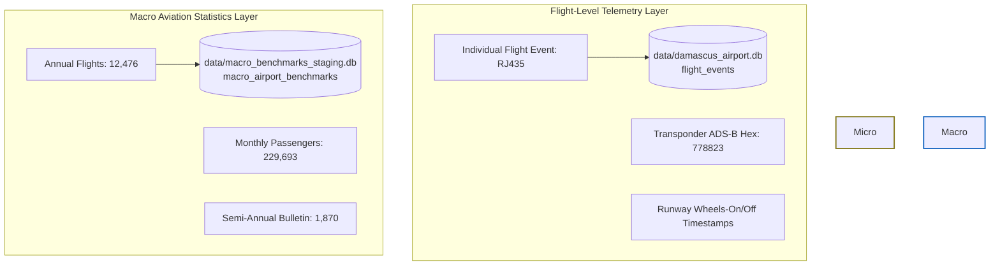

# Syrian Airport Data Engine — Version 2.10
# Macro Aviation Statistics Staging Layer Design Specification

**Document Identifier**: `docs/V2_10_MACRO_STATISTICS_DESIGN.md`  
**Target Aerodrome**: Damascus International Airport (`DAM` / `OSDI`)  
**Staging Target**: `data/macro_benchmarks_staging.db` (Isolated SQLite database)  
**Standard**: Strict Epistemic Separation between Micro-Telemetry and Macro-Benchmarks  
**Status**: APPROVED DESIGN SPECIFICATION  

---

## 1. Architectural Motivation & Problem Statement

In aviation data engineering, a fundamental architectural vulnerability is the **conflation of aggregate macro statistics with micro operational flight movements**:



### Critical Risks Prevented:
1. **Ecological Fallacy**: Attempting to disaggregate a monthly total (e.g. 2,022 flights in September 2026) across individual days or flight legs fabricates synthetic, non-existent flight movements.
2. **Double Counting**: If monthly macro figures were ingested into event tables alongside observed flights, aggregate queries would sum real movements and monthly summaries together.
3. **Airspace Conflation**: Sovereign civil aviation releases report transit overflights (e.g., 19,951 in September 2026) in the same news dispatches as runway flights (2,022). Placing them in airport movement tables corrupts airport operations metrics.
4. **Unverified Scope Contamination**: Macro announcements reported in economic news without verified primary statistical PDFs must be quarantined without blocking verified operational telemetry.

Version 2.10 implements a **completely isolated staging table** (`macro_airport_benchmarks`) in an independent staging database (`data/macro_benchmarks_staging.db`) to preserve macro statistics safely.

---

## 2. Staging Data Model: `macro_airport_benchmarks`

### 2.1 Entity Attribute Specification

| Column Name | SQL Data Type | Nullable | Primary / Constraint | Description & Purpose |
| :--- | :--- | :---: | :---: | :--- |
| `benchmark_id` | `TEXT` | No | `PRIMARY KEY` | Deterministic unique identifier (e.g. `bmk_2025_annual_flights`). |
| `airport_icao` | `TEXT` | No | — | 4-letter ICAO aerodrome code (`OSDI` for Damascus, `OSTT` for Syrian FIR). |
| `airport_iata` | `TEXT` | Yes | — | 3-letter IATA aerodrome code (`DAM` for Damascus; `NULL` for airspace FIR). |
| `reporting_period_start` | `TEXT` | No | `CHECK (start <= end)` | ISO date (`YYYY-MM-DD`) marking start of the reporting window. |
| `reporting_period_end` | `TEXT` | No | — | ISO date (`YYYY-MM-DD`) marking end of the reporting window. |
| `metric_type` | `TEXT` | No | `CHECK (metric_type IN ...)` | Standardized metric classifier (see Section 3). |
| `metric_value` | `REAL` | No | `CHECK (metric_value >= 0)` | Numeric reported value (non-negative integer or rate). |
| `unit` | `TEXT` | No | `CHECK (unit IN ...)` | Measurement unit (`flights`, `passengers`, `airlines`, `overflights`). |
| `direction` | `TEXT` | Yes | `CHECK (direction IN ...)` | Movement direction (`arrival`, `departure`, `total`, or `NULL`). |
| `geographic_scope` | `TEXT` | No | `CHECK (geographic_scope IN ...)` | Audited spatial scope (see Section 4). |
| `source_name` | `TEXT` | No | — | Full statutory name of publishing body or news wire agency. |
| `source_url` | `TEXT` | No | — | Canonical URL or `UNRESOLVED_PRIMARY_URL`. |
| `source_publication_date` | `TEXT` | No | — | Date of official publication (`YYYY-MM-DD`). |
| `source_excerpt` | `TEXT` | Yes | — | Direct textual quote or Arabic excerpt from original publication. |
| `verification_status` | `TEXT` | No | `CHECK (status IN ...)` | Audited evidence classification. |
| `calculation_method` | `TEXT` | No | — | Derivation type (`official_report`, `derived_sum`, `derived_subtraction`). |
| `is_derived` | `INTEGER` | No | `CHECK (is_derived IN (0, 1))` | Boolean flag (`0` for direct reports, `1` for calculated remainders). |
| `collected_at` | `TEXT` | No | — | ISO 8601 UTC collection timestamp. |

---

## 3. Standardized Metric Types

The schema enforces six mutually exclusive metric types:

```text
+------------------------+-------------+-------------+------------------------------------------------+
| Metric Type            | Valid Units | Direction   | Scope Restrictions                             |
+------------------------+-------------+-------------+------------------------------------------------+
| reported_flights       | flights     | total       | Aerodrome only (DAM / reported_as_DAM)         |
| passengers             | passengers  | total       | Aerodrome only (DAM / reported_as_DAM)         |
| arriving_passengers    | passengers  | arrival     | Aerodrome only (DAM / reported_as_DAM)         |
| departing_passengers   | passengers  | departure   | Aerodrome only (DAM / reported_as_DAM)         |
| airspace_overflights   | overflights | total       | Strictly restricted to OSTT_FIR                |
| operating_airlines     | airlines    | total       | Aerodrome only (DAM / reported_as_DAM)         |
+------------------------+-------------+-------------+------------------------------------------------+
```

### Overflight Separation Invariant
The database schema enforces this separation at the SQLite engine level via:
```sql
CONSTRAINT chk_overflight_scope CHECK (
    (metric_type = 'airspace_overflights' AND geographic_scope = 'OSTT_FIR') OR
    (metric_type != 'airspace_overflights' AND geographic_scope != 'OSTT_FIR')
)
```
Under no circumstances can an overflight metric be scoped to `DAM`, nor can airport flights be assigned to `OSTT_FIR`.

---

## 4. Geographic Scope Hierarchy

The schema supports five valid geographic scope classifications:

1. **`DAM`**: Verified aerodrome-level statistics for Damascus International Airport (`OSDI`).
2. **`reported_as_DAM_pending_primary_source_verification`**: Statistics quoted in secondary media for Damascus Airport where the canonical primary URL on `sana.sy` or `scaa.sy` remains unverified.
3. **`OSTT_FIR`**: National upper airspace transit overflights traversing the Damascus Flight Information Region.
4. **`SYRIA_NATIONAL`**: Sovereign aggregates reporting national civil aviation without aerodrome breakdown.
5. **`DAM_ALP_LTK`**: Composite multi-airport gateway aggregate (e.g., World Bank SEM dataset).

---

## 5. DDL & Index Design

```sql
CREATE TABLE IF NOT EXISTS macro_airport_benchmarks (
    benchmark_id TEXT PRIMARY KEY,
    airport_icao TEXT NOT NULL,
    airport_iata TEXT,
    reporting_period_start TEXT NOT NULL,
    reporting_period_end TEXT NOT NULL,
    metric_type TEXT NOT NULL,
    metric_value REAL NOT NULL,
    unit TEXT NOT NULL,
    direction TEXT,
    geographic_scope TEXT NOT NULL,
    source_name TEXT NOT NULL,
    source_url TEXT NOT NULL,
    source_publication_date TEXT NOT NULL,
    source_excerpt TEXT,
    verification_status TEXT NOT NULL,
    calculation_method TEXT NOT NULL,
    is_derived INTEGER NOT NULL DEFAULT 0,
    collected_at TEXT NOT NULL,
    CONSTRAINT chk_period CHECK (reporting_period_start <= reporting_period_end),
    CONSTRAINT chk_metric_val CHECK (metric_value >= 0),
    CONSTRAINT chk_metric_type CHECK (metric_type IN (
        'reported_flights',
        'passengers',
        'arriving_passengers',
        'departing_passengers',
        'airspace_overflights',
        'operating_airlines'
    )),
    CONSTRAINT chk_unit CHECK (unit IN ('flights', 'passengers', 'airlines', 'overflights')),
    CONSTRAINT chk_direction CHECK (direction IS NULL OR direction IN ('arrival', 'departure', 'total')),
    CONSTRAINT chk_geo_scope CHECK (geographic_scope IN (
        'DAM',
        'reported_as_DAM_pending_primary_source_verification',
        'OSTT_FIR',
        'SYRIA_NATIONAL',
        'DAM_ALP_LTK'
    )),
    CONSTRAINT chk_verif_status CHECK (verification_status IN (
        'verified_primary',
        'verified_secondary',
        'partially_verified',
        'unverified_source_url',
        'contradicted'
    )),
    CONSTRAINT chk_is_derived CHECK (is_derived IN (0, 1)),
    CONSTRAINT chk_overflight_scope CHECK (
        (metric_type = 'airspace_overflights' AND geographic_scope = 'OSTT_FIR') OR
        (metric_type != 'airspace_overflights' AND geographic_scope != 'OSTT_FIR')
    ),
    CONSTRAINT uq_benchmark UNIQUE (
        airport_icao,
        reporting_period_start,
        reporting_period_end,
        metric_type,
        direction,
        geographic_scope,
        source_name
    )
);

CREATE INDEX IF NOT EXISTS idx_macro_period ON macro_airport_benchmarks (reporting_period_start, reporting_period_end);
CREATE INDEX IF NOT EXISTS idx_macro_metric ON macro_airport_benchmarks (metric_type, direction);
CREATE INDEX IF NOT EXISTS idx_macro_scope ON macro_airport_benchmarks (geographic_scope);
CREATE INDEX IF NOT EXISTS idx_macro_verif ON macro_airport_benchmarks (verification_status);
```

---

## 6. Staging Isolation & Production Safety

1. **Dedicated Staging File**: All operations execute against `data/macro_benchmarks_staging.db`.
2. **Zero Production Mutation**: Production database `data/damascus_airport.db` remains 100% read-only and unmigrated.
3. **No Automated Ingestion**: The macro benchmarks staging table serves as an **analytical macro-validation ledger**, enabling researchers to cross-check aggregate monthly and annual totals against flight-level event counts without polluting raw or processed flight events.
