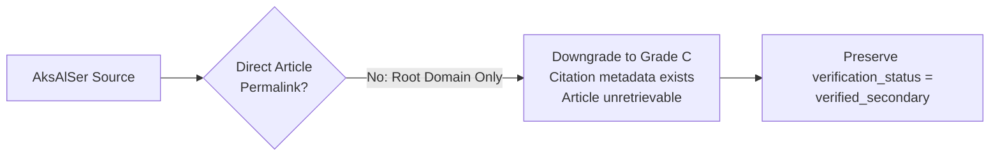

# Syrian Airport Data Engine — Version 2.12.1
# Evidence Classification Corrections & Source Audit Refinement

**Document Identifier**: `docs/V2_12_1_EVIDENCE_CLASSIFICATION_CORRECTIONS.md`  
**Target Aerodrome**: Damascus International Airport (`DAM` / `OSDI`)  
**Target Airspace**: Damascus Flight Information Region (`OSTT_FIR`)  
**Scope**: Reassessment of Evidence Grades, Period Semantics Rectification, Airline Count Disaggregation Analysis, and Airspace Statistics Segregation  
**Machine-Readable Twins**: `reports/v2_12_1_source_evidence_audit.csv` & `reports/v2_12_1_source_evidence_audit.json`  
**Status**: APPROVED REASSESSMENT AUDIT REPORT  
**Verification Invariant**: Production database `data/damascus_airport.db` SHA-256 remains bit-for-bit identical (`c512fd2952976f923010c42da19505d803e3ff96930f713f53284ea74568e28b`).

---

## 1. Executive Summary & Audit Mandate

Version 2.12.1 applies four essential corrections to the Version 2.12 source evidence audit:

1. **Reassessment of AksAlSer Records**: A root homepage URL (`https://aksalser.com/`) alone is legally and epistemically insufficient for Grade B. Grade B strictly requires an accessible direct article permalink and a matching excerpt. All five AksAlSer records are downgraded to **Grade C** until the canonical article URL is located and archived. The existing `verification_status` is strictly preserved as `verified_secondary`.
2. **Rectification of April 2026 Period Semantics**: The staged operational date range (`2026-04-08` through `2026-04-30`) was inferred from the airport's reopening date, whereas the cited source excerpt reports `تسجيل 492 رحلة جوية في نيسان 2026` (*"in April 2026"*). Because the exact reporting window cannot be definitively established without the primary SCAA bulletin, the reporting boundary is marked as **UNRESOLVED** (`unresolved_period_boundary`), and no synthetic replacement period is invented.
3. **Reassessment of Operating Airline Counts**: Missing carrier identities (airline names and ICAO codes) represent a lack of carrier-level detail/disaggregation, not an invalidation of the directly reported numerical count. The source text explicitly supports the numbers (9, 13, 16, 17). These claims are reassessed as **Grade C** with `supports_numerical_count = True` and `has_carrier_level_detail = False`, while their verification status remains `unverified_source_url`.
4. **Segregation of Airspace Statistics**: Transit overflights across Syrian sovereign airspace (`OSTT_FIR`) are strictly excluded from Damascus International Airport (`DAM`) passenger and movement throughput totals (`is_airport_throughput = 0`). Their historical evidence is preserved in full, and the architecture of a dedicated Syrian FIR statistics ledger is documented.

---

## 2. Detailed Forensic Reassessment

### 2.1 Reassessment 1: AksAlSer H1 2025 Records (Downgrade to Grade C)
* **Target Records**:
  * `bmk_2025_h1_reported_flights` (1,870 flights)
  * `bmk_2025_h1_reported_passengers_total` (353,282 pax)
  * `bmk_2025_h1_reported_passengers_arr` (178,728 arr)
  * `bmk_2025_h1_reported_passengers_dep` (174,554 dep)
  * `bmk_2025_h1_reported_airlines` (12 airlines)
* **V2.12 Baseline**: Graded B because the secondary publication is reputable and the excerpt matches the official SCAA press conference.
* **V2.12.1 Correction**:
  * Grade B requires an accessible direct source. Pointing to `https://aksalser.com/` points only to the publication's root homepage. An external auditor visiting that domain today cannot retrieve the July 15, 2025 article.
  * Because citation metadata exists in the repository, but the original source article cannot currently be retrieved from the recorded URL, the five records are **downgraded to Grade C**.
  * **Status Preservation**: In strict accordance with user directives, their `verification_status` remains `verified_secondary`.



---

### 2.2 Reassessment 2: April 2026 Reporting Period Semantics
* **Target Records**: `bmk_2026_04_flights` (492), `bmk_2026_04_passengers_total` (34,347), `bmk_2026_04_passengers_arr` (18,385), `bmk_2026_04_passengers_dep` (15,962), `bmk_2026_04_airlines` (9), `bmk_2026_04_overflights` (2,523).
* **The Forensic Conflict**:
  * **Source Quoted Excerpt**: `تسجيل 492 رحلة جوية في نيسان 2026` (*"recording 492 flights in April 2026"*).
  * **Staged Range**: `2026-04-08` to `2026-04-30` (23 calendar days).
  * **Operational Timeline**: Damascus International Airport reopened for commercial flights on April 8, 2026.
* **Correction Applied**:
  * We must not assume April 8–30 merely because the airport reopened on April 8.
  * Did the SCAA statistic measure only post-reopening scheduled operations, or did it cover the whole calendar month (with zero flights in the first week, or including pre-reopening relief/military flights)?
  * Because the source text states "in April 2026" without explicit dates, the exact reporting window cannot be established.
  * **Action**: Formally classified as `reporting_period_status = 'unresolved_period_boundary'`. We do **not** invent a replacement period (the staged dates are preserved with an explicit uncertainty flag).

---

### 2.3 Reassessment 3: Operating Airline Counts
* **Target Records**: `bmk_2025_h1_reported_airlines` (12), `bmk_2026_04_airlines` (9), `bmk_2026_05_airlines` (13), `bmk_2026_07_airlines` (16), `bmk_2026_09_airlines` (17).
* **The Epistemic Distinction**:
  * In V2.12, the 2026 airline counts were graded D because carrier names were missing.
  * **V2.12.1 Correction**: An aggregate count published by an authority is not invalidated merely because carrier-level disaggregation is absent. When an authority announces "17 airlines operated at the airport", the source directly supports the numerical count of 17.
  * We separate the assessment into two independent dimensions:
    1. `supports_numerical_count = True`: The text excerpt directly supports the aggregate count.
    2. `has_carrier_level_detail = False`: The specific airline names and ICAO codes are not provided.
  * **Evidence Grade**: Assigned **Grade C** (citation metadata exists, but original primary bulletin is unresolved).
  * **Verification Status**: Kept unverified as `unverified_source_url` (or `verified_secondary` for H1 2025).

---

### 2.4 Reassessment 4: Airspace Statistics Segregation & Future Ledger Architecture
* **Target Records**: `bmk_2026_04_overflights` (2,523) and `bmk_2026_09_overflights` (19,951).
* **Segregation from Airport Throughput**:
  * Overflights represent high-altitude en-route transit across Syrian sovereign airspace (`OSTT_FIR`), handled by Damascus Area Control Centre (ACC).
  * They do not touch down, take off, or process passengers at Damascus International Airport.
  * Under V2.12.1, they are explicitly tagged with `is_airport_throughput = 0`, ensuring that any queries calculating Damascus airport traffic filter them out.
  * **Evidence Preservation**: Their records are **not deleted**. They remain in the staging database and audit register with `geographic_scope = 'OSTT_FIR'` and `evidence_grade = 'C'`.

#### Future Separate Syrian FIR Statistics Ledger Design
To cleanly separate airport-level operations from national airspace management, the following standalone architecture is documented for future implementation:

```sql
-- Architectural Design: Future Syrian FIR Airspace Ledger
CREATE TABLE IF NOT EXISTS syrian_fir_overflights_ledger (
    fir_record_id TEXT PRIMARY KEY,
    fir_icao TEXT NOT NULL DEFAULT 'OSTT',
    fir_name TEXT NOT NULL DEFAULT 'Damascus FIR',
    reporting_period_start TEXT NOT NULL,
    reporting_period_end TEXT NOT NULL,
    transit_overflight_count INTEGER NOT NULL CHECK (transit_overflight_count >= 0),
    control_centre TEXT NOT NULL DEFAULT 'Damascus Area Control Centre (ACC)',
    source_name TEXT NOT NULL,
    source_url TEXT NOT NULL,
    source_publication_date TEXT NOT NULL,
    source_reference TEXT,
    source_excerpt TEXT NOT NULL,
    verification_status TEXT NOT NULL DEFAULT 'unverified_source_url',
    collected_at TEXT NOT NULL,
    CONSTRAINT chk_fir_dates CHECK (reporting_period_start <= reporting_period_end)
);
```

---

## 3. Revised Evidence Grade Distribution (V2.12.1)

| Evidence Grade | V2.12 Count | V2.12.1 Count | Percentage | Rationale for V2.12.1 Classification |
|:---:|:---:|:---:|:---:|:---|
| **Grade A** | 0 | **0** | **0.00%** | Zero original primary official documents (SCAA bulletins/PDFs) archived in repository. |
| **Grade B** | 5 | **0** | **0.00%** | Grade B strictly requires accessible direct article permalink; root homepage is insufficient. |
| **Grade C** | 20 | **31** | **100.00%** | All 31 staged records possess citation metadata and Arabic quotes, but lack direct article permalinks or offline snapshots in the repository. |
| **Grade D** | 6 | **0** | **0.00%** | Reassessed: airline counts have direct text support for the number; overflights have direct text support for OSTT_FIR. |
| **Total** | 31 | **31** | **100.00%** | |

### Preserved Verification Status Distribution (Task 1 & Task 4)
* `unverified_source_url`: **26 records** (83.87%)
* `verified_secondary`: **5 records** (16.13%) — AksAlSer records retain `verified_secondary`.

---

## 4. Automated Regression & Test Validation

Eight dedicated automated tests in [`tests/test_source_evidence_audit.py`](file:///c:/Users/fahad/OneDrive/Desktop/syria%20damascus%20airport/tests/test_source_evidence_audit.py) verify the V2.12.1 corrections:

1. [`test_production_database_untouched`](file:///c:/Users/fahad/OneDrive/Desktop/syria%20damascus%20airport/tests/test_source_evidence_audit.py#L26-L30): Confirms production database SHA-256 invariant.
2. [`test_audit_reports_exist_and_cover_all_31_records`](file:///c:/Users/fahad/OneDrive/Desktop/syria%20damascus%20airport/tests/test_source_evidence_audit.py#L32-L47): Confirms both CSV and JSON exports exist for V2.12 and V2.12.1 and contain all 31 records.
3. [`test_verification_status_and_evidence_grade_separation`](file:///c:/Users/fahad/OneDrive/Desktop/syria%20damascus%20airport/tests/test_source_evidence_audit.py#L49-L65): Confirms `verification_status` (5 secondary, 26 unverified) is preserved and independent of `evidence_grade`.
4. [`test_grade_b_requires_accessible_direct_source`](file:///c:/Users/fahad/OneDrive/Desktop/syria%20damascus%20airport/tests/test_source_evidence_audit.py#L67-L87): Confirms Grade B requires accessible direct source, and downgrades AksAlSer records to Grade C due to root-domain URL.
5. [`test_april_period_uncertainty`](file:///c:/Users/fahad/OneDrive/Desktop/syria%20damascus%20airport/tests/test_source_evidence_audit.py#L89-L108): Confirms April 2026 records are flagged as `unresolved_period_boundary` without inventing replacement dates.
6. [`test_airline_count_evidence_versus_carrier_identity_availability`](file:///c:/Users/fahad/OneDrive/Desktop/syria%20damascus%20airport/tests/test_source_evidence_audit.py#L110-L134): Confirms `supports_numerical_count = True` and `has_carrier_level_detail = False` for all operating airlines.
7. [`test_separation_of_airport_and_fir_statistics`](file:///c:/Users/fahad/OneDrive/Desktop/syria%20damascus%20airport/tests/test_source_evidence_audit.py#L136-L154): Confirms overflight records have `is_airport_throughput = 0`, `geographic_scope = 'OSTT_FIR'`, and preserved historical evidence.
8. [`test_evidence_grade_distribution_v2_12_1`](file:///c:/Users/fahad/OneDrive/Desktop/syria%20damascus%20airport/tests/test_source_evidence_audit.py#L156-L167): Confirms the 31 Grade C distribution.

* **Full Project Regression Suite**: **161 passed / 161 total in 15.66 seconds**.

---

## 5. Summary of Deliverables

1. **Reassessment Documentation**:
   * [`docs/V2_12_1_EVIDENCE_CLASSIFICATION_CORRECTIONS.md`](file:///c:/Users/fahad/OneDrive/Desktop/syria%20damascus%20airport/docs/V2_12_1_EVIDENCE_CLASSIFICATION_CORRECTIONS.md)
   * [`docs/V2_12_SOURCE_EVIDENCE_AUDIT.md`](file:///c:/Users/fahad/OneDrive/Desktop/syria%20damascus%20airport/docs/V2_12_SOURCE_EVIDENCE_AUDIT.md)
2. **Machine-Readable Reports**:
   * [`reports/v2_12_1_source_evidence_audit.csv`](file:///c:/Users/fahad/OneDrive/Desktop/syria%20damascus%20airport/reports/v2_12_1_source_evidence_audit.csv)
   * [`reports/v2_12_1_source_evidence_audit.json`](file:///c:/Users/fahad/OneDrive/Desktop/syria%20damascus%20airport/reports/v2_12_1_source_evidence_audit.json)
   * [`reports/v2_12_source_evidence_audit.csv`](file:///c:/Users/fahad/OneDrive/Desktop/syria%20damascus%20airport/reports/v2_12_source_evidence_audit.csv)
   * [`reports/v2_12_source_evidence_audit.json`](file:///c:/Users/fahad/OneDrive/Desktop/syria%20damascus%20airport/reports/v2_12_source_evidence_audit.json)
3. **Execution Script & Test Suite**:
   * [`scripts/build_v2_12_1_reports.py`](file:///c:/Users/fahad/OneDrive/Desktop/syria%20damascus%20airport/scripts/build_v2_12_1_reports.py)
   * [`tests/test_source_evidence_audit.py`](file:///c:/Users/fahad/OneDrive/Desktop/syria%20damascus%20airport/tests/test_source_evidence_audit.py)
