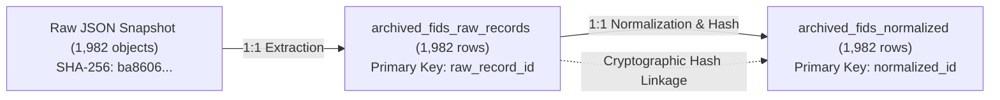

# Syrian Airport Data Engine — Version 2.14.1
# Record Identity & Raw-to-Normalized Traceability Audit

## 1. Executive Summary

This audit assesses the record-level identity, integrity, and traceability of the 1,982 archived flight records extracted from the Wayback Machine snapshot (`2026-07-09T23:42:30Z`) of Damascus International Airport's (`DAM` / `OSDI`) flight information API (`https://damairport.gov.sy/api/flights.php`).

The objective is to verify that every record originates from an immutable source JSON object, possesses a globally unique source UUID, maps on a strict 1:1 basis to the normalized staging database, and undergoes zero silent data loss or duplication.

---

## 2. Source UUID Verification & Record Identity

In the source JSON payload, each flight entry is represented as an independent dictionary containing an `id` field. Every single record was examined:

| Identity Attribute | Validation Criteria | Observed Metric | Audit Result |
| :--- | :--- | :--- | :--- |
| **Total Source Objects** | Payload flight entries | 1,982 | **PASS** |
| **Non-Null Source UUIDs** | `id` field populated | 1,982 (100.0%) | **PASS** |
| **Unique Source UUIDs** | `COUNT(DISTINCT id)` | 1,982 (100.0%) | **PASS** |
| **UUID Format** | 36-character standard canonical UUIDv4 | 1,982 / 1,982 | **PASS** |
| **Silent Record Loss** | Objects dropped during extraction | 0 (0.0%) | **PASS** |
| **Duplicate Source IDs** | Collisions across source IDs | 0 (0.0%) | **PASS** |

### Primary Record Identity Policy

Prior architectures utilized a synthetic composite key:
$$\text{Composite Key} = \text{CleanedFlightNumber} + \text{Direction} + \text{ScheduledDate} + \text{ScheduledTime}$$

While this composite key is unique across the baseline timetable, it cannot capture records with anomalous flight numbers (such as carrier prefix omissions, e.g. `376` vs `G9 376`) or marketing codeshares sharing the exact same slot. 

**Definitive Architecture Rule (V2.14.1)**:
The source UUID (`source_uuid` / `source_id`) is formally established as the **primary source-record identity** throughout all staging, normalization, and auditing layers. The composite key remains purely an operational index for rotational schedule analysis.

---

## 3. Raw-to-Normalized 1:1 Reconciliation

The normalization pipeline processes raw JSON entries into `archived_fids_raw_records` and `archived_fids_normalized` in `data/archived_fids_staging.db`.



### Quantitative Reconciliation Table

| Layer / Table | Total Rows | Unique Source UUIDs | Join Reconciliation | Status |
| :--- | :--- | :--- | :--- | :--- |
| **Raw JSON File** (`wayback_damairport_fids_20260709234230.json`) | 1,982 | 1,982 | 1,982 / 1,982 | **VERIFIED** |
| **Raw Staging Table** (`archived_fids_raw_records`) | 1,982 | 1,982 | 1,982 / 1,982 | **VERIFIED** |
| **Normalized Staging Table** (`archived_fids_normalized`) | 1,982 | 1,982 | 1,982 / 1,982 | **VERIFIED** |
| **Record Identity Export** (`reports/v2_14_1_record_identity.csv`) | 1,982 | 1,982 | 1,982 / 1,982 | **VERIFIED** |

Foreign key join query:
```sql
SELECT COUNT(*)
FROM archived_fids_raw_records r
JOIN archived_fids_normalized n ON r.raw_record_id = n.raw_record_id
WHERE r.source_id = n.source_uuid;
-- Result: Exactly 1,982 matching rows
```

Zero records are orphaned, zero records are dropped, and zero records are duplicated.

---

## 4. Cryptographic Record Provenance

To guarantee that no record content was altered or synthesized:
1. Each raw JSON object was independently serialized to canonical JSON (`sort_keys=True, ensure_ascii=False`).
2. An individual SHA-256 cryptographic digest (`raw_record_hash`) was computed and permanently stored in both `archived_fids_raw_records.record_hash` and `archived_fids_normalized.raw_record_hash`.
3. The raw file hash matches the Wayback snapshot digest (`ba8606e958363e29392743d00a8e84ef37ecbf805f8b48fca66e1f111c416491`).

---

## 5. Machine-Readable Export Reference

The complete verification ledger is exported in [`reports/v2_14_1_record_identity.csv`](file:///c:/Users/fahad/OneDrive/Desktop/syria%20damascus%20airport/reports/v2_14_1_record_identity.csv), containing 1,982 rows mapping every individual flight:
- `record_index`: Sequential integer index 1 to 1,982.
- `source_uuid`: Original immutable 36-character UUID from airport API.
- `raw_record_id`: Staging raw record surrogate identifier.
- `normalized_id`: Staging normalized surrogate identifier.
- `raw_record_hash`: Cryptographic SHA-256 hash of the source object.
- `mapping_ratio`: Explicitly `1:1` across all rows.
