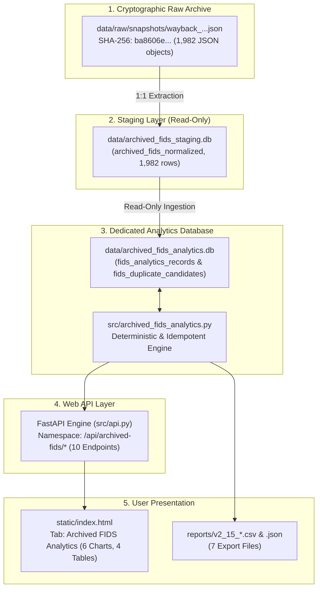

# Syrian Airport Data Engine — Version 2.15
# Archived FIDS Analytics Layer Architecture

## 1. System Overview

The **Archived FIDS Analytics Layer** (Version 2.15) provides an isolated, read-only analytical engine built exclusively on the verified Wayback Machine snapshot (`2026-07-09T23:42:30Z`) of the Damascus International Airport (`DAM` / `OSDI`) flight information API (`damairport.gov.sy/api/flights.php`).

The dataset comprises **1,982 scheduled flight records** spanning **67 consecutive calendar days** (`2026-07-05` to `2026-09-09`).

---

## 2. Database Isolation & Security Invariants

To eliminate any risk of data contamination between scheduled timetable listings and verified physical radar movements, the system enforces strict architectural boundaries:

| Database File | File Role | Access Mode | Modification Status in V2.15 | SHA-256 Invariant |
| :--- | :--- | :--- | :--- | :--- |
| **`data/damascus_airport.db`** | Production flight movement events & registry | **Strictly Read-Only** | **ZERO modifications** (No writes, no inserts) | `c512fd2952976f923010c42da19505d803e3ff96930f713f53284ea74568e28b` |
| **`data/archived_fids_staging.db`** | Normalization & provenance staging layer | **Strictly Read-Only** | **ZERO modifications** | `a90c5faedb3238e0c283f1ddb7f61e0f1a9cb90ca621fc92f316ecfdc7db61d4` |
| **`data/archived_fids_analytics.db`** | Analytical aggregates, metrics & indices | Read / Write (Engine) | Fully rebuildable & idempotent | Dynamic (Derived strictly from staging) |

### Key Governance Policies
1. **No Production Insertion**: Archived FIDS records are never written to `flight_events`.
2. **Zero Physical Movement Promotion**: All records retain `actual_movement_evidence = 0`. Scheduled flights are never converted into physical movements.
3. **Rebuildability**: `data/archived_fids_analytics.db` can be dropped and rebuilt deterministically at any time using `build_analytics_database(rebuild=True)`.

---

## 3. Analytics Database Schema

The analytics database (`data/archived_fids_analytics.db`) contains two optimized tables:

### Table `fids_analytics_records`
Primary table containing all 1,982 normalized flight records indexed for fast analytical filtering:
- `record_id`: Surrogate primary key (`normalized_id`).
- `raw_record_id`: Link to raw staging table.
- `source_uuid`: Primary source UUID from airport API.
- `raw_record_hash`: Cryptographic SHA-256 of raw JSON object.
- `airport_iata` / `airport_icao`: Airport identifiers (`DAM` / `OSDI`).
- `flight_number`: Normalized flight number string.
- `airline_name_ar` / `airline_name_en` / `airline_iata`: Displayed airline brand details.
- `airline_role`: Strictly `'displayed_airline_brand'`.
- `movement_type`: Direction (`arrival` or `departure`).
- `origin_iata` / `destination_iata`: Route endpoints.
- `scheduled_date`: Local date (`YYYY-MM-DD`).
- `scheduled_time`: Local wall-clock time (`HH:MM`).
- `scheduled_datetime_utc`: Derived UTC timestamp (`YYYY-MM-DDTHH:MM:SSZ`).
- `scheduled_datetime_local`: Local timestamp (`YYYY-MM-DDTHH:MM:SS+03:00`).
- `scheduled_status`: Commercial schedule status (`'scheduled'`).
- `displayed_status`: Public board text flag (`'scheduled'` or `'arrived'`).
- `actual_movement_evidence`: Integer flag (strictly `0`).
- `classification`: Record nature classification (`archived_scheduled_service` or `archived_actual_movement_candidate`).
- `is_duplicate_candidate`: Binary flag identifying the known candidate pair `G9 376` / `376`.

### Table `fids_duplicate_candidates`
Structured register tracking suspected duplicate candidate pairs:
- `candidate_id`: Canonical candidate identifier (`DUP_CANDIDATE_001`).
- `group_type`: Candidate category (`possible_prefix_variant_duplicate`).
- `source_uuid_1`, `flight_number_1`, `airline_1`: First record (`G9 376`).
- `source_uuid_2`, `flight_number_2`, `airline_2`: Second record (`376`).
- `scheduled_date`, `scheduled_time`, `movement_type`, `origin_iata`, `destination_iata`: Shared slot attributes.
- `duplicate_classification`: Formal classification (`possible_prefix_variant_duplicate`).
- `review_status`: Audit state (`requires_manual_review`).
- `audit_finding`: Detailed reason why both records are preserved unaltered.

---

## 4. API & Frontend Integration

- **API Module**: [`src/archived_fids_analytics.py`](file:///c:/Users/fahad/OneDrive/Desktop/syria%20damascus%20airport/src/archived_fids_analytics.py) defines a FastAPI `APIRouter` mounted under `/api/archived-fids/` in [`src/api.py`](file:///c:/Users/fahad/OneDrive/Desktop/syria%20damascus%20airport/src/api.py).
- **Frontend Dashboard**: Integrated into [`static/index.html`](file:///c:/Users/fahad/OneDrive/Desktop/syria%20damascus%20airport/static/index.html) under the dedicated tab **"Archived FIDS Analytics"**, featuring 5 dynamic summary cards, 6 visual charts, 4 data tables, interactive multi-parameter filters, and direct CSV/JSON export actions.
