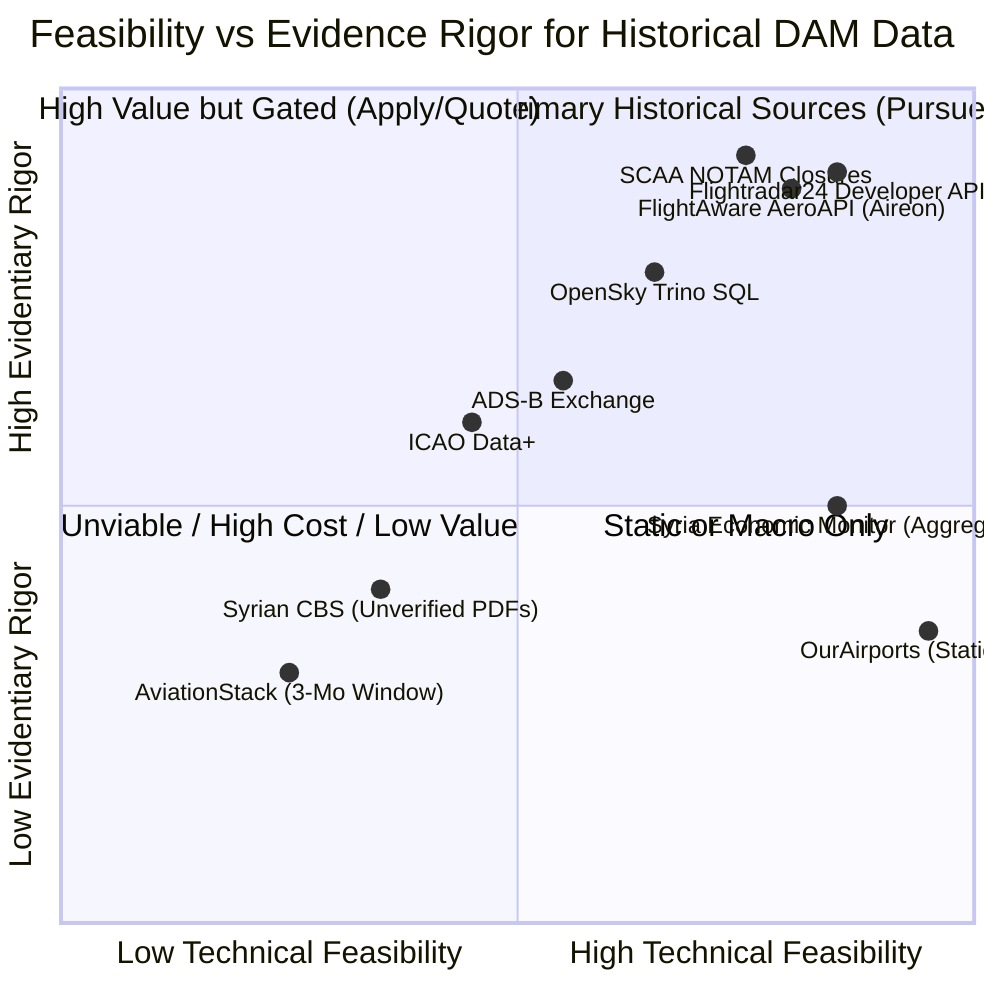

# Syrian Airport Data Engine — Version 2.3
# Historical Acquisition Strategy & Final Strategic Recommendation

**Document Identifier**: `docs/V2_3_FINAL_RECOMMENDATION.md`  
**Target Aerodrome**: Damascus International Airport (`DAM` / `OSDI`)  
**Audit Date**: 2026-10-11  
**Status**: STRATEGIC ARCHITECTURAL RECOMMENDATION (Strictly No Implementation Until Authorized)  

---

## 1. Executive Summary & Governance Notice

This document delivers the final evidence-based strategic classification of all historical aviation data acquisition paths evaluated for Damascus International Airport (`DAM` / `OSDI`) across 2024–2026.

### Strict Governance Constraints
- **Zero Production Implementation**: In accordance with Safety Rule 9, **no automated ingestion adapters, historical backfill routines, or database migrations are implemented in Version 2.3**.
- **Audit-First**: All findings are grounded strictly in primary documentation, live verified endpoints, and production database queries.
- **Epistemic Integrity**: Voids in sensor coverage are explicitly designated as `unverified_data_gap` and must never be treated as zero operations.

---

## 2. Definitive Classification of Acquisition Paths

Every evaluated source and acquisition channel is classified into one of five mutually exclusive operational categories:

1. **Ready for a controlled pilot**
2. **Requires access approval**
3. **Requires commercial quote**
4. **Not currently feasible**
5. **Insufficient evidence**

---

### Classification Table

| Source / Provider | Acquisition Path / Mechanism | Strategic Classification | Key Rationale & Evidence | Next Required Action |
| :--- | :--- | :--- | :--- | :--- |
| **OpenSky Network** | Trino SQL Historical Cluster (`historical state vectors`) | **Requires access approval** | REST API blocks queries >30 days. Trino cluster stores 2013–present data, but requires approved academic research agreement. Low-altitude coverage at DAM is sparse (Tier 3/4 candidates only). | Submit academic research proposal to OpenSky board; prepare candidate correlation adapter. |
| **Flightradar24** | Developer REST API (`Historic Flight Data API`) | **Requires commercial quote** | Developer API provides verified historical data (Essential tier $90/mo for 2 years; Advanced $900/mo for 2016–pres). Consumer web scraping is legally prohibited. | Obtain commercial developer license or enterprise bulk quote for OSDI 2024–2026. |
| **FlightAware** | AeroAPI v4 (`/airports/OSDI/flights`) | **Requires commercial quote** | Personal tier has 0 history; Standard tier ($100/mo min) limited to 30 days. Multi-year archive back to 2024 requires Enterprise sales agreement. Space-based Aireon ADS-B provides verified en-route coverage. | Request formal Enterprise quote for 2024–2026 historical OSDI flight archive. |
| **AviationStack** | Historical REST Endpoint (`/v1/flights?flight_date=`) | **Not currently feasible** | Standard Business Plan is $499.99/mo (contradicting earlier $249.99 claim) and is strictly limited to a **3-month sliding window**. Cannot retrieve 2024 data via standard API. Timestamps are largely scheduled/estimated. | Reject self-service subscription; consider only if enterprise archival pricing is competitive with primary radar providers. |
| **ADS-B Exchange** | Jetnet Enterprise Historical Replay / RapidAPI | **Requires commercial quote** | Unfiltered Mode-S data is high quality, but requires commercial agreement. Damascus local ground-receiver presence historically near-zero; requires empirical sample verification before purchase. | Request historical sample data for OSDI coordinates to test ground-level signal presence. |
| **Syrian SCAA & MoT** | Official Aeronautical Publications & NOTAMs | **Ready for a controlled pilot** | SCAA NOTAMs and eAIP (`gaca.gov.sy`) provide official 24h aerodrome closure verification. Can be piloted for `confirmed_closure_days` and `confirmed_zero_operations_days` without modifying `flight_events`. | Design read-only NOTAM parser pilot for documented closure dates. |
| **Syrian CBS** | Annual Statistical Abstract (Chapter 10) | **Insufficient evidence** | General chapter structure verified, but specific 2020–2024 table numbers, page numbers, and Damascus-specific disaggregation cannot be verified without physical/digital PDF inspection. | Acquire and cryptographically verify official CBS PDF publications before designing extraction. |
| **Syria Economic Monitor** | Gateway Aggregate Baseline (`DAM_ALP_LTK`) | **Ready for a controlled pilot** | Existing table `historical_daily_movements_2024` (578 rows) is fully verified as a multi-airport aggregate. Ready for pilot macroeconomic benchmarking in decoupled analytical views. | Build read-only analytical views exposing national gateway trends with prominent multi-airport warnings. |
| **ICAO Data+** | Airport Traffic Module (Form IS-1) | **Requires commercial quote** | Macro monthly/annual statistics available under paid ICAO commercial subscription. Significant multi-year reporting lag for Syrian state returns. | Defer until macro reconciliation requires international civil aviation verification. |
| **OurAirports** | Static Aerodrome Metadata (`OSDI` / `DAM`) | **Ready for a controlled pilot** | Static reference data (runways, elevation, coordinates, frequencies) is verified and open (CC0). Already fully verified. | Maintain as static geospatial reference; not applicable for historical movement time-series. |

---

## 3. Comparative Strategic Analysis



### Key Insights from Analysis

1. **The Telemetry Truth**: Flightradar24 (Essential/Advanced) and FlightAware (AeroAPI/Aireon) represent the only commercially viable sources with documented high-density coverage of Damascus International Airport movements during 2024–2026.
2. **The OpenSky Academic Path**: OpenSky Network is scientifically rigorous and open, but requires institutional approval for Trino access and, critically, will yield predominantly **Tier 3 (Approach Candidate)** and **Tier 4 (Departure Candidate)** records due to local receiver sparsity. It cannot serve as a standalone ground truth without corroboration.
3. **The AviationStack Elimination**: AviationStack must be discarded as a candidate for deep historical backfill. The discovery that standard plans are capped at a 3-month sliding window and priced at $499.99/mo eliminates its cost-effectiveness compared to primary ADS-B providers.
4. **The Macro Separation Imperative**: Government and World Bank sources (SEM, CBS, MoT) provide macro context but must remain strictly quarantined from physical flight event tables.

---

## 4. Phased Strategic Roadmap (When Authorized)

```mermaid
flowchart LR
    subgraph Phase 1 [Phase 1: Institutional & Commercial Setup]
        P1A[Apply for OpenSky\nAcademic Trino Access]
        P1B[Request Formal Quote\nFR24 Essential $90/mo]
        P1C[Pilot SCAA NOTAM\nClosure Registry]
    end

    subgraph Phase 2 [Phase 2: Corroboration & Controlled Pilot]
        P2A[Ingest OpenSky Candidates\nTier 3 & Tier 4 Only]
        P2B[Cross-Correlate with\nFR24/AeroAPI Pilot Month]
        P2C[Promote Corroborated\nto Physical Movements]
    end

    subgraph Phase 3 [Phase 3: Production Historical Archive]
        P3A[Reconstruct 2024-2026\nDamascus Time-Series]
        P3B[Audit Metric Ratios\nVerified Days Rate]
    end

    Phase 1 --> Phase 2 --> Phase 3
```

### Phase 1 — Access & Agreement Procurement (Read-Only / External)
1. **OpenSky Academic Proposal**: Draft formal research application to OpenSky Network Association for Trino big data cluster access.
2. **Commercial Pricing Confirmation**: Request written enterprise/developer quotes for Flightradar24 Essential API ($90/mo) and FlightAware Standard API ($100/mo minimum).
3. **NOTAM Closure Catalog**: Digitize verified 24-hour closure NOTAMs from SCAA / eAIP records to establish the official `confirmed_closure_days` baseline for 2024–2026.

### Phase 2 — Controlled Multi-Provider Corroboration Pilot (Disposable Database Clone)
1. Ingest 30 days of historical OpenSky state vectors into a disposable database clone.
2. Apply the **Five-Tier OpenSky Classification Rules** (`docs/V2_3_OPENSKY_CLASSIFICATION_RULES.md`).
3. Corroborate Tier 3 (approach) and Tier 4 (climbout) candidates against commercial ADS-B sample records.
4. Verify that zero candidate events are promoted to `physical_movement` without dual-provider proof.

### Phase 3 — Production Historical Expansion (Awaiting Authorization)
1. Execute approved production migrations only after formal sign-off.
2. Populate the standardized metrics defined in `docs/V2_3_COVERAGE_METRIC_DEFINITIONS.md`.
3. Generate the verified historical operational atlas for Damascus International Airport.

---

## 5. Strategic Conclusion

The historical data acquisition strategy for Damascus International Airport is technically sound, methodologically fortified, and protected against data corruption. 

**Immediate Recommendation**:
- Do not execute ingestion or migration tasks.
- Keep the production database strictly locked and read-only.
- Await formal authorization before pursuing Phase 1 access agreements or commercial subscriptions.
