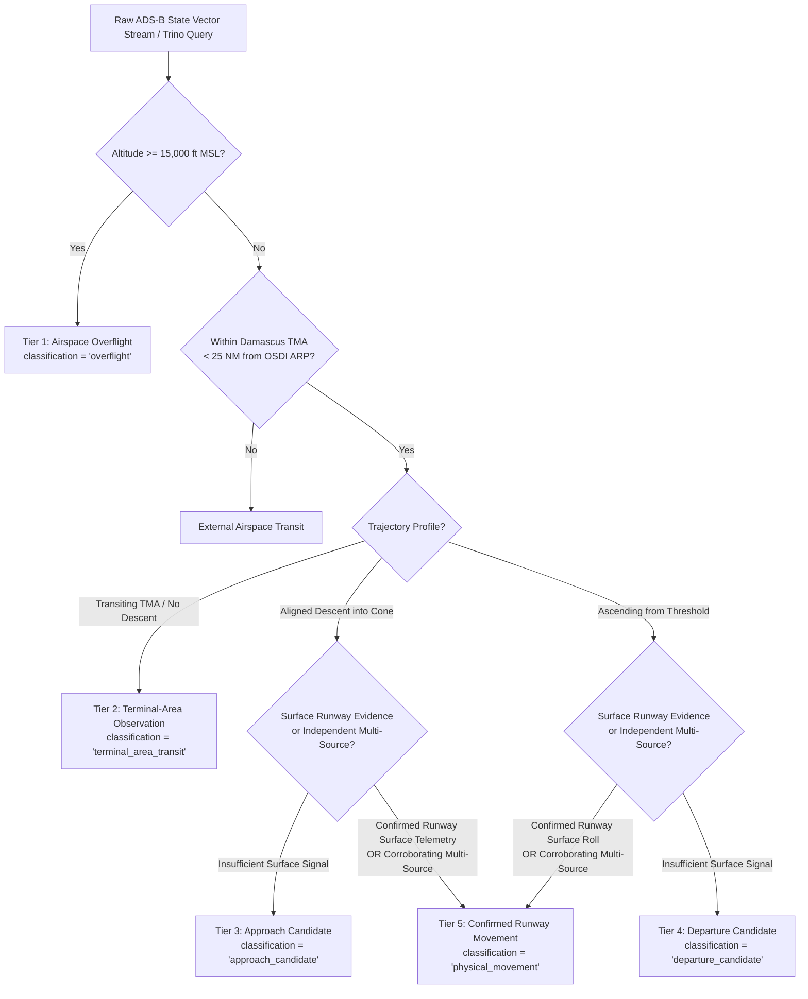

# Syrian Airport Data Engine — Version 2.3
# OpenSky Telemetry Movement Classification & Qualification Rules

**Document Identifier**: `docs/V2_3_OPENSKY_CLASSIFICATION_RULES.md`  
**Target Aerodrome**: Damascus International Airport (`DAM` / `OSDI`)  
**Aerodrome Reference Point (ARP)**: Lat `33.4150° N`, Lon `36.5156° E` | Elevation: `2,020 ft MSL` (`616 m`)  
**Audit Date**: 2026-10-11  
**Target Standard**: Physics-Based Telemetry Qualification & Anti-Overcounting Protocol  
**Status**: APPROVED SPECIFICATION  

---

## 1. Executive Summary & Problem Statement

In Version 2.2, preliminary proposals suggested inferring historical Damascus aircraft movements from OpenSky Network state vectors using heuristic thresholding (e.g., `onground = True`, groundspeed $< 40$ knots, or altitude $< 3,000$ ft). 

An evidence-based operational audit reveals that **none of these fields in isolation, nor uncalibrated combinations thereof, prove that an aircraft operated on the runway at Damascus International Airport**. 

Damascus terminal airspace presents unique operational and physical challenges:
1. **Severe Terrestrial Receiver Deficit**: Terrestrial crowdsourced ADS-B receivers in Syria are sparse. Line-of-sight coverage typically degrades below 4,000–5,000 ft MSL over the Damascus basin. Most arriving aircraft drop off coverage prior to touchdown, while departing aircraft are first detected several miles into climbout.
2. **Dense Regional Overflight Corridor**: Major international high-altitude airways (e.g., connecting Amman, Beirut, Baghdad, and the Gulf) cross directly overhead the Damascus VOR/ARP at flight levels FL250 to FL410.
3. **Neighboring Military Aerodromes**: Mezzeh Military Airbase (`OSMS`, Lat 33.477°, Lon 36.223°, elevation 2,407 ft MSL) is situated only 15 NM northwest of OSDI. Additional military fields (Marj Ruhayyil, Sayqal, Dumayr) operate in the immediate Damascus basin. Low-altitude military or governmental traffic maneuvering near Damascus cannot be assumed to be OSDI traffic.
4. **Avionics & Sensor Anomalies**: Transponder squat switches frequently generate false `onground = True` flags during flight, and barometric altimeters uncorrected for local QNH produce deviations of hundreds of feet.

Therefore, Version 2.3 institutes a strict **Five-Tier Movement Classification Architecture** with immutable qualification invariants. Under no circumstances may candidate or unverified events be promoted to `physical_movement`.

---

## 2. Forensic Audit of Telemetry Assumptions

| Telemetry Field / Condition | Observed Pitfall / Failure Mode | Why It Fails in Damascus Airspace | Required Epistemic Rule |
| :--- | :--- | :--- | :--- |
| **`onground = True`** | Transponder squat-switch bit failure; inverted avionics bits on regional/sanctioned aircraft; ground testing at non-Damascus aerodromes. | An aircraft taxiing at Beirut (`OLBA`, 45 NM west) or Amman (`OJAI`) can transmit packets picked up by long-range border receivers with garbled positional fixes. | `onground = True` is **invalid** without tight geospatial confirmation inside the OSDI runway surface polygon. |
| **`speed < 40 knots`** | Hovering helicopters; strong headwind aloft; decoder packet drops reporting 0 velocity; transponder startup tests. | Rotary-wing military traffic operating between Damascus military headquarters and Mezzeh often fly below 40 kts groundspeed near the city. | Speed below 40 kts alone proves nothing about runway operations. |
| **`altitude near 2,020 ft MSL`** | Standard 1013.25 hPa barometric setting vs local pressure; terrain contour variations; low passes over the Ghouta plain. | Barometric altitude deviates significantly during summer heat troughs (QNH 1004 hPa). Aircraft at 2,800 ft true altitude may indicate ~2,500 ft baro. | Must require geometric/calibrated altitude plus spatial coordinates within the threshold. |
| **`runway alignment` (051° / 231°)** | Standard airway alignments; tactical military vectors; cross-basin holding patterns. | Waypoints and TMA approach paths align with regional valleys and runway bearings without aircraft landing. | Alignment is a necessary condition for approach, but never a sufficient condition for landing. |
| **`vertical rate < -500 fpm`** | Normal en-route descent from cruise levels; transit descent into Lebanese airspace. | Aircraft descending toward Beirut or Amman cross Syrian airspace with high descent rates. | Descent rate indicates descent, not destination. |
| **`proximity < 5 NM from ARP`** | En-route overflights transiting overhead OSDI VOR at FL350; military maneuvers. | Dozens of high-altitude international overflights pass within 1 NM horizontal distance of OSDI daily. | Proximity without low altitude and ground deceleration is completely irrelevant. |

---

## 3. The Five-Tier Classification Architecture



---

### Tier 1: Airspace Overflight (`overflight`)

* **Criteria**:
  - Trajectory enters Syrian airspace (Damascus FIR / `OSTT`).
  - Barometric altitude $\ge 15,000\text{ ft MSL}$ throughout the flight segment within 50 NM of OSDI.
  - Groundspeed $\ge 300\text{ knots}$.
  - Flight plan / callsign reflects an international city pair not involving Damascus (e.g., `BEY-DXB`, `AMM-DOH`, `BSR-IST`).
* **Database Action**:
  - **Excluded from airport movement metrics**. Stored only in regional overflight audit logs if airspace billing or overflight monitoring is active.
  - Must **never** be inserted into `flight_events` as an airport arrival or departure.

---

### Tier 2: Terminal-Area Observation (`terminal_area_transit`)

* **Criteria**:
  - Aircraft observed within Damascus TMA (horizontal radius $\le 25\text{ NM}$ from OSDI ARP).
  - Altitude $< 15,000\text{ ft MSL}$ and $\ge 5,000\text{ ft MSL}$.
  - Aircraft maintains level flight or transitions between regional reporting points without entering the final approach corridor.
* **Database Action**:
  - Recorded as an airspace observation.
  - `classification = 'terminal_area_transit'`.
  - Excluded from `verified_movements_count`.

---

### Tier 3: Approach Candidate (`approach_candidate`)

* **Criteria**:
  - Aircraft enters the OSDI Final Approach Corridor:
    - Within $10\text{ NM}$ of Runway 05R/05L or Runway 23L/23R threshold.
    - Lateral track within $\pm 7^\circ$ of runway centerline ($051^\circ \pm 7^\circ$ or $231^\circ \pm 7^\circ$).
  - Kinematic descent profile:
    - Continuous descent with vertical rate $\le -300\text{ fpm}$.
    - Altitude steadily descending below $4,500\text{ ft MSL}$ down to the limit of receiver reception (typically 2,800–3,500 ft MSL).
    - Groundspeed decelerating consistently from $\approx 220\text{ kts}$ to approach reference speed ($130–165\text{ kts}$).
  - Signal Loss: Telemetry terminates prior to confirming touchdown due to terrestrial line-of-sight masking.
* **Database Action**:
  - Stored in `flight_events` with `classification = 'approach_candidate'`.
  - `status = 'candidate_unverified'`.
  - **IMMUTABLE RULE**: MUST NEVER BE PROMOTED TO `physical_movement` without secondary independent evidence.

---

### Tier 4: Departure / Climbout Candidate (`departure_candidate`)

* **Criteria**:
  - Initial state vector appears within the OSDI Departure Climbout Corridor:
    - Within $5\text{ NM}$ of Runway 05R/05L or 23L/23R departure end of runway (DER).
    - Track aligned with runway heading ($\pm 10^\circ$) or published SID departure transition.
  - Kinematic climb profile:
    - Initial observed altitude $< 5,000\text{ ft MSL}$, rapidly climbing with positive vertical rate $\ge +800\text{ fpm}$.
    - Groundspeed accelerating from $< 180\text{ kts}$ through $250\text{ kts}$.
  - Telemetry begins mid-air without prior surface taxi or takeoff ground roll evidence.
* **Database Action**:
  - Stored in `flight_events` with `classification = 'departure_candidate'`.
  - `status = 'candidate_unverified'`.
  - **IMMUTABLE RULE**: MUST NEVER BE PROMOTED TO `physical_movement` without secondary independent evidence.

---

### Tier 5: Confirmed Runway Movement (`physical_movement`)

To qualify as a Tier 5 Confirmed Runway Movement, an event MUST satisfy **Condition A (Primary Physical Surface Telemetry)** OR **Condition B (Corroborated Telemetry)**:

#### Condition A — Direct Primary Surface Telemetry
1. **Geospatial Surface Containment**: Multiple sequential position messages (minimum 3 messages over $\ge 15$ seconds) located strictly within the OSDI Aerodrome Movement Area polygon (runways 05R/23L, 05L/23R, or taxiways A, B, C, D, K).
2. **Surface Kinematics**:
   - For Arrival: Groundspeed decelerating from rollout speed ($< 100\text{ kts}$) down to runway exit taxi speed ($< 30\text{ kts}$).
   - For Departure: Groundspeed accelerating continuously along the runway centerline from $< 40\text{ kts}$ through rotation speed ($V_r > 120\text{ kts}$).
3. **Altitude & Squat Switch**: Geometric/barometric altitude within $\pm 100\text{ ft}$ of aerodrome elevation ($2,020\text{ ft MSL}$), corroborated by `onground = True` while within the aerodrome boundary.

#### Condition B — Multi-Source Corroborated Candidate
1. The event satisfies all kinematic and geometric criteria of **Tier 3 (Approach Candidate)** or **Tier 4 (Departure Candidate)**.
2. The candidate is **corroborated by an independent provider** with active, non-retracted evidence:
   - Example 1: Flightradar24 record providing `actual_landing_time` matching the approach candidate within $\pm 10$ minutes.
   - Example 2: FlightAware AeroAPI record providing `actual_off` matching the departure candidate within $\pm 10$ minutes.
   - Example 3: Official SCAA / air traffic control flight movement log recording the callsign, registration, and runway time.

* **Database Action**:
  - `classification = 'physical_movement'`.
  - `status = 'active'`.
  - Contributes to `verified_movements_count` and `verified_days_rate`.

---

## 4. Minimum Evidence Qualification Matrix

| Field Observed | Value Observed | Standalone Event Classification | Required Corroboration for Promotion |
| :--- | :--- | :--- | :--- |
| `onground` | `True` (outside runway polygon) | `unverified_sensor_anomaly` | Must be within OSDI runway polygon; otherwise rejected. |
| `groundspeed` | $< 40\text{ kts}$ (no coordinates) | `unverified_telemetry` | Requires spatial coordinates within OSDI boundary. |
| `altitude` | $< 2,500\text{ ft}$ (in Ghouta plain) | `terminal_area_transit` | Requires approach cone alignment and descent trajectory. |
| `track` | $051^\circ$ (at FL280) | `overflight` | None (Rejected as aerodrome event). |
| `vertical_rate` | $-1,200\text{ fpm}$ (at $12,000\text{ ft}$) | `terminal_area_transit` | Requires continuous descent into OSDI approach cone. |
| Full Approach Cone | Decelerating descent to $3,200\text{ ft}$ | `approach_candidate` | Surface rollout telemetry OR independent provider match. |
| Full Departure Cone| Accelerating climb from $3,500\text{ ft}$ | `departure_candidate` | Surface takeoff roll telemetry OR independent provider match. |
| Surface Polygon | Rollout $< 60\text{ kts}$ on runway | **`physical_movement`** | Primary qualification met (Self-sufficient). |

---

## 5. Architectural Guardrails in Ingestion Pipeline

To prevent accidental promotion of candidates into production flight metrics:
1. **Explicit Enum Constraints**: The database column `classification` in `flight_events` must strictly enforce:
   `CHECK(classification IN ('physical_movement', 'approach_candidate', 'departure_candidate', 'terminal_area_transit', 'overflight', 'scheduled_commercial', 'historical_aggregate'))`.
2. **API Isolation**: All public API endpoints reporting confirmed airport operations (`/api/movements`, `/api/summary/daily`) must hardcode the predicate:
   ```sql
   WHERE classification = 'physical_movement' AND status = 'active'
   ```
3. **No Automatic Promotion**: Ingestion adapters processing OpenSky Trino state vectors must emit candidate events with `classification = 'approach_candidate'` or `classification = 'departure_candidate'`. Promotion to `physical_movement` is restricted to the cross-source correlation aggregator when secondary corroboration is proven.
