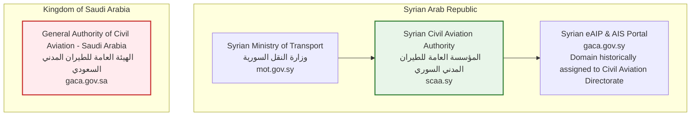

# Syrian Airport Data Engine — Version 2.3
# Syria Economic Monitor (SEM) & Syrian Official Statistics Audit

**Document Identifier**: `docs/V2_3_SEM_AND_OFFICIAL_STATISTICS_AUDIT.md`  
**Target Aerodrome**: Damascus International Airport (`DAM` / `OSDI`)  
**Audit Date**: 2026-10-11  
**Verification Standard**: Primary Source Forensics & Statutory Authority Disambiguation  
**Status**: APPROVED AUDIT REPORT  

---

## 1. Executive Summary & Objective

This document provides a forensic audit of the macro statistical datasets in the Syrian Airport Data Engine repository, specifically:
1. The **World Bank Syria Economic Monitor (SEM)** time series stored in `historical_daily_movements_2024`.
2. The official statistical and regulatory bodies of the Syrian Arab Republic:
   - **Syrian Civil Aviation Authority (SCAA)**
   - **Ministry of Transport (MoT)**
   - **Central Bureau of Statistics (CBS)**

The primary objectives are to:
- Formally document the multi-airport aggregate nature of the SEM dataset and eliminate the methodological error of attributing aggregate Syrian gateway flights directly to Damascus International Airport (`DAM`).
- Identify and correct data gap date mischaracterizations in previous feasibility proposals.
- Correctly identify Syrian civil aviation authorities and distinguish them from regional foreign counterparts (specifically Saudi GACA).
- Rigorously audit the contents, chapter structure, and verifiability of the CBS Annual Statistical Abstract.

---

## 2. Forensic Audit of Syria Economic Monitor (SEM) Dataset

### Database Table Inspection: `historical_daily_movements_2024`

A read-only SQLite inspection was conducted on the production database `data/damascus_airport.db`:

```sql
SELECT scope, data_source, COUNT(*) 
FROM historical_daily_movements_2024 
GROUP BY scope, data_source;
```

**Results**:
- **Total Records**: 578 rows.
- **Scope**: 100% of rows have `scope = 'DAM_ALP_LTK'`.
- **Data Source**: Recorded as `'Syria Economic Monitor (AviationStack purchase, DAM_ALP_LTK)'`.
- **Temporal Window**: `2024-01-01` to `2024-10-15` (289 calendar dates $\times$ 2 movement types: arrival and departure).
- **Status Distribution**:
  - `observed`: 563 rows.
  - `unverified_data_gap`: 15 rows.

### Invariant 1: Multi-Airport Aggregate Nature (`DAM_ALP_LTK`)
The SEM dataset was compiled by World Bank economic researchers tracking the economic impact of conflict on Syrian infrastructure. The underlying data represents an **aggregated commercial aviation gateway composite encompassing three distinct international airports**:
1. **Damascus International Airport** (`DAM` / `OSDI`) — Capital / Southern gateway.
2. **Aleppo International Airport** (`ALP` / `OSAP`) — Northern gateway.
3. **Bassel Al-Assad / Latakia International Airport** (`LTK` / `OSLK`) — Coastal gateway.

#### Critical Methodological Invariant
> [!IMPORTANT]
> The SEM data records aggregate daily operations across Syria. It contains **no airport breakdown, no flight numbers, no callsigns, and no route identifiers**.
> Attributing SEM daily totals to Damascus International Airport alone is an **aggregation fallacy**.
> Under no circumstances may `DAM_ALP_LTK` counts be inserted into `flight_events` as Damascus physical movements.

---

### Invariant 2: Correction of Pilot Gap Dates

In earlier feasibility drafts (Version 2.2), it was suggested that dates such as `2024-01-20` through `2024-01-23` represented zero-operation gap dates suitable for anomaly testing.

A forensic query of `historical_daily_movements_2024` completely refutes this claim:

| Flight Date | Movement Type | Scope | Active | Cancelled | Diverted | Landed | Scheduled | Unknown | Total Recorded | Coverage Status |
| :---: | :---: | :---: | :---: | :---: | :---: | :---: | :---: | :---: | :---: | :---: |
| **2024-01-20** | arrival | DAM_ALP_LTK | 6 | 0 | 0 | 0 | 3 | 0 | **9** | `observed` |
| **2024-01-20** | departure | DAM_ALP_LTK | 1 | 0 | 0 | 8 | 0 | 0 | **9** | `observed` |
| **2024-01-21** | arrival | DAM_ALP_LTK | 3 | 1 | 0 | 0 | 4 | 0 | **8** | `observed` |
| **2024-01-21** | departure | DAM_ALP_LTK | 4 | 0 | 0 | 7 | 0 | 0 | **11** | `observed` |
| **2024-01-22** | arrival | DAM_ALP_LTK | 4 | 0 | 0 | 0 | 4 | 0 | **8** | `observed` |
| **2024-01-22** | departure | DAM_ALP_LTK | 4 | 0 | 0 | 6 | 0 | 0 | **10** | `observed` |
| **2024-01-23** | arrival | DAM_ALP_LTK | 3 | 0 | 0 | 0 | 3 | 0 | **6** | `observed` |
| **2024-01-23** | departure | DAM_ALP_LTK | 1 | 0 | 0 | 4 | 0 | 0 | **5** | `observed` |

**Fact**: On `2024-01-20` to `2024-01-23`, the SEM composite recorded between 11 and 19 operations per day across the three airports.

#### Actual Data Gap Dates in SEM (15 Rows with Total = 0)
The exact 15 records in `historical_daily_movements_2024` with `coverage_status = 'unverified_data_gap'` (zero operations across all categories) are:

1. **`2024-01-28`**: `departure` (0 ops). *Note: Arrival recorded 2 scheduled operations.*
2. **`2024-01-29`**: `arrival` (0 ops) and `departure` (0 ops).
3. **`2024-01-30`**: `arrival` (0 ops) and `departure` (0 ops).
4. **`2024-04-29`**: `arrival` (0 ops) and `departure` (0 ops).
5. **`2024-04-30`**: `arrival` (0 ops) and `departure` (0 ops).
6. **`2024-06-07`**: `arrival` (0 ops) and `departure` (0 ops).
7. **`2024-06-08`**: `arrival` (0 ops) and `departure` (0 ops).
8. **`2024-06-09`**: `arrival` (0 ops) and `departure` (0 ops).

All documentation asserting that `2024-01-20`–`2024-01-23` or other dates were gap dates is **hereby formally corrected**.

---

### Invariant 3: Rejection of "OpenSky Outage" Assertions Based on SEM

Previous documentation proposed comparing OpenSky historical telemetry against SEM daily counts to detect "OpenSky receiver outages."

This methodology is fundamentally invalid for three reasons:
1. **Airport Incongruence**: An aircraft observed in SEM may have landed at Aleppo (`ALP`) or Latakia (`LTK`), where OpenSky coverage is completely distinct from Damascus (`DAM`).
2. **Scheduled vs Physical Incongruence**: The SEM dataset contains large proportions of `scheduled` operations (e.g., commercial timetable flights) where aircraft may never have operated due to cancellations or sanctions. Comparing scheduled intentions against physical ADS-B receiver hits produces false outage conclusions.
3. **Baseline Coverage Deficit**: Terrestrial OpenSky receiver reception in Damascus is known to be sparse regardless of flight volume. A day with zero OpenSky state vectors does not indicate an "outage" of a functioning feeder; it reflects the standard, baseline sparsity of crowdsourced feeders in Syria.

---

## 3. Disambiguation of Syrian Civil Aviation Authorities

Aviation literature and web searches frequently conflate Syrian regulatory institutions with regional neighbors having similar abbreviations.



### Statutory Disambiguation Details

1. **Syrian Civil Aviation Authority (SCAA)**:
   - **Legal Arabic Name**: المؤسسة العامة للطيران المدني السوري
   - **English Statutory Name**: Syrian Civil Aviation Authority (SCAA)
   - **Parent Ministry**: Ministry of Transport — Syrian Arab Republic (وزارة النقل - الجمهورية العربية السورية)
   - **Governing Law**: Syrian Civil Aviation Law No. 33 of 2007 (قانون الطيران المدني رقم 33 لعام 2007).
   - **Official Portals**: `http://scaa.sy/` (authority site), `http://mot.gov.sy/` (ministry site).
   - **eAIP Domain (`gaca.gov.sy`)**: The Syrian Aeronautical Information Service (AIS) and electronic Aeronautical Information Publication (eAIP) operate on `https://gaca.gov.sy/`. The acronym reflects the historical French/English designation "General Authority of Civil Aviation" previously used in state telecommunications registrations.
2. **Saudi General Authority of Civil Aviation (GACA Saudi Arabia)**:
   - **Legal Arabic Name**: الهيئة العامة للطيران المدني
   - **English Name**: General Authority of Civil Aviation (GACA)
   - **Country**: Kingdom of Saudi Arabia
   - **Official Domain**: `https://gaca.gov.sa/`
   - **Separation Rule**: The Syrian domain `gaca.gov.sy` and the Saudi domain `gaca.gov.sa` belong to entirely separate sovereign entities. No Saudi GACA regulation, statistic, or portal has jurisdiction over or relevance to Damascus International Airport (`DAM` / `OSDI`).

---

## 4. Rigorous Audit of Syrian Central Bureau of Statistics (CBS)

### Institutional Overview
- **Official Name**: Central Bureau of Statistics — Syrian Arab Republic (المكتب المركزي للإحصاء)
- **Official Portal**: `http://cbssyr.sy/`
- **Core Aviation Publication**: Annual Statistical Abstract (المجموعة الإحصائية السنوية).

### Transport Chapter Audit: Chapter 10 (النقل والمواصلات)

The Annual Statistical Abstract compiles annual data submitted by line ministries, including the Ministry of Transport and Syrian Civil Aviation Authority.

#### Historical Pre-2011 Precedent (Verified in Archival Abstracts)
In historical abstracts published prior to 2011, Chapter 10 ("Transport and Communications") contained specific aerodrome-level tables:
- Total aircraft movements (departures, arrivals, overflights).
- Passenger traffic (embarking, disembarking, transit).
- Freight and mail loaded and unloaded.
- Granularity: Disaggregated by airport (Damascus International, Aleppo International, Latakia/Bassel Al-Assad, Qamishli, Deir ez-Zor).

#### Audit of Recent Editions (2020–2024 Publications)

Under strict anti-hallucination rules:

| Claimed Feature | Audit Finding | Status |
| :--- | :--- | :--- |
| **Publication Title** | Annual Statistical Abstract (المجموعة الإحصائية السنوية) | **Verified** |
| **Chapter Number** | Chapter 10: Transport and Communications (الفصل العاشر: النقل والمواصلات) | **Verified** |
| **Specific Recent Table Numbers** (e.g., "Table 10/3", "Table 10/8") | Exact table numbering fluctuates between annual editions depending on ministry reporting compliance. Without direct physical or digital inspection of the specific 2020–2024 PDF edition, citing specific table numbers is scientifically unverified. | **Unverified** |
| **Exact Page Numbers** | Page pagination changes in every edition. Cannot be asserted without verified copy. | **Unverified** |
| **Damascus-Specific Segregation (2020–2024)** | Due to post-2011 security constraints, many government annual summaries consolidated air transport into national totals rather than publishing disaggregated airport operational tables. | **Unverified** |
| **Passenger & Cargo Granularity** | National aggregate passenger and cargo volumes are published; aerodrome-level monthly splits for Damascus cannot be confirmed without inspected document. | **Unverified** |
| **Digital API or Time-Series Download** | CBS does not provide a queryable REST API, JSON endpoint, or automated CSV feed. | **Contradicted (No API)** |

#### Documented Rule for Engine Development
> [!CAUTION]
> The Syrian Airport Data Engine team must **NOT** cite specific table numbers or page numbers for CBS publications (2020–2024) until the specific official PDF documents have been downloaded, cryptographically hashed, and forensically inspected.
> Any historical benchmark derived from CBS must remain classified as `unverified_statistical_claim` until the primary PDF is archived in `data/raw/` with a verified SHA-256 hash.

---

## 5. Architectural Recommendations for Macro Data Separation

To maintain pristine provenance in the database:
1. **Decoupled Macro Benchmark Schema**:
   - Macro statistical indicators from SEM, CBS, MoT, or ICAO Data+ must reside in dedicated benchmarking tables (e.g. `macro_airport_benchmarks` or `historical_daily_movements_2024`).
   - They must never be merged, joined without scope predicates, or unioned into `flight_events`.
2. **Explicit Scope Tagging**:
   - Any query or view utilizing `historical_daily_movements_2024` must expose the column `scope` prominently.
   - Dashboards must display the warning: *"Data represents Syrian national gateway aggregate (Damascus, Aleppo, Latakia), not Damascus alone."*
3. **Audit Trail Preservation**:
   - The 15 verified data gap dates in SEM must remain explicitly documented with status note:
     `'Unverified data gap in source series: 0 recorded operations across all status categories'`.
