# Syrian Airport Data Engine — Version 2.4
# Historical Acquisition Go / No-Go Decision & Source Classifications

**Document Identifier**: `docs/V2_4_GO_NO_GO_DECISION.md`  
**Target Aerodrome**: Damascus International Airport (`DAM` / `OSDI`)  
**Audit Date**: 2026-10-11  
**Decision Authority**: Syrian Airport Data Engine Architectural Governance  
**Status**: FORMAL DECISION GATE (Implementation Strictly Frozen)  

---

## 1. Executive Decision Summary

### Implementation Decision: **NO-GO FOR PIPELINE IMPLEMENTATION**

In accordance with strict project safety rules, **the historical ingestion pipeline and database migrations remain FROZEN**. 

No automated adapters, backfill scripts, or ingestion jobs may be deployed until:
1. Formal proof-of-availability sample data has been received from at least one primary sensor provider (Flightradar24, FlightAware, or OpenSky).
2. The sample records have been forensically verified against the **Nine Assessment Gates** (`docs/V2_4_SAMPLE_VALIDATION_SPEC.md`).
3. Explicit production authorization is granted by project leadership.

---

## 2. Definitive Source Classifications

Every evaluated aviation source and data acquisition channel is classified into one of the five mandatory governance categories:

```mermaid
flowchart TD
    subgraph Decision Outcomes
        Cat1[1. Sample Obtained and Validated]
        Cat2[2. Sample Available Upon Approval]
        Cat3[3. Sample Available After Commercial Quote]
        Cat4[4. Historical Availability Not Demonstrated]
        Cat5[5. Not Suitable for DAM Historical Reconstruction]
    end

    SEM[Syria Economic Monitor Multi-Airport Baseline] --> Cat1
    OpenSky[OpenSky Network Trino Cluster] --> Cat2
    CBS_MoT[Syrian CBS & MoT Macro Publications] --> Cat2
    FR24[Flightradar24 Developer API / Sales] --> Cat3
    FA[FlightAware AeroAPI / Enterprise] --> Cat3
    ADSBx[ADS-B Exchange Jetnet Enterprise] --> Cat3
    AviationStack[AviationStack 3-Month Window API] --> Cat4
    OurAirports[OurAirports Static Directory] --> Cat5
    ConsumerScraping[Consumer Web Scraping] --> Cat5

    style Cat1 fill:#e8f5e9,stroke:#2e7d32,stroke-width:2px
    style Cat2 fill:#e1f5fe,stroke:#0288d1,stroke-width:2px
    style Cat3 fill:#fff8e1,stroke:#f57f17,stroke-width:2px
    style Cat4 fill:#fbe9e7,stroke:#d84315,stroke-width:2px
    style Cat5 fill:#ffebee,stroke:#c62828,stroke-width:2px
```

---

### Detailed Source Classification Ledger

| Source / Provider Name | Definitive Classification | Technical Rationale & Evidentiary Findings | Next Permitted Action |
| :--- | :--- | :--- | :--- |
| **Syria Economic Monitor (SEM)** | **Sample obtained and validated** *(Macro Aggregate Only)* | The 578 daily operation records for 2024 are present and verified in `historical_daily_movements_2024`. However, it is validated **strictly as a multi-airport gateway aggregate (`DAM_ALP_LTK`)**, not as a Damascus-specific flight event feed. | Retain in isolated macro benchmarking view; do NOT insert into `flight_events`. |
| **OpenSky Network** | **Sample available upon approval** | Historical state vectors back to 2013 exist in the Trino SQL cluster. Access is available at zero financial cost, but **strictly requires approved academic/institutional credentials**. REST API access for $>30$ days is hard-blocked. | Prepare and submit academic research application to the OpenSky Network Association board. |
| **Syrian CBS & MoT Official Publications** | **Sample available upon approval** *(Macro Reference Only)* | Physical/PDF statistical publications exist in state archives. Documents must be procured and verified via official government channels. Suitable for annual macro reconciliation, not per-flight tracking. | Dispatch official inquiries to acquire verified PDF copies of CBS 2021–2024 abstracts. |
| **Flightradar24** | **Sample available after commercial quote** | Multi-year historical archives exist back to May 2016 with verified ATD/ATA actual timestamps. Receiving a targeted OSDI sample and developer licensing requires commercial outreach to `sales@fr24.com`. | Transmit Outbound Draft 1 (`docs/V2_4_HISTORICAL_SAMPLE_REQUESTS.md`) to FR24 sales. |
| **FlightAware** | **Sample available after commercial quote** | Space-based Aireon 1090MHz ADS-B provides active en-route tracking over Syria. Historical queries past 30 days require custom Enterprise contracting and sales quotation. | Transmit Outbound Draft 2 (`docs/V2_4_HISTORICAL_SAMPLE_REQUESTS.md`) to FlightAware sales. |
| **ADS-B Exchange** | **Sample available after commercial quote** | Raw unfiltered historical message tarballs exist back to 2016. However, querying Damascus-specific coordinates and determining receiver density requires commercial engagement via Jetnet Enterprise. | Request historical trace sample for OSDI coordinates to test ground-level signal presence. |
| **AviationStack** | **Historical availability not demonstrated** | Official documentation proves standard Business plans ($499.99/mo) are capped at a **3-month sliding window**, making 2024 historical reconstruction impossible. Timestamps are largely unverified schedules/estimations. | Disqualify and eliminate from historical data acquisition pipeline. |
| **OurAirports** | **Not suitable for DAM historical reconstruction** | Strictly a static aeronautical infrastructure directory (runway dimensions, elevation, coordinates). Contains zero operational flight movements or historical timestamps. | Retain as static aerodrome geospatial reference only. |
| **Consumer Web Scraping** | **Not suitable for DAM historical reconstruction** | Scraping consumer portals (Flightradar24, FlightAware, RadarBox) is explicitly prohibited under Section 8 of their respective Terms of Service, legally tainted, and technically fragile. | Prohibit automated scraping across all modules. |

---

## 3. Governance Status & Safety Invariants

1. **Production Database Integrity**:
   - `data/damascus_airport.db` remains in strictly read-only mode (`mode=ro`).
   - Database SHA-256 hash verified identical:
     `c512fd2952976f923010c42da19505d803e3ff96930f713f53284ea74568e28b`.
   - Zero rows added, modified, or deleted in `flight_events`, `event_evidence`, or `evidence_retractions`.
2. **Task Scheduler**:
   - Zero Windows Task Scheduler jobs created or registered.
3. **Financial Commitments**:
   - Zero paid subscriptions, credit cards, or API contracts committed.

---

## 4. Next Permitted Actions for Project Leadership

Project leadership may proceed with the following non-intrusive administrative steps:

1. **Dispatch Commercial Sample Inquiries**:
   Send the ready-to-send email drafts in [`docs/V2_4_HISTORICAL_SAMPLE_REQUESTS.md`](file:///c:/Users/fahad/OneDrive/Desktop/syria%20damascus%20airport/docs/V2_4_HISTORICAL_SAMPLE_REQUESTS.md) to Flightradar24 (`sales@fr24.com`) and FlightAware (`sales@flightaware.com`).
2. **Submit OpenSky Academic Application**:
   If an institutional academic partner is affiliated with the project, submit the Trino cluster research proposal.
3. **Procure Official CBS PDFs**:
   Acquire official digital or scanned copies of the CBS Annual Statistical Abstract (Chapter 10, Transport) for 2021–2024 to verify airport-level disaggregation.
4. **Awaiting Explicit Authorization**:
   Do not modify code or schema until sample responses are returned and presented for formal review.
