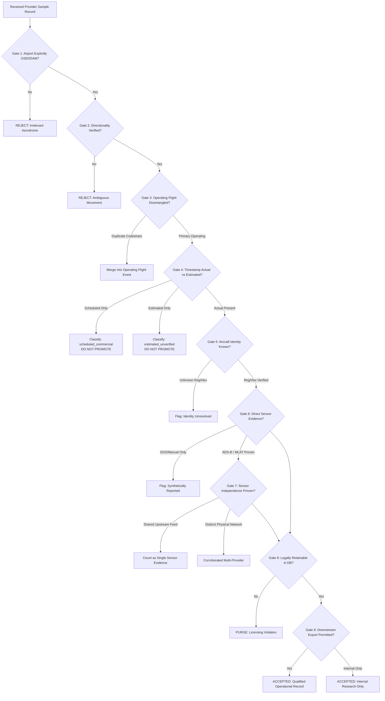

# Syrian Airport Data Engine — Version 2.4
# Historical Sample Data Validation Specification & Acceptance Protocol

**Document Identifier**: `docs/V2_4_SAMPLE_VALIDATION_SPEC.md`  
**Target Aerodrome**: Damascus International Airport (`DAM` / `OSDI`)  
**Audit Date**: 2026-10-11  
**Target Standard**: Forensic Epistemic Validation & Multi-Provider Deduplication  
**Status**: APPROVED SPECIFICATION  

---

## 1. Executive Summary & Purpose

When a prospective commercial provider or research partner provides a sample flight movement dataset for Damascus International Airport (`DAM` / `OSDI`), the dataset must undergo rigorous automated and manual forensic validation before any conclusion regarding data availability can be reached.

This specification establishes the **Nine Mandatory Assessment Gates** that every received flight record must satisfy. It defines explicit qualification rules to prevent:
- Mistaking commercial codeshare listings for multiple physical flights.
- Promoting timetable intentions or estimated times to confirmed physical movements.
- Conflating multiple API vendors reselling the same underlying feed as "independent sensor corroboration."
- Violating vendor intellectual property terms or license boundaries.

---

## 2. The Nine Assessment Gates

---

### Gate 1: Airport Specificity Check
* **Criterion**: The record must explicitly specify `OSDI` (ICAO) or `DAM` (IATA) as the origin aerodrome (for departures) or destination aerodrome (for arrivals).
* **Failure Modes**:
  - Regional overflights traversing the Damascus FIR.
  - Flights diverted to Beirut (`OLBA`) or Amman (`OJAI`) recorded under Damascus search queries.
  - Multi-airport regional aggregates (such as `DAM_ALP_LTK`).
* **Rule**: Records referencing regional airspace without explicit aerodrome binding to OSDI are **instantly rejected**.

---

### Gate 2: Movement Directionality
* **Criterion**: The movement must be unequivocally identified as an `arrival` or `departure`.
* **Failure Modes**:
  - Ambiguous "transit" or "serviced" records lacking direction.
  - Incongruent city pairs (e.g. Origin `OSDI`, Destination `DXB` tagged as `arrival`).
* **Rule**: Direction must perfectly match the origin/destination attribute. Incongruent records are quarantined for review.

---

### Gate 3: Operating vs. Codeshare Identification
* **Criterion**: The flight must be identified by its **actual operating air carrier and operating flight number**.
* **Failure Modes**:
  - Regional commercial flights are frequently marketed under multiple airline designators (e.g. Syrian Air `RB435` operating with Cham Wings `6Q...` or regional partner marketing codes).
  - Counting marketing codeshares as independent flights inflates movement totals by 100% to 300%.
* **Rule**:
  - Ingest the primary operating flight number.
  - Attach marketing numbers to `marketing_flight_no` metadata.
  - **Never** create multiple `flight_events` rows for the same physical movement.

---

### Gate 4: Timestamp Epistemic Classification
* **Criterion**: Every timestamp must be explicitly categorized as `actual`, `estimated`, `scheduled`, or `inferred`.
* **Qualification Standard**:
  - An `actual` timestamp must represent physical wheels-on or wheels-off.
  - If a provider provides only `scheduled` departure/arrival, the record can **never** be promoted to `physical_movement`. It must remain classified as `scheduled_commercial`.
  - If a provider provides only `estimated` times, the record must remain classified as `estimated_candidate`.
  - **IMMUTABLE INVARIANT**: Scheduled or estimated times alone **CANNOT** prove a historical physical flight occurred.

---

### Gate 5: Physical Aircraft Identity Verification
* **Criterion**: The record should provide positive aircraft identification:
  - Official national tail registration (e.g., Syrian civil marks `YK-...`, Iranian marks `EP-...`, Russian marks `RA-...`).
  - 24-bit Mode-S ICAO24 transponder hex address (e.g. `74001B`).
* **Validation Check**:
  - Compare ICAO24 hex against published national allocation blocks (Syrian Arab Republic allocation: `740000` to `7403FF`).
  - Match registration format against sovereign civil aviation registries.
  - Records lacking tail/hex data are marked `identity_unresolved` and require stronger secondary evidence.

---

### Gate 6: Direct Sensor Evidence Verification
* **Criterion**: The record must document the primary telemetry mechanism used to capture the movement.
* **Evidence Hierarchy**:
  1. *Primary Terrestrial ADS-B / MLAT*: Multi-receiver triangulation or direct decoded Mode-S message stream.
  2. *Space-Based ADS-B (Aireon)*: Low-Earth orbit satellite transponder reception.
  3. *Air Traffic Control Operational Feed*: Direct electronic ANSP movement message.
  4. *GDS / Commercial Aggregator Estimation*: Synthetic schedule progression (Disqualified from sensor proof).
* **Rule**: A record supported solely by GDS schedule progression cannot serve as physical evidence.

---

### Gate 7: Multi-Provider Independence Audit
* **Criterion**: When cross-correlating a sample across multiple providers, the physical sensor provenance of each provider must be traced.
* **The Shared Upstream Fallacy**:
  > [!WARNING]
  > Multiple commercial API providers often resell the exact same underlying raw data. For example, if Provider A and Provider B both license their real-time feed from the same satellite data partner, receiving matching records from Provider A and Provider B represents **one physical observation**, NOT two independent corroborating witnesses.
* **Rule**: True multi-provider independence requires verification that the data origins rely on distinct physical sensor infrastructure (e.g., terrestrial crowdsourced receiver network vs. space-based satellite constellation vs. sovereign air traffic control log).

---

### Gate 8: Legal & Database Retainability
* **Criterion**: The commercial license terms of the acquired sample must explicitly permit permanent local database storage.
* **Audit Questions**:
  - Does the provider license permit caching or persistent storage of historical records?
  - Does the license mandate automated deletion (e.g., "must purge records after 30 days")?
* **Rule**: Data subject to mandatory deletion clauses cannot be incorporated into the Syrian Airport Data Engine production database.

---

### Gate 9: Downstream Export & Research Publication Rights
* **Criterion**: The license must permit the generation of derivative statistical aggregates, research reports, and academic analysis.
* **Audit Questions**:
  - Does the provider prohibit publishing aggregate daily movement counts?
  - Are derivative time-series indices permitted?
* **Rule**: Only non-restrictive or research-compliant data may be incorporated into public-facing reports.

---

## 3. Single Strong Direct Observation Threshold

While multi-provider corroboration is preferred, a **single strong direct observation** may qualify a flight event as a confirmed `physical_movement` if and only if it meets all of the following conditions:

1. **High-Density Surface Telemetry**:
   - $\ge 3$ consecutive ADS-B position messages recorded within the OSDI runway movement area (Runway 05R/23L or 05L/23R).
   - Altitude verified within $\pm 100\text{ ft}$ of aerodrome elevation ($2,020\text{ ft MSL}$) with transponder `onground = True`.
2. **Kinematic Deceleration / Acceleration Profile**:
   - For Arrivals: Continuous groundspeed deceleration from touchdown speed down to runway exit speed ($< 35\text{ kts}$).
   - For Departures: Continuous groundspeed acceleration along the runway centerline from $< 40\text{ kts}$ through rotation speed.
3. **Cryptographic Payload Archival**:
   - Raw JSON/telemetry payload stored in `data/raw/snapshots/` with SHA-256 hash verified.

If a single provider record lacks high-density surface telemetry (e.g. drops coverage at 3,200 ft MSL on final approach), it **MUST REMAIN AN `approach_candidate`** and cannot be promoted to `physical_movement` without an independent corroborating source.

---

## 4. Automated Sample Acceptance Decision Matrix

| Gate Status | Resulting Event Classification | Database Status | Eligible for `verified_movements_count`? |
| :--- | :--- | :--- | :---: |
| Fails Gate 1 (Not OSDI) | `rejected_external_airport` | Rejected / Logged only | **NO** |
| Passes G1–G3, Fails G4 (Scheduled Only) | `scheduled_commercial` | `active_scheduled` | **NO** |
| Passes G1–G3, Fails G4 (Estimated Only) | `estimated_candidate` | `unverified_candidate` | **NO** |
| Passes G1–G6, Approaching OSDI (Lost at 3,000 ft)| `approach_candidate` | `candidate_unverified` | **NO** |
| Passes G1–G6 with Single Strong Surface Proof | `physical_movement` | `active` | **YES** |
| Passes G1–G6 Candidate + Independent Sensor Corrob.| `physical_movement` | `active` | **YES** |
| Fails Gate 8 (Retainability Denied by License) | `license_incompatible` | Purged from DB | **NO** |
