# Syrian Airport Data Engine — Version 2.5
# Provider Historical Acquisition Go / No-Go Decision Gate

**Document Identifier**: `docs/V2_5_PROVIDER_GO_NO_GO.md`  
**Target Aerodrome**: Damascus International Airport (`DAM` / `OSDI`)  
**Audit Date**: 2026-10-11  
**Decision Authority**: Syrian Airport Data Engine Architectural Governance  
**Status**: FORMAL DECISION GATE (Historical Ingestion Implementation Strictly Frozen)  

---

## 1. Executive Summary & Governance Ruling

### Overall Architecture Decision: **HISTORICAL PIPELINE IMPLEMENTATION FROZEN**

In strict adherence to the project's behavioral safety rules, **no automated ingestion adapters, historical backfill routines, database migrations, or Windows Scheduled Tasks may be implemented or deployed at this stage**.

Historical flight data availability at Damascus International Airport (`DAM` / `OSDI`) cannot be assumed from provider marketing claims or documentation alone. Concrete sample records from prospective providers must be acquired, cryptographically hashed, placed in `data/historical_sample_review/`, and forensically validated against the Ten Assessment Gates before any implementation authorization can be granted.

---

## 2. Definitive Provider Decision Ledger

Every evaluated provider and acquisition channel has been evaluated and assigned one of four formal operational decisions:
- `GO`
- `CONDITIONAL_GO`
- `NO_GO`
- `PENDING_SAMPLE`

```mermaid
flowchart TD
    subgraph Governance Decisions
        D_GO[GO: Fully Approved for Specific Scope]
        D_COND[CONDITIONAL_GO: Approved Subject to External Prerequisite]
        D_PEND[PENDING_SAMPLE: Awaiting Commercial / Technical Sample Data]
        D_NOGO[NO_GO: Disqualified & Eliminated from Pipeline]
    end

    OurAirports[OurAirports Static Aerodrome Reference] --> D_GO
    OpenSky[OpenSky Network Trino SQL Cluster] --> D_COND
    SEM[Syria Economic Monitor Macro Baseline] --> D_COND
    OfficialStats[Syrian CBS & MoT Official Publications] --> D_COND
    FR24[Flightradar24 Developer API / Commercial] --> D_PEND
    FA[FlightAware AeroAPI / Aireon Satellite] --> D_PEND
    ADSBx[ADS-B Exchange Jetnet Enterprise] --> D_PEND
    AviationStack[AviationStack 3-Month Window API] --> D_NOGO
    ConsumerScraping[Consumer Web Scraping Engines] --> D_NOGO

    style D_GO fill:#c8e6c9,stroke:#2e7d32,stroke-width:2px
    style D_COND fill:#e1f5fe,stroke:#0288d1,stroke-width:2px
    style D_PEND fill:#fff9c4,stroke:#fbc02d,stroke-width:2px
    style D_NOGO fill:#ffcdd2,stroke:#d32f2f,stroke-width:2px
```

---

### Comprehensive Provider Decision Table

| Provider / Channel | Operational Decision | Technical & Contractual Rationale | Prerequisites / Conditions for Execution | Permitted Action in Current Phase |
| :--- | :---: | :--- | :--- | :--- |
| **Flightradar24** | **`PENDING_SAMPLE`** | Multi-year historical archives exist (May 2016 to present) with actual MLAT/ADS-B timestamps. Final contract execution and pricing depend on receiving and validating a proof-of-availability sample for OSDI. | Verification of complimentary sample covering the 8 target dates; written confirmation of local DB retention and export terms. | **Approved to transmit Outbound Inquiry Draft 1** (`sales@fr24.com`). Pipeline implementation strictly frozen. |
| **FlightAware** | **`PENDING_SAMPLE`** | Space-based Aireon 1090MHz satellite ADS-B provides active en-route monitoring over Syria. Enterprise contract required for historical data $>30$ days. Feasibility depends on whether Aireon tracks low-altitude terminal descent at OSDI. | Delivery of proof-of-availability sample demonstrating low-altitude/surface OOOI timestamps; enterprise sales quotation. | **Approved to transmit Outbound Inquiry Draft 2** (`sales@flightaware.com`). Pipeline implementation strictly frozen. |
| **OpenSky Network** | **`CONDITIONAL_GO`** | Zero financial cost, open academic licensing (CC BY-NC 4.0), and comprehensive state vector tables back to 2013. However, access strictly requires approved institutional credentials. | Formal research application must be submitted and approved by OpenSky Network Association board; Trino credentials provisioned. | **Approved to submit academic research application** via OpenSky portal. Telemetry adapter implementation frozen until credentials active. |
| **Syria Economic Monitor (SEM)** | **`CONDITIONAL_GO`** *(Macro Only)* | Verified table `historical_daily_movements_2024` (578 rows) is active in production. However, it represents multi-airport aggregate `DAM_ALP_LTK` across Damascus, Aleppo, and Latakia. | Must remain strictly quarantined from `flight_events`; restricted to macro-economic benchmarking views. | **Approved for read-only macro analytical views** with prominent composite gateway warnings. Insertion into flight events prohibited. |
| **Syrian CBS & MoT Official Stats** | **`CONDITIONAL_GO`** *(Macro Only)* | Authoritative statutory publications exist in Syrian state archives. Macro totals (annual passengers, cargo, flights) provide vital high-level envelopes. | Physical/PDF copies of CBS 2021–2024 abstracts must be procured, hashed, and archived in `data/historical_sample_review/official_statistics/`. | **Approved to procure official government publication PDFs**. Manual extraction only; no automated API implementation. |
| **OurAirports** | **`GO`** *(Static Metadata)* | Static aerodrome reference metadata (elevation 2,020 ft MSL, runways 05R/23L, coordinates, frequencies) is verified, accurate, and Public Domain (CC0). | Must NOT be used for flight movement time-series. | **Approved for static aerodrome geometry and coordinate validation**. |
| **ADS-B Exchange** | **`PENDING_SAMPLE`** | Unfiltered raw Mode-S archives exist back to 2016, but local receiver density in Damascus is unverified and historically sparse. Commercial contract required via Jetnet. | Sample historical trace for OSDI coordinates must demonstrate reception below 3,500 ft MSL before entering contract. | May submit sample request to Jetnet sales if primary providers decline. |
| **AviationStack** | **`NO_GO`** | Disqualified: standard $499.99/mo Business tier enforces a **3-month sliding window limitation**, making 2024 historical access impossible. Regional timestamps are largely unverified schedules/estimations. | None (Disqualified). | **Eliminated from acquisition architecture**. No further outreach or engineering effort permitted. |
| **Consumer Web Scraping** | **`NO_GO`** | Disqualified: automated scraping is explicitly prohibited under Section 8 of Flightradar24 and FlightAware Terms of Use; legally tainted, contractually non-compliant, and fragile. | None (Disqualified). | **Strictly prohibited across all codebase modules**. |

---

## 3. Immediate Action Plan for Project Leadership

Project leadership is recommended to execute the following non-intrusive administrative actions:

1. **Authorize and Dispatch Commercial Inquiries**:
   - Transmit Outbound Draft 1 to Flightradar24 Commercial Sales (`sales@fr24.com`).
   - Transmit Outbound Draft 2 to FlightAware Enterprise Sales (`sales@flightaware.com`).
2. **Authorize OpenSky Institutional Submission**:
   - If affiliated with an eligible university or research institute, submit the prepared research proposal to the OpenSky Data Access portal.
3. **Establish Sample Intake Manifests**:
   - When vendor replies with sample attachments, place raw unmutated files into `data/historical_sample_review/<provider>/`.
   - Calculate SHA-256 hash immediately and complete a manifest using `data/historical_sample_review/sample_manifests/TEMPLATE_MANIFEST.md`.
4. **Await Sample Validation Before Coding**:
   - Execute sample validation scripts only against files in `data/historical_sample_review/`.
   - Do not write code to modify production database schema or implement production adapters until validation results prove data availability.
