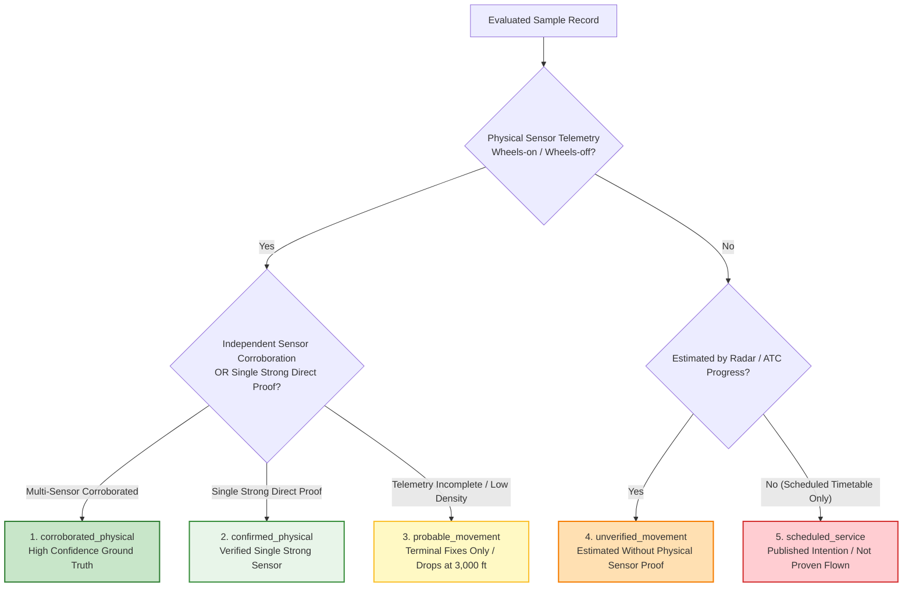
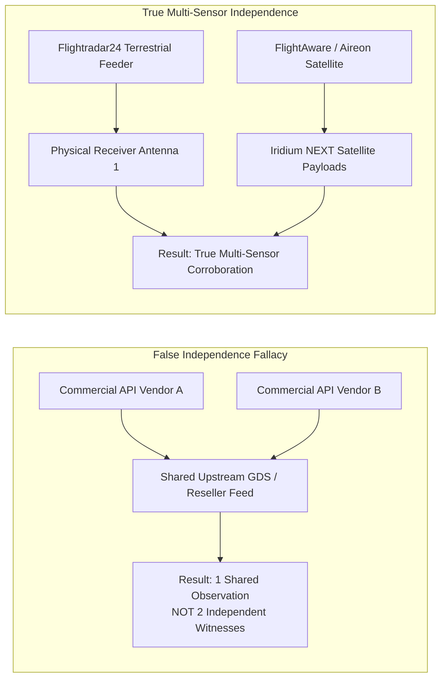

# Syrian Airport Data Engine — Version 2.5
# Provider Sample Validation Specification & Classification Protocol

**Document Identifier**: `docs/V2_5_PROVIDER_SAMPLE_VALIDATION.md`  
**Target Aerodrome**: Damascus International Airport (`DAM` / `OSDI`)  
**Audit Date**: 2026-10-11  
**Target Standard**: Epistemic Rigor & Multi-Sensor Lineage Provenance  
**Status**: APPROVED SPECIFICATION  

---

## 1. Executive Summary & Purpose

When incoming sample flight records are received from commercial data providers (e.g. Flightradar24, FlightAware) or research clusters (OpenSky Network), they must be subjected to a rigorous ten-point forensic evaluation before any record can be admitted into research time series.

This document formalizes the **Ten Sample Validation Criteria**, defines the **Five Standard Movement Classifications**, codifies the **Single Strong Direct Observation Threshold**, and establishes the **Upstream Lineage Independence Audit**.

---

## 2. The Ten Sample Validation Criteria

Every sample record undergoes sequential evaluation against ten deterministic gates:

| Gate | Validation Criterion | Evaluated Attribute | Pass Condition | Failure Action |
| :---: | :--- | :--- | :--- | :--- |
| **G1** | **Airport Specificity** | `airport_icao` / `airport_iata` | Must explicitly match `OSDI` (ICAO) or `DAM` (IATA) as origin (dep) or destination (arr). | **Reject**: Exclude from airport event database. |
| **G2** | **Movement Direction** | `movement_type` | Unambiguously identified as `arrival` or `departure`, matching origin/destination aerodromes. | **Quarantine**: Flag as ambiguous direction. |
| **G3** | **Operating Flight Identity** | `operating_flight_no` | Valid callsign/flight number of operating airline (e.g. `RB435`, `SAW501`). | **Flag**: Missing operational callsign. |
| **G4** | **Codeshare Disambiguation** | `marketing_flight_no` | Codeshare numbers mapped to metadata; duplicate physical events prevented. | **Deduplicate**: Merge into single physical movement. |
| **G5** | **Timestamp Epistemic State** | `actual`, `estimated`, `scheduled` | Timestamp must be explicitly tagged by type; actual times require physical sensor proof. | **Classify**: Downgrade scheduled/estimated records. |
| **G6** | **Aircraft Identity** | `aircraft_reg` and `icao24` | Valid tail mark (e.g. `YK-AKB`) or 24-bit Mode-S address matching national allocation. | **Flag**: Identity unverified. |
| **G7** | **Direct Telemetry Evidence** | `sensor_provenance` | Documented primary ADS-B, MLAT, or space-based sensor origin. | **Disqualify**: GDS/schedule cannot prove physical flight. |
| **G8** | **Source Record Identifier** | `source_record_id` | Unique, persistent transaction identifier in provider's production archive. | **Quarantine**: Missing upstream audit key. |
| **G9** | **Historical Date Coverage** | `flight_date` | Date aligns with Damascus operational local calendar (`Asia/Damascus`, UTC+3). | **Re-index**: Reconcile date boundary. |
| **G10**| **Retention & Export Rights** | `license_terms` | Commercial license explicitly permits internal SQLite storage and academic publishing. | **Purge**: Reject license-incompatible records. |

---

## 3. The Five Standard Movement Classifications

Every admitted flight record is classified into one of five mutually exclusive operational states:

### Detailed Classification Definitions

1. **`confirmed_physical`**:
   - *Definition*: A flight movement confirmed by high-density primary sensor telemetry satisfying the Single Strong Direct Observation Threshold.
   - *Evidence Required*: $\ge 3$ consecutive ADS-B/MLAT surface fixes within the OSDI runway movement area, verified `onground = True`, groundspeed $<80\text{ kts}$ decelerating (arrival) or accelerating $>80\text{ kts}$ on runway centerline (departure), and altitude within $\pm 100\text{ ft}$ of aerodrome elevation ($2,020\text{ ft MSL}$).
   - *Engine Impact*: Admitted to `verified_movements_count`.
2. **`corroborated_physical`**:
   - *Definition*: A flight movement corroborated by two or more independent physical sensor networks with distinct upstream lineage.
   - *Evidence Required*: E.g., an OpenSky approach candidate matching a Flightradar24 actual landing time (ATA) or FlightAware actual-on timestamp within $\pm 10$ minutes, with identical ICAO24/registration.
   - *Engine Impact*: Admitted to `verified_movements_count`.
3. **`probable_movement`**:
   - *Definition*: An observed flight trajectory entering the OSDI approach or departure corridor, but where low-altitude telemetry degrades prior to confirming runway touchdown.
   - *Evidence Required*: Continuous descent profile below $4,500\text{ ft MSL}$ aligned with runway heading ($051^\circ / 231^\circ$), terminating at $2,800–3,500\text{ ft MSL}$ due to terrestrial line-of-sight signal loss.
   - *Engine Impact*: **MUST NOT** be admitted to `verified_movements_count` without secondary corroboration. Stored as a candidate event.
4. **`unverified_movement`**:
   - *Definition*: A flight record supported only by modeled, estimated, or ATC en-route progress updates without direct terminal sensor telemetry.
   - *Evidence Required*: Estimated arrival/departure timestamps derived from cruise airspeed extrapolation.
   - *Engine Impact*: Excluded from verified operational counts.
5. **`scheduled_service`**:
   - *Definition*: A published commercial airline timetable intention (e.g. OAG/Cirium GDS listing).
   - *Evidence Required*: Scheduled departure and arrival times only.
   - *Engine Impact*: Excluded from historical movement totals. Recorded solely for schedule-versus-reality variance analysis.

---

## 4. Single Strong Direct Observation Threshold

A single provider's observation may be promoted to `confirmed_physical` without secondary corroboration **if and only if** all five mandatory parameters are met:

1. **Geospatial Runway Polygon Intersection**: Position fixes strictly contained within the verified OSDI runway surface polygon:
   - Runway 05R/23L: Length 3,600 m, Width 45 m.
   - Runway 05L/23R: Length 3,000 m, Width 45 m.
2. **Kinematic Ground Roll Profile**:
   - For Arrivals: Deceleration from touchdown speed ($120–140\text{ kts}$) down through high-speed exit taxi speed ($< 35\text{ kts}$).
   - For Departures: Acceleration along the centerline from taxi speed ($< 30\text{ kts}$) through takeoff rotation speed ($V_r > 120\text{ kts}$).
3. **Squat-Switch & Altitude Alignment**: Transponder `onground = True` accompanied by geometric/barometric altitude within $\pm 100\text{ ft}$ of aerodrome elevation ($2,020\text{ ft MSL}$).
4. **Message Frequency & Continuity**: Minimum of 3 position messages spanning $\ge 15$ seconds without anomalous geospatial jumps ($> 50\text{ m}$ off centerline).
5. **Cryptographic Payload Archival**: Raw unmutated JSON/CSV payload stored in `data/raw/snapshots/` with verified SHA-256 hash.

---

## 5. Multi-Provider Sensor Independence Audit Protocol

When evaluating multiple commercial APIs, true sensor independence must be demonstrated:

### Upstream Lineage Verification Checklist
1. **Transponder Reception Channel**:
   - Terrestrial receiver network (FR24 receivers, OpenSky feeders).
   - Space-based satellite receiver (Aireon 1090MHz payloads on Iridium NEXT).
   - Radar data processing system (ANSP radar feed).
2. **Disqualification Rule**:
   - If Provider A and Provider B both license their flight movement timestamps from a shared airline GDS or common commercial aggregator, they represent **one observation**.
   - Matching timestamps between resold feeds cannot promote an event to `corroborated_physical`.

---

## 6. Archetypal Sample Validation Walkthroughs

The following five test archetypes demonstrate how received records will be categorized by the validation engine:

| Archetype Record | Provider | Timestamp Type | Upstream Provenance | Kinematic Profile | Final Classification | Eligible for `verified_movements_count`? |
| :--- | :--- | :--- | :--- | :--- | :--- | :---: |
| **Arch 1: Syrian Air A320 (`RB435`)** | Flightradar24 | `actual` (ATA) | Terrestrial ADS-B / MLAT | Deceleration to 28 kts on Rwy 05R | **`confirmed_physical`** | **YES** |
| **Arch 2: Cham Wings A320 (`6Q501`)** | OpenSky + FlightAware | `actual` | OpenSky TMA descent + Aireon `actual_on` | OpenSky descent to 3,200 ft matched with Aireon wheels-on | **`corroborated_physical`** | **YES** |
| **Arch 3: Mahan Air A310 (`W5114`)** | OpenSky Trino | `inferred` | OpenSky terrestrial receiver | Descents to 3,400 ft on 051° track, drops off 4 NM out | **`probable_movement`** | **NO** (Candidate only) |
| **Arch 4: Regional Cargo B737** | AviationStack | `estimated` | Airline schedule model | Estimated time derived from departure + flight duration | **`unverified_movement`** | **NO** |
| **Arch 5: Codeshare Listing (`IR601`)** | Commercial GDS | `scheduled` | Published timetable | Timetable listing for Cham Wings flight; no sensor data | **`scheduled_service`** | **NO** (Codeshare metadata) |
