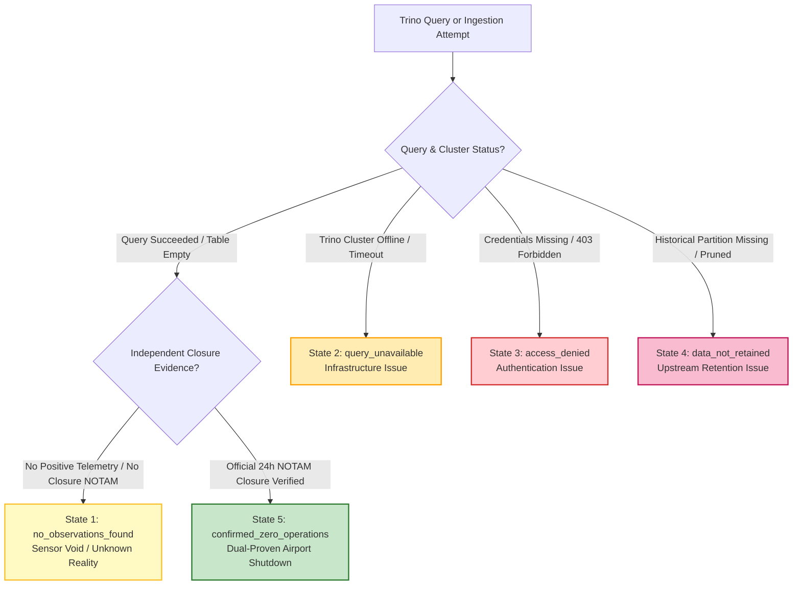

# Syrian Airport Data Engine — Version 2.6
# OpenSky Eligibility Checklist & Coverage Measurement Metrics

**Document Identifier**: `docs/V2_6_OPENSKY_ELIGIBILITY_CHECKLIST.md`  
**Target Aerodrome**: Damascus International Airport (`DAM` / `OSDI`)  
**Audit Date**: 2026-10-11  
**Target Standard**: Verified Primary Source Policy & Epistemic State Segregation  
**Status**: APPROVED SPECIFICATION  

---

## 1. OpenSky Historical Eligibility Checklist

This checklist evaluates the Syrian Airport Data Engine project profile against the official OpenSky Network data access policies verified on 2026-10-11:

| Policy / Eligibility Dimension | Official OpenSky Requirement | Project Profile Status | Compliance Verdict | Mandatory Action Required Before Submission |
| :--- | :--- | :--- | :---: | :--- |
| **Institutional Affiliation** | Must be affiliated with an accredited university, research institute, civil aviation authority, or registered non-profit. | Unaffiliated if applying as an anonymous individual; eligible if user provides academic/institutional affiliation. | **CONDITIONAL** | User must provide accredited institution name and department in `[USER_INSTITUTION_NAME]`. |
| **Institutional Email Domain** | Institutional email address required for account verification. | Project assistant has no access to personal/institutional email. | **CONDITIONAL** | User must supply an active institutional email address in `[USER_INSTITUTION_EMAIL]`. |
| **Non-Commercial Exclusivity** | Strictly non-commercial academic research. Commercial use requires a separate paid license. | The Syrian Airport Data Engine is a research analysis platform with zero commercial monetization. | **VERIFIED COMPLIANT** | Confirm explicit declaration of non-commercial academic intent in application text. |
| **Project Proposal Scope** | Must describe specific research questions, target aerodrome, temporal bounds, and requested tables. | Fully defined in `docs/V2_6_OPENSKY_RESEARCH_PROPOSAL.md` (6 specific research questions, OSDI focus). | **VERIFIED COMPLIANT** | Include proposal text in OpenSky Data Request submission form. |
| **Attribution & Citation Agreement** | Mandatory citation of Schäfer et al. (IPSN 2014) in all public reports, papers, and web outputs. | Documented and integrated into project documentation standards. | **VERIFIED COMPLIANT** | Affirm citation commitment in application text. |
| **No Bulk Redistribution** | Redistribution of raw state vectors is prohibited under CC BY-NC 4.0; only derived aggregates permitted. | Project enforces local database isolation (`data/historical_sample_review/opensky/`); no public raw dumps. | **VERIFIED COMPLIANT** | Re-confirm data retention and local storage security plan. |
| **Cluster Etiquette & Partitioning**| Must use time partitioning and spatial filters to avoid full cluster scans. | Fully codified in `docs/V2_6_OPENSKY_PILOT_QUERY_DESIGN.md` (single-day partitions and lat/lon bounds). | **VERIFIED COMPLIANT** | Enforce query template without modification. |

---

## 2. Coverage Measurement Framework

When historical OpenSky data is extracted for OSDI, coverage density, receiver continuity, and data quality will be quantified using the following eleven standardized metrics:

### Metric Formulations

1. **Total Observations per Date ($N_{\text{obs}}$)**:
   Total count of raw Mode-S state-vector rows returned within the Damascus TMA bounding box for a 24-hour UTC window.
2. **Unique ICAO24 Aircraft Count ($N_{\text{icao24}}$)**:
   $$\text{Unique Aircraft} = |\text{DISTINCT}(icao24)|$$
3. **Unique Flight Callsigns ($N_{\text{callsign}}$)**:
   $$\text{Unique Callsigns} = |\text{DISTINCT}(callsign)|$$
4. **Observation Message Frequency ($F_{\text{obs}}$)**:
   Mean time delta (in seconds) between consecutive positional fixes for an individual aircraft trajectory:
   $$\bar{\Delta t} = \frac{t_{\text{last}} - t_{\text{first}}}{N_{\text{fixes}} - 1}$$
5. **Missing Time Intervals ($N_{\text{intervals}}$)**:
   Count of temporal segments during the operational day exceeding 60 minutes with zero transponder messages across the entire TMA.
6. **Maximum Observation Gap ($G_{\text{max}}$)**:
   Longest duration (in minutes or hours) between consecutive state-vector observations within the evaluated 24-hour window.
7. **Spatial Zone Distribution**:
   Proportion of observations occurring within each spatial zone:
   $$\% Z_i = \frac{N_{\text{obs}}(Z_i)}{N_{\text{obs}}} \times 100\% \quad (i \in \{1, 2, 3, 4\})$$
8. **Altitude Band Distribution**:
   Proportion of observations occurring within each vertical altitude band:
   $$\% A_k = \frac{N_{\text{obs}}(A_k)}{N_{\text{obs}}} \times 100\% \quad (k \in \{A, B, C, D\})$$
9. **Candidate Arrivals Count ($N_{\text{arr\_cand}}$)**:
   Count of unique trajectories exhibiting continuous descent below 4,000 ft MSL along the Runway 05R/23L or 05L/23R final approach localizer.
10. **Candidate Departures Count ($N_{\text{dep\_cand}}$)**:
    Count of unique trajectories originating in the immediate departure climbout corridor climbing through 5,000 ft MSL.
11. **Percentage with Valid Aircraft Identity ($P_{\text{identity}}$)**:
    Proportion of observations possessing a valid ICAO24 hex address that successfully maps to an official national aircraft registry:
    $$P_{\text{identity}} = \frac{N_{\text{mapped\_hex}}}{N_{\text{total\_hex}}} \times 100\%$$

---

## 3. Strict Epistemic State Segregation

A fundamental methodological defect in naive aviation analysis is collapsing missing data into zero operations. The Syrian Airport Data Engine enforces **strict segregation across five distinct negative or null states**:

### Detailed Epistemic State Definitions

| Epistemic State | Technical Definition | Cause / Operational Reality | Database Representation | Permitted to Infer Zero Flights? |
| :--- | :--- | :--- | :---: | :---: |
| **`no_observations_found`** | Query executed successfully (`HTTP 200 OK`, valid Trino cursor), but returned 0 rows for the target spatial-temporal box. | Terrestrial ADS-B receiver line-of-sight void or aircraft operated with transponders off. | `NULL` / `unverified_data_gap` | **STRICTLY NO** |
| **`query_unavailable`** | Query failed to execute due to cluster maintenance, network timeout, or execution abort. | Technical communication failure between client and Trino coordinator. | `NULL` / `system_error` | **STRICTLY NO** |
| **`access_denied`** | Query rejected due to invalid, expired, or unapproved credentials (`HTTP 403 Forbidden`). | Account lacks historical query authorization. | `NULL` / `unauthorized` | **STRICTLY NO** |
| **`data_not_retained`** | Upstream table indicates that historical partition for that date range was purged, lost, or never recorded. | Upstream provider archive failure. | `NULL` / `upstream_data_void` | **STRICTLY NO** |
| **`confirmed_zero_operations`** | Trino query returns 0 rows **AND** an authoritative official NOTAM / SCAA decree confirms 24-hour aerodrome closure. | Aerodrome was legally and physically closed to civil traffic. | `0` (Confirmed Zero) | **YES (Dual-Proven)** |

### Mandatory Engine Rule
> [!CAUTION]
> In all analytical exports, database views, and statistical summaries, States 1 through 4 must **NEVER** be merged with State 5.
> Setting flight counts to `0` is legally and scientifically prohibited unless the record is classified as `confirmed_zero_operations`.
