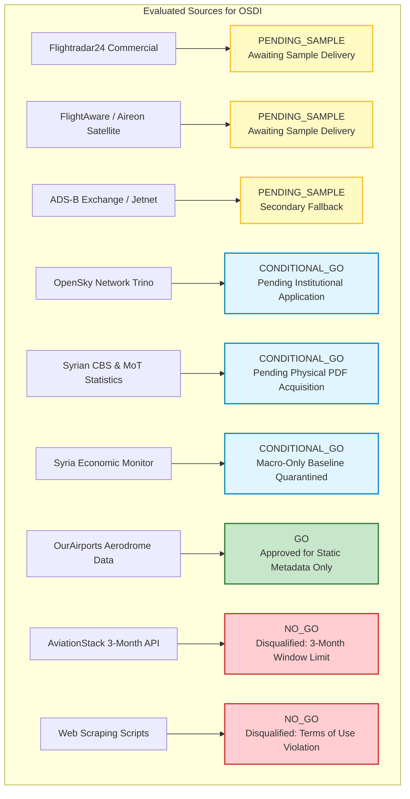

# Syrian Airport Data Engine — Version 2.6
# Provider Decision Log & Governance Gate Register

**Document Identifier**: `docs/V2_6_PROVIDER_DECISION_LOG.md`  
**Target Aerodrome**: Damascus International Airport (`DAM` / `OSDI`)  
**Audit Date**: 2026-10-11  
**Governance Standard**: Empirical Sample Verification Required for Ingestion Authorization  
**Status**: ACTIVE GOVERNANCE GATE  

---

## 1. Executive Summary & Core Decision Invariants

This document establishes the official governance record and decision status for all evaluated aviation data providers and acquisition channels for the historical reconstruction of Damascus International Airport (`DAM` / `OSDI`).

### The Cardinal Governance Invariant
> [!CRITICAL]
> **A provider cannot receive `GO` for historical DAM reconstruction based only on marketing documentation, pricing pages, or API availability.**
>
> **Actual OSDI sample validation against the Ten Assessment Gates is strictly required before any provider or pipeline adapter can be authorized for ingestion into the Syrian Airport Data Engine.**

### Strict Behavioral Safeguards
1. **Zero Pipeline Ingestion**: No automated adapters, daily ingestion scripts, or historical backfill routines may be implemented or executed in Version 2.6.
2. **Zero Database Mutation**: The production SQLite database (`data/damascus_airport.db`) remains completely untouched and read-only throughout this phase.
3. **No Unsanctioned Submissions**: No emails, commercial subscription orders, or portal applications may be dispatched without explicit, documented user approval.
4. **No Reclassification**: Existing movement classifications in production tables remain unaltered.

---

## 2. Decision State Definitions

Every candidate data source is evaluated against four formal decision states:

| Decision State | Formal Definition | Prerequisites for Promotion | Permitted Current Scope |
| :---: | :--- | :--- | :--- |
| **`GO`** | **Fully Approved for Production Integration**. Provider has delivered concrete samples meeting all 10 gates; commercial/licensing terms permit local DB retention and export. | Validated OSDI sample data demonstrating physical telemetry; signed contract or open license. | Full pipeline development and historical ingestion permitted. |
| **`CONDITIONAL_GO`** | **Approved Subject to External Prerequisite**. Technical feasibility or academic license is verified, but formal access depends on an external barrier (e.g. institutional approval, physical publication acquisition). | Removal of external condition (e.g. credential grant, PDF receipt). | Preparation of queries, schemas, and outreach applications. Ingestion remains frozen. |
| **`PENDING_SAMPLE`** | **Commercial or Technical Feasibility Unverified**. Provider claims to possess historical data, but low-altitude coverage at OSDI is unknown and unproven. | Receipt and forensic validation of a complimentary proof-of-availability sample covering the 8 benchmark dates. | Preparation of outbound inquiry drafts; awaiting user dispatch approval. |
| **`NO_GO`** | **Disqualified & Discontinued**. Provider fails technical, historical, legal, or economic requirements. | None (Irrevocably disqualified). | Eliminated from acquisition architecture. No engineering or commercial effort permitted. |

---

## 3. Comprehensive Master Provider Decision Ledger

---

### Master Decision Ledger Table

| Candidate Data Source | Operational Decision | Current Governance Scope | Primary Basis for Decision | Conditions Precedent to `GO` Promotion |
| :--- | :---: | :--- | :--- | :--- |
| **Flightradar24** | **`PENDING_SAMPLE`** | Commercial Inquiry Draft Prepared | High historical archive depth (2016–pres); unknown ground receiver density at OSDI. Cannot assume terminal coverage exists. | 1. Receipt of 8-date OSDI sample. 2. Validation of runway touchdown telemetry. 3. Commercial agreement permitting local DB retention. |
| **FlightAware** | **`PENDING_SAMPLE`** | Enterprise Inquiry Draft Prepared | Aireon space-based ADS-B covers Syrian airspace, but low-altitude terminal descent detection at OSDI (2,020 ft MSL) is unverified. | 1. Receipt of proof-of-availability sample. 2. Proof of actual OOOI surface times. 3. Enterprise quotation & retention terms. |
| **OpenSky Network** | **`CONDITIONAL_GO`** | Academic Research Application Prepared | Zero commercial cost; CC BY-NC 4.0 license; 2013–pres state vector archive. Requires university/institutional affiliation. | 1. User approval of academic application. 2. Association credential approval. 3. Execution of Trino SQL test query for OSDI. |
| **Syrian CBS & MoT Official Stats** | **`CONDITIONAL_GO`** *(Macro Only)* | Procurement Specification Approved | Authoritative state publication baseline. High macro accuracy; lacks per-flight telemetry. | 1. Procurement and SHA-256 archival of 2021–2024 statistical yearbooks. 2. Manual data extraction and cross-check. |
| **Syria Economic Monitor (SEM)** | **`CONDITIONAL_GO`** *(Macro Only)* | Verified Baseline Ingested (578 rows) | Ingested table `historical_daily_movements_2024` verified. Strictly composite `DAM_ALP_LTK` aggregate. Quarantined from flight events. | Permanent quarantine maintained; macro validation only. Never promoted to individual flight events. |
| **OurAirports** | **`GO`** *(Static Metadata Only)* | Active Static Reference Metadata | Public Domain (CC0); aerodrome coordinates, elevations, and runway alignments empirically verified. | **Current scope approved**. Prohibited from generating movement time-series. |
| **ADS-B Exchange (Jetnet)** | **`PENDING_SAMPLE`** | Secondary Commercial Option on Hold | Raw Mode-S historical archive exists back to 2016; receiver coverage in Damascus historically weak. Commercial fees via Jetnet. | Re-evaluated only if primary commercial vendors fail to provide viable OSDI coverage. |
| **AviationStack** | **`NO_GO`** | Disqualified & Eliminated | Enforces a hard **3-month sliding window limitation** on standard plans. 2024 historical access impossible. Regional timestamps unverified. | Irrevocably disqualified. No further consideration. |
| **Consumer Web Scraping** | **`NO_GO`** | Prohibited Codebase-Wide | Violates provider Terms of Use; legally non-compliant; fragile to DOM changes; lacks cryptographic auditability. | Irrevocably prohibited. |

---

## 4. Provider Decision Audit History

| Timestamp | Document Version | Provider | Prior State | New State | Governance Rationale |
| :---: | :---: | :--- | :---: | :---: | :--- |
| **2026-10-10** | V2.3 | AviationStack | *Evaluating* | `NO_GO` | 3-month window limit verified; multi-year historical access blocked. |
| **2026-10-10** | V2.3 | Scraping | *Evaluating* | `NO_GO` | Legal and contractual terms audit confirmed strict prohibition. |
| **2026-10-11** | V2.4 | OpenSky | `PENDING_SAMPLE` | `CONDITIONAL_GO` | Open academic access terms verified; conditioned on institutional application. |
| **2026-10-11** | V2.5 | SEM Baseline | *Evaluating* | `CONDITIONAL_GO` | 578 rows verified in DB; quarantined to macro composite analysis only. |
| **2026-10-11** | V2.5 | FR24 & FA | `PENDING_SAMPLE` | `PENDING_SAMPLE` | Inquiries drafted; pipeline implementation frozen pending concrete samples. |
| **2026-10-11** | V2.6 | All Providers | *Maintained* | *Maintained* | Version 2.6 outreach tracker active; zero unsanctioned dispatches confirmed. |

---

## 5. Summary of Pending User Actions & Approvals

Before any operational state transition can take place, the project leadership must provide explicit approval on the following pending actions:

### Action 1: Flightradar24 Inquiry Dispatch Authorization
- **Target**: `sales@fr24.com`, `api@fr24.com`
- **Content**: Formal Proof-of-Availability Sample & Commercial Terms Request (Request 1 in `docs/V2_5_SAMPLE_ACQUISITION_STATUS.md`).
- **Required User Decision**: Approve or reject sending the inquiry email.
- **Action Upon Approval**: Mark status as `sent` in `docs/V2_6_PROVIDER_OUTREACH_TRACKER.md`.

### Action 2: FlightAware Enterprise Inquiry Dispatch Authorization
- **Target**: `sales@flightaware.com`, `aeroapi@flightaware.com`
- **Content**: Formal AeroAPI Enterprise & Aireon Satellite Telemetry Sample Request (Request 2 in `docs/V2_5_SAMPLE_ACQUISITION_STATUS.md`).
- **Required User Decision**: Approve or reject sending the inquiry email.
- **Action Upon Approval**: Mark status as `sent` in `docs/V2_6_PROVIDER_OUTREACH_TRACKER.md`.

### Action 3: OpenSky Network Institutional Application Review
- **Target**: OpenSky Network Data Access Portal
- **Content**: Non-commercial academic research application for Trino SQL cluster access (Request 3 in `docs/V2_5_SAMPLE_ACQUISITION_STATUS.md`).
- **Required User Decision**: Confirm institutional affiliation details and authorize online submission.
- **Action Upon Approval**: Mark status as `sent` in `docs/V2_6_PROVIDER_OUTREACH_TRACKER.md`.

---

## 6. Engineering Freeze & Verification Sign-Off

- **Historical Pipeline Status**: **STRICTLY FROZEN**
- **Production Database Status**: **UNTOUCHED / READ-ONLY**
- **Outbound Communication Status**: **AWAITING USER APPROVAL**
- **Next Milestone**: Milestone V2.7 (Sample Receipt, Cryptographic Verification, and Forensic Validation).
