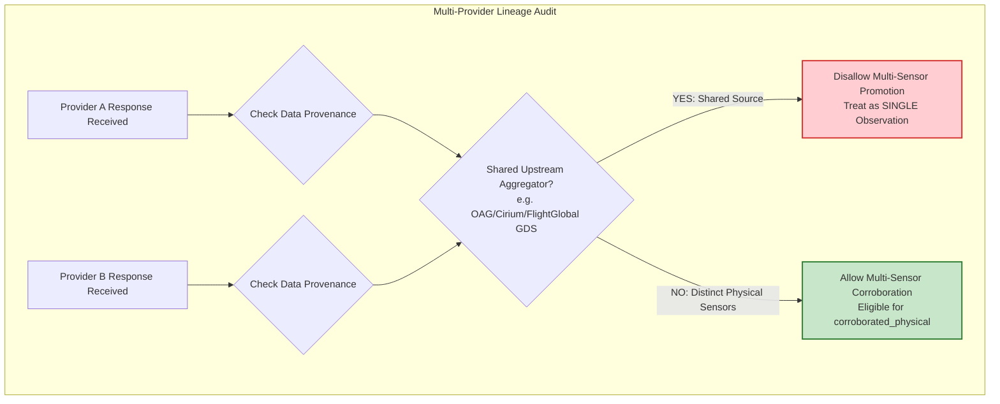

# Syrian Airport Data Engine — Version 2.6
# Provider Outreach & Response Tracking Register

**Document Identifier**: `docs/V2_6_PROVIDER_OUTREACH_TRACKER.md`  
**Target Aerodrome**: Damascus International Airport (`DAM` / `OSDI`)  
**Audit Date**: 2026-10-11  
**Operating Standard**: STRICTLY READ-ONLY (No Pipeline Ingestion, No Unauthorized Outbound Submissions)  
**Status**: ACTIVE TRACKER  

---

## 1. Governance & Operational Principles

This tracker governs all outbound commercial inquiries, research applications, and inbound communication regarding historical data availability for Damascus International Airport (`DAM` / `OSDI`).

### Invariant Rules
1. **Zero Outbound Transmission Without Explicit Authorization**:
   - **Never mark an inquiry as `sent` unless the user confirms it was actually sent.**
   - All drafted inquiries remain in `draft_ready` until explicit user authorization is recorded in this log.
2. **Provider Independence & Independent Sensor Assessment**:
   - Each provider must be assessed independently.
   - Do not assume that different APIs represent independent sensors. If two vendors resell or redistribute data from a common upstream aggregator, radar data feed, or airline schedule GDS, they represent a single observation.
3. **No Production Database Mutation**:
   - This phase manages provider communication and sample tracking only.
   - No historical ingestion pipelines, database migrations, or scheduled ingestion tasks may be created or modified.

---

## 2. Standard Outreach Lifecycle Statuses

Every tracked provider and acquisition channel must be assigned one of the following mutually exclusive lifecycle statuses:

| Status Code | Definition & Criteria | Permitted Transition |
| :--- | :--- | :--- |
| **`draft_ready`** | Formal inquiry/application draft has been prepared, verified against V2.5 standards, and is ready for user review. | $\rightarrow$ `approved_by_user` or `rejected` |
| **`approved_by_user`**| User has reviewed and explicitly approved transmission of the inquiry draft. | $\rightarrow$ `sent` |
| **`sent`** | User has confirmed that the inquiry was officially transmitted to the provider via email or portal. | $\rightarrow$ `provider_acknowledged` or `no_response` |
| **`provider_acknowledged`** | Provider has confirmed receipt of inquiry and assigned a sales/support ticket or initiated internal review. | $\rightarrow$ `sample_received`, `rejected`, or `no_response` |
| **`sample_received`** | Provider has delivered a concrete sample dataset; raw file is quarantined in `data/historical_sample_review/<provider>/`. | $\rightarrow$ `sample_validated` |
| **`sample_validated`** | Forensic evaluation against the Ten Sample Validation Gates is complete and recorded. | $\rightarrow$ Feeds Decision Gate (`GO` / `NO_GO`) |
| **`rejected`** | Provider declined the sample request, refused licensing terms, or user terminated inquiry. | Terminal state for channel |
| **`no_response`** | Provider failed to respond within standard follow-up window ($\ge 14$ business days). | $\rightarrow$ Follow-up draft or `rejected` |

---

## 3. Master Provider Outreach Tracking Register

| Provider Name | Contact Channel | Status | Inquiry Date | Response Date | Requested Dates | Sample Available | Pricing Terms | Licensing / Retention | Export Rights | Next Action | Supporting Evidence / Docs |
| :--- | :--- | :---: | :---: | :---: | :---: | :---: | :---: | :---: | :---: | :--- | :--- |
| **Flightradar24** | `sales@fr24.com`<br>`api@fr24.com` | `draft_ready` | *Pending User Approval* | — | 8 Target Dates (2024–2026) | *Pending Response* | Dev Essential: $90/mo<br>Advanced: $900/mo<br>Archive: Bespoke Quote | Internal SQLite DB retention requested | Academic derivative publishing requested | User review & dispatch approval | [`docs/V2_5_SAMPLE_ACQUISITION_STATUS.md`](file:///c:/Users/fahad/OneDrive/Desktop/syria%20damascus%20airport/docs/V2_5_SAMPLE_ACQUISITION_STATUS.md#L60-L105) |
| **FlightAware** | `sales@flightaware.com`<br>`aeroapi@flightaware.com` | `draft_ready` | *Pending User Approval* | — | 8 Target Dates (2024–2026) | *Pending Response* | AeroAPI Personal: $0 (30d)<br>Standard: $100/mo<br>Enterprise: Quote | Internal SQLite DB retention requested | Academic derivative publishing requested | User review & dispatch approval | [`docs/V2_5_SAMPLE_ACQUISITION_STATUS.md`](file:///c:/Users/fahad/OneDrive/Desktop/syria%20damascus%20airport/docs/V2_5_SAMPLE_ACQUISITION_STATUS.md#L109-L152) |
| **OpenSky Network** | Data Access Portal<br>(Trino Cluster) | `draft_ready` | *Pending User Approval* | — | 8 Target Dates (2024–2026) | *Pending Application* | €0.00 (Non-commercial academic) | Permanent SQLite storage permitted (CC BY-NC 4.0) | Permitted (Attribution required) | User review of institutional affiliation | [`docs/V2_5_SAMPLE_ACQUISITION_STATUS.md`](file:///c:/Users/fahad/OneDrive/Desktop/syria%20damascus%20airport/docs/V2_5_SAMPLE_ACQUISITION_STATUS.md#L156-L223) |
| **Syrian CBS & MoT** | Official Gazette / State Procurement | `draft_ready` | *Pending User Approval* | — | Annual Macro (2021–2024) | *Physical Procurement Required* | Nominal state publication fees | Sovereign public domain / statutory archive | Academic quotation permitted | Review physical procurement options | [`docs/V2_4_OFFICIAL_STATISTICS_ACQUISITION.md`](file:///c:/Users/fahad/OneDrive/Desktop/syria%20damascus%20airport/docs/V2_4_OFFICIAL_STATISTICS_ACQUISITION.md) |
| **ADS-B Exchange** | `sales@adsbexchange.com`<br>(Jetnet Enterprise) | `draft_ready` (Secondary) | *On Hold* | — | 8 Target Dates (2024–2026) | *Pending Inquiry* | Enterprise commercial quote required | Commercial license terms required | To be determined | Hold as secondary commercial fallback | [`docs/V2_4_PROVIDER_COMPARISON.md`](file:///c:/Users/fahad/OneDrive/Desktop/syria%20damascus%20airport/docs/V2_4_PROVIDER_COMPARISON.md) |
| **AviationStack** | Self-Service API | `rejected` (Disqualified) | — | — | 2024 Historical Blocked | Disqualified | $499.99/mo Business tier | Commercial API | N/A | Eliminated from acquisition pipeline | [`docs/V2_4_PROVIDER_COMPARISON.md`](file:///c:/Users/fahad/OneDrive/Desktop/syria%20damascus%20airport/docs/V2_4_PROVIDER_COMPARISON.md) |
| **Syria Economic Monitor** | Local Database Baseline | `sample_validated` (Macro Only) | Baseline | 2026-10-10 | 6 of 8 Target Dates (2024) | Ingested (578 rows) | $0 (Public World Bank / UN report) | Open macro statistics | Permitted with composite caveat | Maintain quarantine from flight events | [`docs/V2_5_HISTORICAL_COVERAGE_RESULTS.md`](file:///c:/Users/fahad/OneDrive/Desktop/syria%20damascus%20airport/docs/V2_5_HISTORICAL_COVERAGE_RESULTS.md#L84-L123) |

---

## 4. Provider-Specific Evaluation Sheets

Each provider is evaluated using an isolated evaluation sheet. These templates must be filled as responses, pricing, and sample datasets are received.

---

### Evaluation Sheet 1: Flightradar24 (FR24 Commercial Data Services)

```text
================================================================================
EVALUATION SHEET: FLIGHTRADAR24 (FR24)
================================================================================
Provider Name: Flightradar24 AB (Stockholm, Sweden)
Contact Channel: sales@fr24.com / api@fr24.com
Tracking Status: draft_ready
Inquiry Prepared: docs/V2_5_SAMPLE_ACQUISITION_STATUS.md (Request 1)
User Dispatch Authorized: [ NO ]  (Awaiting User Explicit Approval)
Actual Inquiry Sent Date: [ NONE ]
Provider Acknowledgment Date: [ NONE ]
Assigned Ticket / Representative: [ NONE ]

1. TECHNICAL FEASIBILITY & SENSOR LINEAGE
--------------------------------------------------------------------------------
Primary Sensor Network: Terrestrial ADS-B receiver network + MLAT
Low-Altitude OSDI Coverage: UNVERIFIED (Ground receiver density in Levant is limited)
Runway Touchdown Confirmation: Requires proof of fixes <= 2,150 ft MSL at OSDI
Sensor Independence: INDEPENDENT for terrestrial ADS-B/MLAT; CAUTION on schedule feeds
Sample Format Expected: CSV or JSON extract

2. SAMPLE RECEIPT & INTEGRITY AUDIT
--------------------------------------------------------------------------------
Sample Delivered: [ NO ]
Target Dates Evaluated (8 Dates):
  [ ] 2024-01-15: [ PENDING ]
  [ ] 2024-03-15: [ PENDING ]
  [ ] 2024-05-15: [ PENDING ]
  [ ] 2024-07-15: [ PENDING ]
  [ ] 2024-09-15: [ PENDING ]
  [ ] 2024-10-10: [ PENDING ]
  [ ] 2025-06-15: [ PENDING ]
  [ ] 2026-06-15: [ PENDING ]
File Path in Quarantine: data/historical_sample_review/flightradar24/
Cryptographic Hash (SHA-256): [ PENDING ]

3. COMMERCIAL, PRICING & LICENSING TERMS
--------------------------------------------------------------------------------
Quoted API Tier: [ PENDING QUOTATION ]
Quoted Historical Archive Fee: [ PENDING QUOTATION ]
Local SQLite Database Storage Permission: [ PENDING WRITTEN CONFIRMATION ]
Downstream Research Aggregate Publishing Permission: [ PENDING CONFIRMATION ]

4. INDEPENDENT EVALUATION VERDICT
--------------------------------------------------------------------------------
Preliminary Assessment: PENDING_SAMPLE
Notes: Cannot be promoted to GO without verified OSDI sample showing physical telemetry.
================================================================================
```

---

### Evaluation Sheet 2: FlightAware (Enterprise Sales & AeroAPI v4)

```text
================================================================================
EVALUATION SHEET: FLIGHTAWARE / AIREON
================================================================================
Provider Name: FlightAware LLC / Collins Aerospace (Houston, TX, USA)
Contact Channel: sales@flightaware.com / aeroapi@flightaware.com
Tracking Status: draft_ready
Inquiry Prepared: docs/V2_5_SAMPLE_ACQUISITION_STATUS.md (Request 2)
User Dispatch Authorized: [ NO ]  (Awaiting User Explicit Approval)
Actual Inquiry Sent Date: [ NONE ]
Provider Acknowledgment Date: [ NONE ]
Assigned Ticket / Representative: [ NONE ]

1. TECHNICAL FEASIBILITY & SENSOR LINEAGE
--------------------------------------------------------------------------------
Primary Sensor Network: Aireon 1090MHz space-based ADS-B on Iridium NEXT constellation
Low-Altitude OSDI Coverage: UNVERIFIED (Satellite tracks high-altitude; terminal requires proof)
Surface OOOI Telemetry: Requires actual_on / actual_off derived from sensor, NOT flight plan
Sensor Independence: INDEPENDENT space-based constellation; distinct from terrestrial feeders
Sample Format Expected: JSON (AeroAPI schema) or CSV archive

2. SAMPLE RECEIPT & INTEGRITY AUDIT
--------------------------------------------------------------------------------
Sample Delivered: [ NO ]
Target Dates Evaluated (8 Dates):
  [ ] 2024-01-15: [ PENDING ]
  [ ] 2024-03-15: [ PENDING ]
  [ ] 2024-05-15: [ PENDING ]
  [ ] 2024-07-15: [ PENDING ]
  [ ] 2024-09-15: [ PENDING ]
  [ ] 2024-10-10: [ PENDING ]
  [ ] 2025-06-15: [ PENDING ]
  [ ] 2026-06-15: [ PENDING ]
File Path in Quarantine: data/historical_sample_review/flightaware/
Cryptographic Hash (SHA-256): [ PENDING ]

3. COMMERCIAL, PRICING & LICENSING TERMS
--------------------------------------------------------------------------------
Quoted AeroAPI Tier / Custom Archive: [ PENDING QUOTATION ]
Evaluation Trial Token Offered: [ PENDING CONFIRMATION ]
Local SQLite Database Storage Permission: [ PENDING WRITTEN CONFIRMATION ]
Derivative Research Publishing Terms: [ PENDING CONFIRMATION ]

4. INDEPENDENT EVALUATION VERDICT
--------------------------------------------------------------------------------
Preliminary Assessment: PENDING_SAMPLE
Notes: Must confirm whether Aireon satellite telemetry resolves runway touchdown at OSDI.
================================================================================
```

---

### Evaluation Sheet 3: OpenSky Network (Research Access / Trino SQL)

```text
================================================================================
EVALUATION SHEET: OPENSKY NETWORK
================================================================================
Provider Name: OpenSky Network Association (Basel, Switzerland)
Contact Channel: https://opensky-network.org/my-opensky/request-data
Tracking Status: draft_ready
Application Prepared: docs/V2_5_SAMPLE_ACQUISITION_STATUS.md (Request 3)
User Dispatch Authorized: [ NO ]  (Awaiting User Institutional Decision)
Actual Submission Date: [ NONE ]
Association Decision Date: [ NONE ]
Granted Cluster Credentials: [ NONE ]

1. TECHNICAL FEASIBILITY & SENSOR LINEAGE
--------------------------------------------------------------------------------
Primary Sensor Network: Community-operated raw Mode-S receiver network
Coverage Database: state_vectors_data4 (Trino SQL cluster back to 2013)
Low-Altitude OSDI Coverage: UNVERIFIED (Requires running terminal SQL query)
Sensor Independence: INDEPENDENT academic network (Unfiltered Mode-S state vectors)
Sample Format Expected: CSV or Parquet query export

2. SAMPLE RECEIPT & INTEGRITY AUDIT
--------------------------------------------------------------------------------
Sample Delivered: [ NO ]
Trino Query Execution: [ PENDING CREDENTIALS ]
Target Dates Evaluated (8 Dates):
  [ ] 2024-01-15: [ PENDING ]
  [ ] 2024-03-15: [ PENDING ]
  [ ] 2024-05-15: [ PENDING ]
  [ ] 2024-07-15: [ PENDING ]
  [ ] 2024-09-15: [ PENDING ]
  [ ] 2024-10-10: [ PENDING ]
  [ ] 2025-06-15: [ PENDING ]
  [ ] 2026-06-15: [ PENDING ]
File Path in Quarantine: data/historical_sample_review/opensky/
Cryptographic Hash (SHA-256): [ PENDING ]

3. COMMERCIAL, PRICING & LICENSING TERMS
--------------------------------------------------------------------------------
Financial Cost: €0.00 (Academic / Non-commercial research grant)
Licensing Framework: Creative Commons Attribution-NonCommercial 4.0 (CC BY-NC 4.0)
Local SQLite Database Storage Permission: PERMITTED
Downstream Research Aggregate Publishing Permission: PERMITTED WITH ATTRIBUTION

4. INDEPENDENT EVALUATION VERDICT
--------------------------------------------------------------------------------
Preliminary Assessment: CONDITIONAL_GO (Pending Institutional Credential Approval)
Notes: Zero commercial cost, but cannot query historical data until credentials are issued.
================================================================================
```

---

## 5. False Independence Fallacy Guard

When evaluating received responses, the system enforces the following anti-collusion and sensor provenance checks:



### Mandatory Lineage Checklist
1. **Sensor Identity**: Does the record specify whether the timestamp came from an airborne transponder fix, a ground radar feed, or a published timetable?
2. **Reseller Attribution**: Does Provider A license data from Provider B (e.g. FlightAware licensing certain terrestrial feeds or vice-versa)?
3. **Identical Timestamps**: If two commercial providers report identical minute-and-second departure times without raw trajectory points, they must be classified as a single resold flight-plan observation, not independent physical proof.

---

## 6. Action Items & Pending User Decisions

The following actions require explicit user decision before any further transition:

1. **User Action 1: Dispatch Flightradar24 Inquiry**
   - *Status*: `draft_ready`
   - *User Decision Needed*: Authorize sending Request 1 via email to `sales@fr24.com`.
   - *Expected Action*: Mark status as `sent` upon user confirmation of sending.
2. **User Action 2: Dispatch FlightAware Inquiry**
   - *Status*: `draft_ready`
   - *User Decision Needed*: Authorize sending Request 2 via email to `sales@flightaware.com`.
   - *Expected Action*: Mark status as `sent` upon user confirmation of sending.
3. **User Action 3: Review OpenSky Institutional Application**
   - *Status*: `draft_ready`
   - *User Decision Needed*: Confirm institutional affiliation and authorize submission via OpenSky portal.
   - *Expected Action*: Mark status as `sent` upon user submission.
4. **Safety Confirmation**:
   - Zero outbound messages have been sent.
   - Zero purchases have been made.
   - Production database remains completely untouched.
