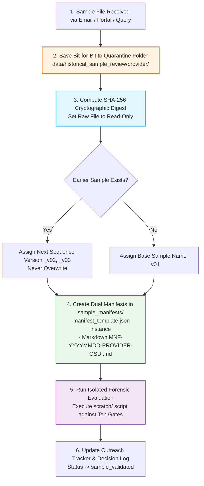

# Syrian Airport Data Engine — Version 2.6
# Sample Receipt, Handling & Cryptographic Intake Protocol

**Document Identifier**: `docs/V2_6_SAMPLE_RECEIPT_PROTOCOL.md`  
**Target Aerodrome**: Damascus International Airport (`DAM` / `OSDI`)  
**Audit Date**: 2026-10-11  
**Operating Standard**: ZERO PRODUCTION MUTATION & CRYPTOGRAPHIC IMMUTABILITY  
**Status**: APPROVED OPERATIONAL PROTOCOL  

---

## 1. Executive Summary & Purpose

This protocol specifies the mandatory forensic handling procedure whenever a historical flight sample dataset is received from an external commercial data provider, research network, or governmental authority.

The objective is to ensure absolute data provenance, cryptographic immutability, zero risk of contaminating the production database (`data/damascus_airport.db`), and adherence to legal and licensing boundaries.

---

## 2. Core Invariant Rules

Whenever incoming sample files arrive:

1. **Preserve the Original File**:
   - The received raw file must be stored bit-for-bit unmutated. Never re-encode, re-format, trim, or normalize the primary receipt file.
2. **Calculate SHA-256 Cryptographic Hash**:
   - Immediately upon saving the raw file, compute its cryptographic SHA-256 digest. Record this digest in both machine-readable and human-readable intake manifests.
3. **Record Complete Acquisition Metadata**:
   - Log transmission channel, sender details, timestamp, file size, target date range, declared aerodrome codes, and licensing restrictions.
4. **Store in Provider-Specific Quarantine**:
   - Store exclusively in the designated provider subfolder within `data/historical_sample_review/`:
     - `data/historical_sample_review/flightradar24/`
     - `data/historical_sample_review/flightaware/`
     - `data/historical_sample_review/opensky/`
     - `data/historical_sample_review/official_statistics/`
5. **Never Overwrite an Earlier Sample**:
   - Each sample received must be versioned monotonically. Subsequent samples received from the same provider must receive a distinct filename and manifest (e.g. `_v01`, `_v02`). Prior samples must never be replaced or overwritten.
6. **Zero Database Mutation Invariant**:
   - **Never insert sample records into the production database (`data/damascus_airport.db`).**
   - Sample evaluation is performed strictly through isolated Python scripts in `scratch/`.
   - Never alter existing production movement classifications or statistics based on unvalidated sample files.

---

## 3. The 6-Step Sample Intake Workflow



---

### Step 1: Quarantine Storage & Directory Allocation

Incoming files must be placed directly into their dedicated provider directory:

```text
data/historical_sample_review/
├── flightradar24/
│   └── fr24_osdi_sample_<YYYYMMDD>_v<NN>.<ext>
├── flightaware/
│   └── fa_osdi_sample_<YYYYMMDD>_v<NN>.<ext>
├── opensky/
│   └── opensky_osdi_sample_<YYYYMMDD>_v<NN>.<ext>
├── official_statistics/
│   └── cbs_mot_syria_<YYYYMMDD>_v<NN>.<ext>
└── sample_manifests/
    ├── MNF-<YYYYMMDD>-<PROVIDER>-OSDI.json
    └── MNF-<YYYYMMDD>-<PROVIDER>-OSDI.md
```

### Step 2: Cryptographic Hashing Protocol

Upon placement, execute the following PowerShell command to compute the SHA-256 hash:

```powershell
# Compute SHA-256 Hash of incoming sample
Get-FileHash -Algorithm SHA256 "data/historical_sample_review/<provider>/<filename>" | Format-List
```

The resulting hash string must be verified and pasted into both manifests. Once computed, mark the raw sample file as read-only to prevent accidental modification:

```powershell
Set-ItemProperty -Path "data/historical_sample_review/<provider>/<filename>" -Name IsReadOnly -Value $true
```

### Step 3: Dual Manifest Registration

For every received sample, two manifest documents must be committed to `data/historical_sample_review/sample_manifests/`:

1. **JSON Machine-Readable Manifest** (`MNF-<YYYYMMDD>-<PROVIDER>-OSDI.json`):
   Conforming to the schema defined in `data/historical_sample_review/sample_manifests/manifest_template.json`.
2. **Markdown Human-Readable Manifest** (`MNF-<YYYYMMDD>-<PROVIDER>-OSDI.md`):
   Instantiated from `data/historical_sample_review/sample_manifests/TEMPLATE_MANIFEST.md`.

#### Mandatory Manifest Fields
- **Manifest ID**: Format `MNF-<YYYYMMDD>-<PROVIDER>-OSDI`
- **Acquisition Timestamp**: ISO-8601 UTC timestamp of receipt
- **Acquisition Channel**: e.g., `Email from sales@fr24.com`, `Trino SQL query export`
- **Sender Identity**: Name, title, and institutional contact of provider agent
- **SHA-256 Digest**: Exact 64-character lowercase hex digest
- **File Size**: Byte count
- **Target Dates Covered**: Specific list of the 8 benchmark dates present
- **Licensing Restrictions**: Specific legal terms governing internal retention and academic publishing
- **Movement Count**: Preliminary raw line count prior to forensic validation

---

### Step 4: Non-Overwrite Versioning Convention

If multiple sample files or revisions are supplied by a provider:
- First sample: `<provider>_osdi_sample_<YYYYMMDD>_v01.<ext>`
- Subsequent sample: `<provider>_osdi_sample_<YYYYMMDD>_v02.<ext>`
- Bespoke correction: `<provider>_osdi_sample_<YYYYMMDD>_v03_reconciliation.<ext>`

Under no circumstance will a file be overwritten or deleted. Earlier files remain historical artifacts for comparative lineage audits.

---

### Step 5: Isolated Forensic Validation Execution

Once quarantined and hashed, the sample is evaluated using an isolated scratch script:

```bash
python scratch/validate_incoming_sample.py --provider <provider> --sample-path data/historical_sample_review/<provider>/<filename>
```

#### Evaluation Checklist (The Ten Assessment Gates)
1. **G1 (Airport Specificity)**: Confirm all records correspond to `OSDI` / `DAM`.
2. **G2 (Movement Direction)**: Confirm arrivals and departures are explicitly designated.
3. **G3 (Operating Flight Identity)**: Check presence of operating callsigns/flight numbers.
4. **G4 (Codeshare Disambiguation)**: Verify marketing vs operating airline separation.
5. **G5 (Timestamp Epistemic State)**: Audit whether timestamps are physical `actual` or modeled `estimated`/`scheduled`.
6. **G6 (Aircraft Identity)**: Verify tail numbers (`aircraft_reg`) and Mode-S hex (`icao24`).
7. **G7 (Direct Telemetry Evidence)**: Verify low-altitude sensor provenance (runway surface vs cruise).
8. **G8 (Source Record Identifier)**: Verify persistent unique upstream record keys.
9. **G9 (Historical Date Coverage)**: Verify local calendar alignment (`Asia/Damascus`).
10. **G10 (Retention & Export Rights)**: Verify written agreement permits internal DB retention and derivative reporting.

---

### Step 6: Classification & Intake Quarantine Gate

Every record evaluated is assigned one of the five standard movement classifications:
- `confirmed_physical`
- `corroborated_physical`
- `probable_movement`
- `unverified_movement`
- `scheduled_service`

**Strict Ingestion Guard**:
- Evaluated records are **quarantined in analytical review files** within `reports/`.
- No records are inserted into production `damascus_airport.db` tables (`flight_events`, `flights_raw`, etc.) until a formal architectural `GO` decision is ratified by project leadership.

---

## 4. Verification Script Specification (`scratch/verify_incoming_sample.py`)

A reference verification template is prepared to automate SHA-256 verification and manifest validation without importing or calling any production database models:

```python
"""
scratch/verify_incoming_sample.py
Standalone forensic sample validator for Syrian Airport Data Engine V2.6.
Strictly isolated: does not connect to damascus_airport.db.
"""

import sys
import hashlib
import json
from pathlib import Path

def compute_sha256(filepath: Path) -> str:
    hasher = hashlib.sha256()
    with open(filepath, "rb") as f:
        while chunk := f.read(65536):
            hasher.update(chunk)
    return hasher.hexdigest()

def verify_sample(provider: str, filename: str):
    base_dir = Path("data/historical_sample_review") / provider
    sample_file = base_dir / filename
    
    if not sample_file.exists():
        print(f"[ERROR] Sample file not found: {sample_file}")
        sys.exit(1)
        
    file_size = sample_file.stat().st_size
    digest = compute_sha256(sample_file)
    
    print("=" * 60)
    print(f"SAMPLE INTAKE AUDIT: {provider.upper()}")
    print("=" * 60)
    print(f"File Path:   {sample_file}")
    print(f"File Size:   {file_size} bytes")
    print(f"SHA-256:     {digest}")
    print(f"Target:      Damascus International Airport (DAM / OSDI)")
    print("=" * 60)
    print("STATUS: Quarantined in historical_sample_review.")
    print("PROTECTION: Production database damascus_airport.db is UNTOUCHED.")
    print("=" * 60)

if __name__ == "__main__":
    if len(sys.argv) < 3:
        print("Usage: python verify_incoming_sample.py <provider> <filename>")
        sys.exit(1)
    verify_sample(sys.argv[1], sys.argv[2])
```

---

## 5. Protocol Verification & Compliance Sign-Off

- **Lead Auditor**: Syrian Airport Data Engine Architecture Agent
- **Verification Rule**: Zero database writes, zero unsanctioned emails, absolute cryptographic tracking.
