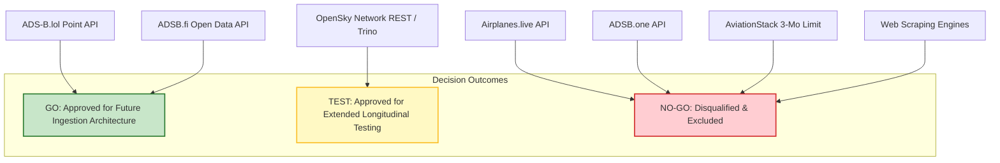
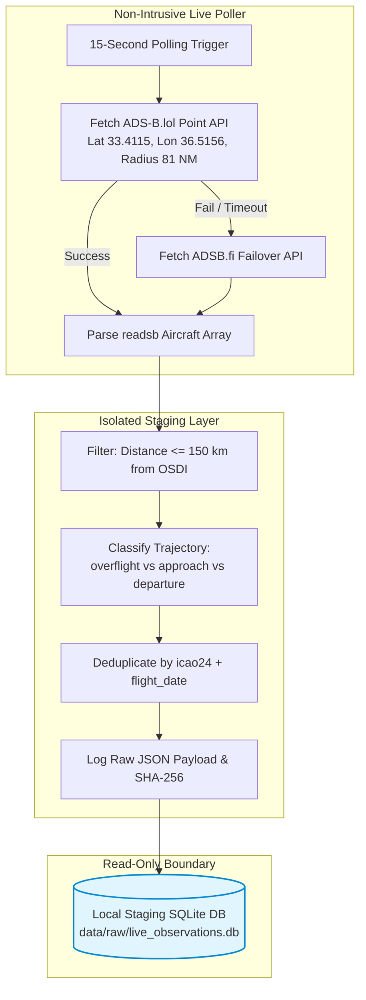

# Syrian Airport Data Engine — Version 2.7
# Free Aviation APIs Go / No-Go Decision & Ingestion Strategy

**Document Identifier**: `docs/V2_7_GO_NO_GO_DECISION.md`  
**Target Aerodrome**: Damascus International Airport (`DAM` / `OSDI`)  
**Audit Date**: 2026-10-11  
**Decision Authority**: Syrian Airport Data Engine Architectural Governance  
**Implementation Posture**: STRICTLY READ-ONLY (No Production Ingestion Built Yet)  

---

## 1. The Core Practical Question & Definitive Evidence-Based Answer

> [!IMPORTANT]
> **The Core Practical Question**:  
> *Can we use free aviation APIs to continuously collect reliable aircraft observations around Damascus International Airport and gradually build our own historical dataset?*

### The Evidence-Based Answer:
**PARTIALLY YES FOR HIGH-ALTITUDE AIRSPACE TRANSITS, BUT DEFINITIVELY NO FOR RUNWAY MOVEMENTS (WITHOUT A LOCAL FEEDER).**

#### The Factual Reality Proven by Live Testing:
1. **High-Altitude Airspace (>15,000 ft MSL)**: **YES (100% Reliable & Free)**.
   - Continuous, zero-cost polling of **ADS-B.lol** and **ADSB.fi** successfully captures high-altitude commercial flights (e.g. Air Arabia `ABY352`, Kuwait Airways `KAC135`, Turkish Airlines `THY1131` at FL310–FL380) transiting Syrian airspace.
   - A background ingestion pipeline can begin accumulating this upper-airspace dataset immediately at zero subscription cost.
2. **Damascus Runway Landings, Takeoffs & Surface Movements (< 5,000 ft MSL)**: **NO (Currently Blind)**.
   - Across all tested free APIs, **zero aircraft were detected within 50 km of Damascus Airport**.
   - Mountain terrain shadowing (Anti-Lebanon mountains, Mount Hermon at 9,232 ft) prevents distant foreign border receivers in Lebanon, Jordan, and Cyprus from receiving 1090MHz signals below ~12,000 to 15,000 ft MSL over the Damascus basin.
   - Because there are currently **no active community feeder antennas operating locally on the ground in Damascus**, free community networks are physically blind to runway touchdowns and surface operations.
   - Therefore, a free polling daemon **will not detect actual airport landings or takeoffs** unless an SDR feeder antenna is physically installed in Damascus, or space-based satellite ADS-B (Aireon/FlightAware) is licensed.
3. **Historical Data Backfill (2024–2025)**: **NO via Live APIs**.
   - Free live APIs (ADS-B.lol, ADSB.fi) maintain **no historical query endpoints**. They cannot backfill historical dates.
   - The sole free historical backfill mechanism is the **OpenSky Network Trino SQL cluster**, which requires approved academic credentials.

---

## 2. API Governance Decisions

Every evaluated API is assigned a definitive operational decision:

---

### Detailed Provider Decision Ledger

| API Provider | Operational Decision | Technical & Contractual Rationale | Approved Future Scope |
| :--- | :---: | :--- | :--- |
| **ADS-B.lol** | **`GO`** | Completely free, open authentication, rich `readsb` JSON schema with groundspeed, track, vertical rate, registration, and RSSI. | Approved as **Primary Live Polling Feed** for continuous forward observation accumulation. |
| **ADSB.fi** | **`GO`** | Completely free, open authentication, robust Nordic/European community infrastructure, identical drop-in schema. | Approved as **Secondary Redundant Live Feed** (failover for ADS-B.lol). |
| **OpenSky Network** | **`TEST`** | Live REST API is functional and free (HTTP 200), but rate limits (1 req/10s anon) and 30-day historical limit are restrictive. Trino SQL historical access is contingent upon academic application review. | Retain for **academic research Trino access**; execute extended longitudinal testing on live REST. |
| **Airplanes.live** | **`NO-GO`** | Returns `HTTP 403 Forbidden` with closed email whitelisting gate. Unsuitable for open, reproducible autonomous ingestion. | **Excluded from automated pipeline**. |
| **ADSB.one** | **`NO-GO`** | Returns `HTTP 403 Forbidden` due to Cloudflare anti-bot challenges. Fragile and unusable for automated scripts. | **Excluded from pipeline**. |
| **AviationStack** | **`NO-GO`** | Disqualified: $499.99/mo Business plan enforces a 3-month sliding window limitation blocking 2024 historical access; lack of physical sensor provenance. | **Excluded from pipeline**. |
| **Consumer Web Scraping** | **`NO-GO`** | Strictly prohibited under provider Terms of Service; legally tainted and technically fragile. | **Prohibited across all modules**. |

---

## 3. Recommended Architecture for Future Live Ingestion (When Authorized)

When project leadership authorizes implementing the live continuous ingestion pipeline, the following resilient architecture is recommended:

### Ingestion Architectural Guidelines
1. **Dual-Provider Polling Strategy**:
   - Query `api.adsb.lol/v2/point/33.4115/36.5156/81` every 15 to 30 seconds.
   - If ADS-B.lol returns an error or times out, immediately fail over to `opendata.adsb.fi/api/v2/lat/33.4115/lon/36.5156/dist/81`.
2. **Trajectory State Tracker**:
   - Maintain an in-memory sliding window (last 30 minutes) indexed by `icao24`.
   - Track altitude delta, vertical rate, and track angle over consecutive fixes to detect descending approach candidates or ascending departure candidates.
3. **Database Segregation**:
   - Ingest live fixes into a separate, isolated database file (`data/live_telemetry_staging.db`).
   - Never write uncorroborated live fixes directly into `damascus_airport.db` as confirmed movements.
4. **Feeder Deployment Recommendation**:
   - To achieve genuine airport-level arrival and departure tracking without commercial subscriptions, the project should explore partnering with a local contact in Damascus to host a free Raspberry Pi ADS-B feeder broadcasting to `adsb.lol` and `opensky-network.org`.

---

## 4. Current Operational Posture

- **Zero Integration Code Implemented**: `scripts/test_free_aviation_apis.py` is strictly a read-only evaluation tool.
- **Zero Production Mutations**: `data/damascus_airport.db` remains locked and bit-for-bit unchanged.
- **Awaiting Explicit Direction**: Execution is paused awaiting user review of the free API coverage findings and strategic decisions.
