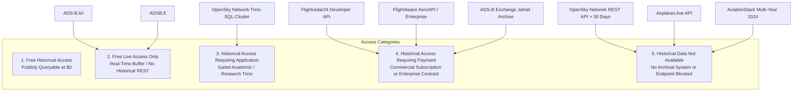

# Syrian Airport Data Engine — Version 2.7
# Historical Aviation Data Availability & Access Tier Evaluation

**Document Identifier**: `docs/V2_7_HISTORICAL_AVAILABILITY.md`  
**Target Aerodrome**: Damascus International Airport (`DAM` / `OSDI`)  
**Audit Date**: 2026-10-11  
**Target Historical Years**: `2024`, `2025`, and `2026`  
**Standard**: Rigorous Temporal Differentiation & Anti-Speculation Protocol  
**Status**: APPROVED EVALUATION SPECIFICATION  

---

## 1. Executive Summary & Epistemic Boundaries

A common and dangerous misconception in aviation software engineering is assuming that an API providing live real-time aircraft positions can be queried with a historical timestamp to retrieve past flights.

In reality, **almost all free community ADS-B networks are real-time broadcast buffers that discard or archive telemetry immediately**. They do not maintain indexed, queryable historical REST endpoints.

This document evaluates the historical data availability of every candidate provider across calendar years **2024**, **2025**, and **2026**, explicitly classifying each into one of five mutually exclusive access categories:
1. `Free historical access`
2. `Free live access only`
3. `Historical access requiring an application`
4. `Historical access requiring payment`
5. `Historical data that is not available`

---

## 2. Historical Availability Classification by Provider

---

## 3. Provider-by-Provider Historical Evaluation

### 1. OpenSky Network

* **Current Observations (Live)**: **Available** (`GET /api/states/all`). Anonymous access permitted at 10-second polling intervals.
* **Recent Historical (0 to 30 Days)**: **Available** (`GET /api/flights/departure` and `/api/flights/arrival`). Restricted to a 1-hour window per request within a 30-day sliding window for registered free accounts.
* **Deep Historical (2024, 2025, 2026)**:
  - *Via REST API*: **Not Available** (Queries $>30$ days into the past return `HTTP 403 Forbidden`).
  - *Via Trino / Impala SQL Cluster*: **Available** (`state_vectors_data4` table contains multi-petabyte raw telemetry back to 2013). However, access is strictly gated behind an academic/institutional application process.
* **Downloadable Pre-Curated Datasets**: OpenSky publishes monthly global CSV datasets for academic researchers, but these files are multi-gigabyte global dumps that require substantial local extraction scripts.
* **Access Classification**:
  - For REST API: **`Free live & recent 30-day access only`**.
  - For Deep Historical (2024–2026): **`Historical access requiring an application`**.

---

### 2. ADS-B.lol

* **Current Observations (Live)**: **Available** (`GET /v2/point/{lat}/{lon}/{dist_nm}`). High-fidelity `readsb` JSON output with ~1-second refresh rate.
* **Recent Historical (0 to 30 Days)**: **Not Available**. The API maintains no rolling daily or weekly flight history query endpoints.
* **Deep Historical (2024, 2025, 2026)**: **Not Available via API**.
* **Bulk Downloadable Archives**: Historical raw data is archived in community bulk storage (daily tarballs of global raw messages), but there is **no airport-specific historical query API**. Ingesting historical dates requires downloading hundreds of gigabytes of global unindexed tarballs.
* **Access Classification**: **`Free live access only`**.
* **Engine Implication**: Can be used to continuously collect *future* historical data from the date ingestion begins, but **cannot be used to backfill 2024, 2025, or early 2026 data**.

---

### 3. ADSB.fi

* **Current Observations (Live)**: **Available** (`GET /api/v2/lat/{lat}/lon/{lon}/dist/{dist_nm}`). Completely open, no authentication required.
* **Recent Historical (0 to 30 Days)**: **Not Available**. No point-in-time REST query parameters supported.
* **Deep Historical (2024, 2025, 2026)**: **Not Available via API**.
* **Bulk Downloadable Archives**: ADSB.fi publishes daily raw dumps on `opendata.adsb.fi`. These are global, unindexed message logs intended for big-data researchers with dedicated Hadoop/Spark infrastructure.
* **Access Classification**: **`Free live access only`**.
* **Engine Implication**: Identical to ADS-B.lol: excellent for real-time forward accumulation, incapable of backward historical retrieval.

---

### 4. Airplanes.live

* **Current Observations (Live)**: **Gated / Restricted** (`HTTP 403 Forbidden` on automated endpoints; requires developer whitelisting via email).
* **Recent & Deep Historical (2024, 2025, 2026)**: **Not Available**.
* **Access Classification**: **`Historical data that is not available`**.

---

### 5. Flightradar24 (Commercial Developer API)

* **Current Observations (Live)**: Available via Developer API or consumer web.
* **Recent Historical (0 to 30 Days)**: Available on *Explorer* ($9/mo) and *Essential* ($90/mo).
* **Deep Historical (2024, 2025, 2026)**:
  - *Essential Tier* ($90/mo): Provides 2 years of rolling history. As of late 2026, the 2-year window covers late 2024 to 2026, but drops early 2024.
  - *Advanced Tier* ($900/mo): Provides complete historical archives back to May 2016.
* **Access Classification**: **`Historical access requiring payment`**.

---

### 6. FlightAware (AeroAPI v4)

* **Current Observations (Live)**: Available via AeroAPI.
* **Recent Historical (0 to 30 Days)**: Available on *Standard* tier ($100/mo minimum spend).
* **Deep Historical (2024, 2025, 2026)**: Requires custom Enterprise contract for multi-year historical queries.
* **Access Classification**: **`Historical access requiring payment`**.

---

### 7. AviationStack

* **Current Observations (Live)**: Available on paid plans.
* **Recent Historical (0 to 90 Days)**: Available on Business Plan ($499.99/mo).
* **Deep Historical (2024, 2025, 2026)**: **Not Available**. Standard self-service plans enforce a strict 3-month sliding window limitation. Multi-year 2024 data cannot be retrieved.
* **Access Classification**: **`Historical access requiring payment`** (for 3-month window) / **`Historical data that is not available`** (for multi-year 2024).

---

## 4. Multi-Year Historical Coverage Matrix (2024–2026)

| Provider / Channel | 2024 Historical Coverage | 2025 Historical Coverage | 2026 Historical Coverage | Free vs. Paid Status | Primary Access Mechanism |
| :--- | :---: | :---: | :---: | :--- | :--- |
| **OpenSky Network (Trino)** | **Supported** (2013–pres) | **Supported** | **Supported** | **Free** ($0) | Historical access requiring application (Academic) |
| **OpenSky Network (REST)** | **Blocked** (HTTP 403) | **Blocked** (HTTP 403) | Rolling 30 Days Only | Free | Free live & recent 30-day access only |
| **ADS-B.lol** | **Not Available** | **Not Available** | Live Only | Free | Free live access only (No historical REST) |
| **ADSB.fi** | **Not Available** | **Not Available** | Live Only | Free | Free live access only (No historical REST) |
| **Airplanes.live** | **Not Available** | **Not Available** | Gated (HTTP 403) | Whitelist / Closed | Historical data that is not available |
| **Flightradar24 (Adv)** | **Supported** (May 2016–pres)| **Supported** | **Supported** | Paid ($900/mo or quote)| Historical access requiring payment |
| **Flightradar24 (Ess)** | Partial (2-year rolling)| **Supported** | **Supported** | Paid ($90/mo) | Historical access requiring payment |
| **FlightAware (AeroAPI)** | **Supported** (Enterprise) | **Supported** | **Supported** | Paid ($100/mo min) | Historical access requiring payment |
| **AviationStack (Std)** | **Blocked** (3-mo limit) | **Blocked** (3-mo limit)| Rolling 90 Days Only | Paid ($499.99/mo) | Gated 3-month window / 2024 not available |

---

## 5. Strategic Conclusion on Free Historical Reconstruction

> [!CRITICAL]
> **No free, unauthenticated public API currently provides deep historical query access (2024–2025) for Damascus International Airport.**
> 
> - Community networks (ADS-B.lol, ADSB.fi) are strictly **real-time instruments**. They can be leveraged immediately for continuous zero-cost forward data accumulation, but cannot retrieve past years.
> - The **only free mechanism** in existence for multi-year historical state-vector queries (2024–2026) is the **OpenSky Network Trino SQL cluster**, which is contingent upon academic institutional application approval.
> - Any immediate reconstruction of 2024–2025 flight movements at Damascus without an OpenSky academic agreement requires commercial procurement (Flightradar24 or FlightAware).
