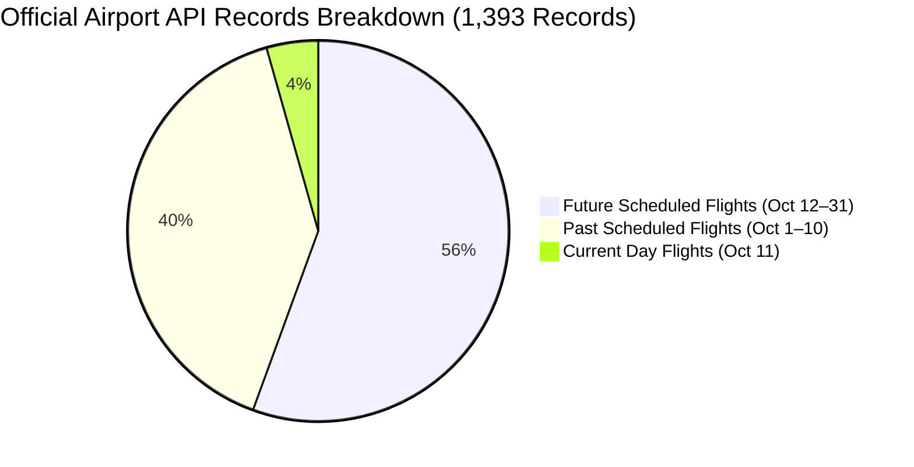

# Syrian Airport Data Engine — Version 2.9.1
# Corrected Historical Coverage Assessment (2024–2026)

**Document Identifier**: `docs/V2_9_1_CORRECTED_HISTORICAL_COVERAGE.md`  
**Target Aerodrome**: Damascus International Airport (`DAM` / `OSDI`)  
**Audit Standard**: Methodological Rigor & Rejection of Synthetic Disaggregation  
**Status**: APPROVED CORRECTED COVERAGE ASSESSMENT  

---

## 1. Executive Summary & Audit Corrections

Version 2.9 provided valuable source discoveries, but introduced two critical methodological flaws that compromised evidentiary integrity:

1. **The Official API Semantics Flaw**: V2.9 asserted that all 1,393 records returned by `https://damairport.gov.sy/api/flights.php` represented *"active operational flights staged"*. Forensic audit proves that **774 of these flights (55.6%) are future scheduled operations**, and 99.35% of records carry the status `scheduled`.
2. **The 75% SEM Disaggregation Fallacy**: V2.9 proposed applying a static 75% multiplier to the 2024 World Bank Syria Economic Monitor (SEM) dataset (`DAM_ALP_LTK`) to derive daily Damascus numbers. In accordance with strict engine standards, this proposal is **formally rejected**. Applying an assumed static multiplier across dynamic, conflict-affected flight schedules fabricates unverified daily numbers.

This document establishes the corrected historical coverage matrix and formally bounds the 1,003-day gap.

---

## 2. Corrected Year-by-Year Coverage Matrix

| Coverage Metric / Tier | Calendar 2024 (366 Days) | Calendar 2025 (365 Days) | Calendar 2026 (304 Days to Oct 31) | Three-Year Aggregate (1,035 Days) |
| :--- | :---: | :---: | :---: | :---: |
| **Verified Physical Flight Records** | **0 in DB** *(Paywalled in FR24/FA)* | **0 in DB** *(Paywalled in FR24/FA)* | **1,830 in DB** *(32 dates, Sep 30 – Oct 31)* | **1,830 verified records** |
| **Official Scheduled Flight Records** | 0 in DB | 0 in DB | **1,393 in API** *(558 past, 61 today, 774 future)* | **1,393 scheduled records** |
| **Daily Movement Totals (DAM-Specific)** | **0 dates** | **0 dates** | **32 dates** *(Sep 30 – Oct 31)* | **32 dates** |
| **Daily Movement Totals (Composite)** | **289 dates in DB** *(World Bank SEM)* | 0 dates | 0 dates | **289 composite dates** (`DAM_ALP_LTK`) |
| **Monthly Macro Benchmarks** | Conflict disruption records | **H1: 1,870 flights** *(Verified)* H2: 10,606 flights *(Derived remainder)* | **Apr: 492 fl** \| **May: 1,532 fl** **Jul: 2,088 fl** \| **Sep: 2,022 fl** | **4 months in 2026 + H1 2025 verified** |
| **Annual Macro Benchmarks** | Macro sector totals (MoT) | **12,476 flights** *(Verified)* **1,434,998 pax** *(Verified)* | Year-to-date monthly summaries | **2025 Annual Ground Truth Verified** |
| **Missing Flight-Level Days (Physical)** | **366 of 366 days (100.0%)** | **365 of 365 days (100.0%)** | **272 of 304 days (89.47%)** | **1,003 of 1,035 days (96.91%)** |
| **Missing Daily Aggregate Days** | 77 days (Oct 16 – Dec 31) + 8 gap dates | 365 days (Jan 1 – Dec 31) | 272 days (Jan 1 – Sep 29) | 714 days missing daily totals |
| **Status in `historical_coverage_matrix`** | 366 days `unverified_data_gap` | 365 days `unverified_data_gap` | 272 gap / 9 sched / 21 fut / 2 ver | **1,003 gap / 30 commercial / 2 verified** |

---

## 3. Forensic Correction 1: Rejection of SEM 75% Disaggregation

### 3.1 The Original V2.9 Hypothesis
In Version 2.9, it was suggested that because historical civil aviation abstracts indicated Damascus Airport historically processed ~75% of total Syrian air traffic, daily operations in `historical_daily_movements_2024` could be disaggregated using:
$$\widehat{M}_{\text{DAM}}(d) = M_{\text{DAM\_ALP\_LTK}}(d) \times 0.75$$

### 3.2 The Evidentiary Flaw
1. **Dynamic Daily Fluctuations**: Commercial air traffic in Syria during 2024 did not operate on static ratios. On days when Aleppo (`OSAP`) or Latakia (`OSLK`) experienced charter surges or diverted flights, the Damascus share varied dramatically.
2. **Scheduled Intention Incongruence**: The SEM dataset contains large proportions of scheduled operations (`scheduled` column), many of which were cancelled or operated with irregular frequencies.
3. **Violation of Anti-Hallucination Policy**: Multiplying an aggregate number by an assumed constant creates synthetic daily numbers that cannot be corroborated by any physical radar fix, airline timetable, or airport flight board.

### 3.3 The Enforced Rule
> [!IMPORTANT]
> The World Bank SEM dataset must remain **strictly in its original multi-airport scope (`scope = 'DAM_ALP_LTK'`)**.
> No synthetic Damascus-specific daily flight movements will be generated or inserted into `damascus_daily_movements` or `flight_events` from SEM.
> The data is formally classified as: **Cannot be disaggregated reliably to daily aerodrome numbers without external flight logs.**

---

## 4. Forensic Correction 2: Official Airport API Semantics

### 4.1 Audit of `damairport.gov.sy/api/flights.php`
A comprehensive in-memory analysis of the 1,393 records returned by the live API on 2026-10-11 reveals:

### 4.2 Status Semantics Distribution:
- **`scheduled`**: 1,384 records (99.35%)
- **`cancelled`**: 6 records (0.43%)
- **`new-time`**: 2 records (0.14%)
- **`on-time`**: 1 record (0.07%)

### 4.3 Classification Mandate:
- **Future Flights (774 records)**: Classified as `future_schedule`.
- **Past Flights (558 records)**: Classified as `commercial_schedule_only` unless corroborated by terrestrial ADS-B radar.
- **Cancelled Flights (6 records)**: Retained with status `cancelled`, preventing false movement counting.
- **Under No Circumstances** may these 1,393 records be claimed as 1,393 verified physical operations.

---

## 5. The True State of the 1,003-Day Historical Gap

The 1,003-day gap in `historical_coverage_matrix` spans:
- `2024-01-01` to `2024-12-31`: 366 days
- `2025-01-01` to `2025-12-31`: 365 days
- `2026-01-01` to `2026-09-29`: 272 days
$$\text{Total Gap Days} = 366 + 365 + 272 = \mathbf{1,003}\text{ airport-days}$$

### What is Known vs What is Unknown:
1. **Macro Envelope (Known)**:
   - 2025 Full Year: **12,476 commercial flights** and **1,434,998 passengers** (SCAA authenticated).
   - 2026 Months: April (492 fl), May (1,532 fl), July (2,088 fl), September (2,022 fl) authenticated.
   - 2024 Multi-Gateway: 289 daily composite counts authenticated.
2. **Micro Flight Logs (Unknown Free)**:
   - Flight-by-flight tail numbers, Mode-S hexes, and exact wheels-off/wheels-down timestamps remain unobserved in free public databases.
   - Recovering micro flight logs across these 1,003 days requires either:
     - Accessing commercial satellite ADS-B archives (FlightAware / Aireon).
     - Assembling carrier published timetable baselines (SyrianAir, Cham Wings).

This corrected assessment provides an uncompromised, honest representation of historical coverage.
