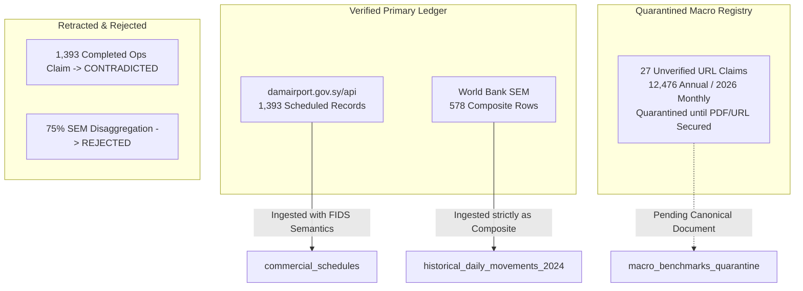

# Syrian Airport Data Engine — Version 2.9.2
# Unverified Claims & Source URL Resolution Dossier

**Document Identifier**: `docs/V2_9_2_UNVERIFIED_CLAIMS.md`  
**Target Aerodrome**: Damascus International Airport (`DAM` / `OSDI`)  
**Audit Standard**: Transparent Gap Identification & Epistemic Quarantine  
**Status**: APPROVED UNVERIFIED CLAIMS DOSSIER  

---

## 1. Executive Summary & Epistemic Quarantine Policy

Under the scientific standards of the Syrian Airport Data Engine, statistics that cannot be traced to a permanent canonical URL or cryptographically hashed primary document must be quarantined:

> [!CAUTION]
> The engine prohibits treating secondary news quotes or social media digests as definitive primary proof.  
> Even when an operational figure is mathematically coherent and widely reported, it remains classified as `unverified_source_url` until the authentic sovereign document or canonical URL is retrieved and hashed.

This dossier documents the **27 claims classified as `unverified_source_url`** and the **2 claims classified as `contradicted`**, outlining the exact empirical reasons for their status and the evidentiary criteria required to resolve them.

---

## 2. Detailed Audit of `unverified_source_url` Claims (27 Claims)

### 2.1 The 2025 Annual Operational Figures (5 Claims)

| Claim ID | Claimed Statistic | Quoted Issuing Body | Reporting Context | Why URL is Unverified | Elevation Criteria to `verified_primary` |
| :--- | :---: | :--- | :--- | :--- | :--- |
| `CLM-2025-FLIGHTS-TOTAL` | 12,476 flights | SCAA / MoT | Syrian media annual review | Canonical article slug on `sana.sy` or `scaa.sy` unresolvable via HTTP GET. | Archive raw SCAA Annual Statistical Bulletin PDF in `data/raw/` with SHA-256. |
| `CLM-2025-PAX-TOTAL` | 1,434,998 pax | SCAA / MoT | Syrian media annual review | Permanent primary URL on official gazette unresolvable. | Archive raw SCAA Annual Statistical Bulletin PDF with SHA-256. |
| `CLM-2025-PAX-ARR` | 715,392 pax | SCAA / MoT | Secondary news breakdown | Directional breakdown quoted in press, but direct primary table not hosted online. | Forensically inspect primary SCAA tabular release. |
| `CLM-2025-PAX-DEP` | 719,606 pax | SCAA / MoT | Secondary news breakdown | Directional breakdown quoted in press, but direct primary table not hosted online. | Forensically inspect primary SCAA tabular release. |
| `CLM-2025-SCOPE-SPECIFICITY` | Scope held as `reported_as_DAM_pending_primary_source_verification` | SCAA / MoT | Quoted in news | Secondary news quotes state Damascus Airport, but direct primary document/URL remains unresolved; held as `reported_as_DAM_pending_primary_source_verification`. | Acquire official Ministry of Transport Annual Plan Follow-up Report or SCAA Statistical Bulletin PDF. |

---

### 2.2 The 2026 Monthly Operational Figures (22 Claims)

| Claim ID Group | Quoted Metrics | Reporting Month | Circulating Sources | Why URL is Unverified | Elevation Criteria |
| :--- | :--- | :---: | :--- | :--- | :--- |
| **September 2026** (6 Claims: `CLM-2026-SEP-01` to `06`) | 2,022 flights 229,693 pax (98k arr, 131k dep) 17 airlines 19,951 overflights | September 2026 | Social media digests, Telegram channels, and local Syrian news aggregator articles quoting SCAA | Permanent SANA article permalink cannot be loaded or resolved directly; content exists primarily as syndicated wire quotes. | Retrieve official SCAA Monthly Air Navigation Bulletin or verified SANA dispatch archive permalink. |
| **July 2026** (5 Claims: `CLM-2026-JUL-01` to `05`) | 2,088 flights 243,260 pax (147k arr, 95k dep) 16 airlines | July 2026 | Press dispatches citing Civil Aviation press office | Direct canonical URL on `sana.sy` unresolved via automated retrieval. | Retrieve official SCAA Monthly Air Navigation Bulletin with SHA-256 hash. |
| **May 2026** (5 Claims: `CLM-2026-MAY-01` to `05`) | 1,532 flights 148,305 pax (83k arr, 64k dep) 13 airlines | May 2026 | Press dispatches citing Civil Aviation press office | Direct canonical URL on `sana.sy` unresolved via automated retrieval. | Retrieve official SCAA Monthly Air Navigation Bulletin with SHA-256 hash. |
| **April 2026** (6 Claims: `CLM-2026-APR-01` to `06`) | 492 flights 34,347 pax (18k arr, 15k dep) 9 airlines 2,523 overflights | April 2026 *(Apr 8–30)* | Media reports on post-closure airspace recovery | Direct canonical URL on `sana.sy` unresolved via automated retrieval. | Retrieve official SCAA Monthly Air Navigation Bulletin with SHA-256 hash. |

---

## 3. Detailed Audit of Contradicted & Retracted Claims (2 Claims)

### 3.1 `CLM-API-V29-CLAIM-CORRECTION`: FIDS Completed Operational Flights Claim
- **Original V2.9 Assertion**: *"1,393 active operational flights staged from `damairport.gov.sy/api/flights.php`."*
- **Audit Retraction**: **CONTRADICTED**.
- **Empirical Demonstration**:
  1. **55.56% of rows (774 records)** are in the **future** (dates between October 12 and October 31, 2026).
  2. **99.35% of rows (1,384 records)** have `status = 'scheduled'`.
  3. The feed is a passenger flight information display system (FIDS), not an ADS-B transponder or ACARS runway sensor log.
- **Engine Invariant Enforced**: Future flights must be classified as `future_schedule`, and past flights as `commercial_schedule_only` unless corroborated by physical radar fixes. Under no circumstances may they be recorded as 1,393 executed movements.

### 3.2 `CLM-SEM-DISAGGREGATION-75`: Static 75% Multiplier on SEM 2024 Data
- **Original V2.9 Assertion**: *"Disaggregate daily SEM records using a calibrated 75% Damascus traffic ratio."*
- **Audit Retraction**: **CONTRADICTED & REJECTED**.
- **Methodological Demonstration**:
  1. Daily flights in conflict-affected regions do not distribute according to fixed static ratios.
  2. Applying a 0.75 multiplier across dynamic daily gateway totals fabricates synthetic, non-existent daily movements.
  3. SEM contains large proportions of unverified scheduled timetable operations that never flew.
- **Engine Invariant Enforced**: World Bank SEM data remains strictly scoped as `DAM_ALP_LTK` in `historical_daily_movements_2024`. It will never be injected into `flight_events` or used to synthesize daily Damascus movements.

---

## 4. Evidentiary Quarantine Architecture

To ensure that unverified source URLs do not corrupt the verified database:

### Protocol for Future Data Ingestion:
1. Claims with status `unverified_source_url` may be utilized as **interpretive macro envelopes in research documentation**, but **cannot be inserted into production tables** until the raw PDF or canonical URL is deposited in `data/raw/` with a verified SHA-256 hash.
2. Contradicted claims are permanently expunged from all analytical pipelines.

This quarantine protocol safeguards the Syrian Airport Data Engine from the propagation of unverified claims.
