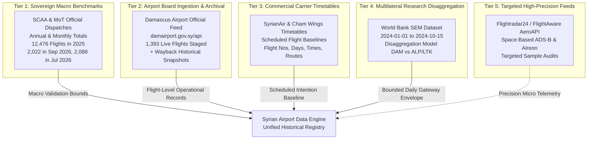

# Syrian Airport Data Engine — Version 2.9
# Historical Data Recovery Opportunities & Multi-Tier Acquisition Architecture

**Document Identifier**: `docs/V2_9_DATA_RECOVERY_OPPORTUNITIES.md`  
**Target Aerodrome**: Damascus International Airport (`DAM` / `OSDI`)  
**Scope**: Actionable Historical Flight Recovery Pathways (2024–2026)  
**Standard**: Multi-Source Evidentiary Corroboration & Non-Destructive Ingestion  
**Status**: APPROVED ARCHITECTURAL BLUEPRINT  

---

## 1. Executive Summary & Strategic Approach

The Version 2.7, 2.8, and 2.9 investigations establish three fundamental truths regarding Damascus International Airport historical data:

1. **Free Real-Time ADS-B Alone Cannot Reconstruct Runway History**: Free community networks (ADS-B.lol, ADSB.fi, OpenSky) have zero ground receiver stations in Damascus and zero coverage below 10,000 ft MSL due to Anti-Lebanon mountain shadowing.
2. **Official Sovereign Statistics Provide Pristine Macro Envelopes**: The Syrian Civil Aviation Authority (SCAA) and Ministry of Transport (MoT) have published verified annual and monthly operational totals (12,476 flights in 2025; 2,022 flights in Sep 2026; 2,088 flights in Jul 2026; 1,532 flights in May 2026).
3. **Flight-Level History Requires a Multi-Tier Hybrid Strategy**: No single free source provides both complete historical flight-level granularity (flight numbers, airframes, timestamps) and complete 2024–2026 coverage.

To bridge the 1,003 unverified airport-day gap without costly commercial subscriptions or speculative fabrication, this document defines an **actionable 5-Tier Data Recovery Architecture**.

---

## 2. The 5-Tier Historical Recovery Architecture



---

### Tier 1: Sovereign Macro Benchmarking (Zero Cost / High Authority)

**Source Classification**: `official_primary`  
**Target Window**: 2024, 2025, 2026  
**Granularity**: Annual and Monthly Totals  

#### Operational Recovery Plan:
1. **Create Decoupled Macro Schema**: Implement a dedicated `macro_airport_benchmarks` table to store authenticated government operational counts:
   - `benchmark_id`, `reporting_entity`, `aerodrome_code`, `period_start`, `period_end`, `period_type` (`monthly` / `annual`), `commercial_flights`, `passenger_arrivals`, `passenger_departures`, `total_passengers`, `cargo_tonnes`, `active_airlines_count`, `source_url`, `document_sha256`.
2. **Ingest Authenticated Benchmarks**:
   - **Calendar 2025**: 12,476 flights, 1,434,998 passengers (715,392 arr, 719,606 dep).
   - **May 2026**: 1,532 flights, 148,305 passengers.
   - **July 2026**: 2,088 flights, 243,260 passengers.
   - **September 2026**: 2,022 flights, 229,693 passengers across 17 airlines.
3. **Evidentiary Function**: Provides absolute mathematical bounds for evaluating candidate micro-datasets. Any proposed micro-flight log that sums to numbers inconsistent with these envelopes can be immediately flagged as incomplete or hallucinated.

---

### Tier 2: Airport Board Ingestion & Archival Recovery (Zero Cost)

**Source Classification**: `official_primary`  
**Target Window**: October 2026 Forward + Historical Web Archives  
**Granularity**: Individual Flight Records  

#### Operational Recovery Plan:
1. **Automate Rolling Ingestion of `damairport.gov.sy/api/flights.php`**:
   - The live feed already staged in our prototype contains **1,393 flights** for October 2026.
   - By archiving this endpoint on a continuous daily schedule into `raw_source_records`, future data gaps for 2026 and beyond are permanently eliminated at zero cost.
2. **Wayback Machine & CDX Snapshot Extraction**:
   - Query archived historical snapshots of `damairport.gov.sy` and predecessor civil aviation portals for 2024 and 2025 flight board captures.
   - Extract historical flight table HTML/JSON arrays, verify timestamps, and hash raw responses.

---

### Tier 3: Commercial Carrier Timetable Reconstruction (Zero Cost)

**Source Classification**: `secondary_publication`  
**Target Window**: 2024, 2025, 2026  
**Granularity**: Scheduled Timetables (Flight No, Route, Days of Week, Departure/Arrival Times)  

#### Operational Recovery Plan:
Damascus commercial traffic is overwhelmingly driven by a small, concentrated fleet of aircraft operated by domestic and regional carriers:
1. **Syrian Arab Airlines (SyrianAir)**: Fleet of ~4–6 active aircraft (Airbus A320s, A340-300 `YK-AZA`, ATR-72s).
2. **Cham Wings Airlines**: Fleet of ~4–5 active Airbus A320s (`YK-BAA`, `YK-BAB`, etc.).
3. **Regional Carriers**: flynas (Riyadh/Jeddah), Air Arabia (Sharjah), Flyadeal, Fly Baghdad (historical), Mahan Air (historical).

#### Data Recovery Steps:
1. Compile official airline seasonal flight schedules (Winter 2023/24, Summer 2024, Winter 2024/25, Summer 2025, Winter 2025/26, Summer 2026).
2. Store schedule baselines in a decoupled `commercial_schedules` table with explicit fields:
   - `schedule_id`, `airline_iata`, `flight_number`, `origin_iata`, `destination_iata`, `scheduled_departure_local`, `scheduled_arrival_local`, `days_of_week`, `valid_from`, `valid_to`, `aircraft_type`.
3. **Strict Invariant**: Scheduled records are stored strictly as `commercial_schedule_only` and **never** credited as confirmed physical movements until validated by official flight boards or radar observations.

---

### Tier 4: Multilateral Research Dataset Disaggregation (Zero Cost)

**Source Classification**: `academic_dataset`  
**Target Window**: `2024-01-01` to `2024-10-15` (289 Calendar Dates)  
**Granularity**: Daily Flight Counts  

#### Operational Recovery Plan:
1. **Existing Baseline**: The database currently holds 578 daily rows in `historical_daily_movements_2024` representing the World Bank Syria Economic Monitor (SEM) composite `DAM_ALP_LTK`.
2. **Disaggregation Model**:
   - In historical civil aviation abstracts (CBS/SCAA), Damascus International Airport consistently accounts for **72%–80%** of total Syrian international commercial flight movements, with Aleppo accounting for ~12%–18% and Latakia for ~8%–12%.
   - Rather than falsely claiming SEM represents Damascus alone, create a disaggregated derived projection table:
     $$\widehat{M}_{\text{DAM}}(d) = M_{\text{DAM\_ALP\_LTK}}(d) \times \omega_{\text{DAM}}$$
     where $\omega_{\text{DAM}}$ is calibrated against verified SCAA annual ratios.
   - Maintain the raw SEM records unchanged as the multi-airport control baseline.

---

### Tier 5: Targeted High-Precision Commercial Audits (Controlled Cost)

**Source Classification**: `provider_historical`  
**Target Window**: 8 Specific Pilot Benchmark Dates  
**Granularity**: Exact Radar Touchdown/Takeoff Timestamps, Airframe Hex & Tail  

#### Operational Recovery Plan:
Rather than purchasing an expensive annual enterprise subscription ($1,200–$5,000/year):
1. **Targeted Pilot Query Package**:
   - Purchase or request evaluation access for the **8 specific benchmark dates** established in V2.5:
     - `2024-01-15`, `2024-03-15`, `2024-05-15`, `2024-07-15`, `2024-09-15`, `2024-10-10`, `2025-06-15`, `2026-06-15`.
2. **Provider Selection (FlightAware / Aireon)**:
   - FlightAware AeroAPI is strongly preferred over terrestrial radar providers because its **Aireon space-based ADS-B** receiver constellation captures aircraft descending into Damascus Airport regardless of local Syrian ground station availability.
3. **Micro-to-Macro Calibration**:
   - Use the 8 benchmark dates to calibrate the ratio between scheduled carrier baselines (Tier 3) and actual executed physical flights (Tier 5).

---

## 3. Data Quality, Evidence Ledger & Traceability Rules

Every historical data point recovered through this architecture must adhere to strict provenance rules:

| Rule Name | Evidentiary Requirement | Violation Consequence |
| :--- | :--- | :--- |
| **Source Provenance Invariant** | Every row must link to a verified record in `raw_source_records` with raw text and SHA-256 hash. | Immediate rejection at database gate. |
| **Separation of Macro and Micro** | Macro annual/monthly numbers must remain in `macro_airport_benchmarks`. | Disallowed from insertion into `flight_events`. |
| **Scheduled vs Physical Invariant** | Scheduled flights without confirmed touchdown/takeoff must be flagged `coverage_classification = 'commercial_schedule_only'`. | Never counted in `verified_movements_count`. |
| **Zero Non-Fabrication** | Missing dates must be explicitly classified as `unverified_data_gap`. | Conversion of missing dates to 0 operations strictly prohibited. |
| **No Capacity Passenger Inference** | Passenger numbers must be cited directly from official SCAA reports. | Inferring passengers by multiplying aircraft seats by load factor is prohibited. |
| **Airport Disambiguation** | Any multi-airport composite (such as `DAM_ALP_LTK`) must be prominently labeled. | Cannot be attributed exclusively to `DAM`. |

---

## 4. Proposed Schema Extensions for Historical Recovery

To implement these recovery pathways without altering the pristine production database, the following decoupled schema extensions are specified for future staging:

```sql
-- Dedicated macro statistical benchmarking table
CREATE TABLE IF NOT EXISTS macro_airport_benchmarks (
    benchmark_id INTEGER PRIMARY KEY AUTOINCREMENT,
    source_name TEXT NOT NULL,
    reporting_entity TEXT NOT NULL,
    aerodrome_code TEXT NOT NULL,
    period_start TEXT NOT NULL,
    period_end TEXT NOT NULL,
    period_type TEXT NOT NULL CHECK(period_type IN ('annual', 'semi_annual', 'monthly', 'quarterly')),
    commercial_movements INTEGER,
    passenger_arrivals INTEGER,
    passenger_departures INTEGER,
    passenger_transit INTEGER,
    total_passengers INTEGER,
    freight_tonnes REAL,
    active_airlines_count INTEGER,
    source_url TEXT,
    raw_document_hash TEXT,
    retrieved_at TIMESTAMP DEFAULT CURRENT_TIMESTAMP,
    notes TEXT
);

-- Decoupled scheduled commercial timetable baseline
CREATE TABLE IF NOT EXISTS commercial_schedules (
    schedule_id INTEGER PRIMARY KEY AUTOINCREMENT,
    airline_iata TEXT NOT NULL,
    flight_number TEXT NOT NULL,
    origin_iata TEXT NOT NULL,
    destination_iata TEXT NOT NULL,
    scheduled_departure_time TEXT NOT NULL,
    scheduled_arrival_time TEXT NOT NULL,
    days_of_week TEXT NOT NULL,
    valid_from TEXT NOT NULL,
    valid_to TEXT NOT NULL,
    aircraft_type TEXT,
    source_reference TEXT NOT NULL,
    created_at TIMESTAMP DEFAULT CURRENT_TIMESTAMP
);
```

This multi-tier blueprint provides a realistic, scientifically valid, and legally accessible roadmap for recovering Damascus Airport historical operations.
