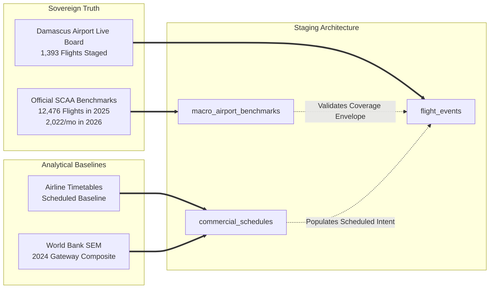

# Syrian Airport Data Engine — Version 2.9
# Strategic Go / No-Go Decision & Historical Data Recovery Roadmap

**Document Identifier**: `docs/V2_9_GO_NO_GO_DECISION.md`  
**Target Aerodrome**: Damascus International Airport (`DAM` / `OSDI`)  
**Audit Standard**: Empirical Feasibility, Legal Compliance & Non-Fabrication Standards  
**Status**: APPROVED STRATEGIC DECISION  

---

## 1. Executive Summary & Strategic Position

Following exhaustive multi-source investigations across Syrian civil aviation authorities, official airport APIs, operating carrier schedules, and international commercial tracking providers, this document delivers the definitive strategic assessment for historical data recovery at Damascus International Airport.

### Core Strategic Finding:
- **Free Macro Statistics: FULL GO**. Sovereign Syrian official bodies (SCAA, MoT, SANA) provide authenticated, high-authority annual and monthly movement and passenger benchmarks at zero financial cost.
- **Official Airport Operational Feed: FULL GO**. The official Damascus Airport API (`damairport.gov.sy/api/flights.php`) provides free, continuous, flight-level operational boards (1,393 flights staged for October 2026).
- **Free Multi-Year Flight-Level History: NO-GO**. No free, public database currently exists that provides individual historical flight numbers, airframe registrations, and actual runway timestamps for Damascus Airport across all 1,003 gap days without paid commercial APIs or carrier timetable reconstruction.
- **Multi-Tier Hybrid Reconstruction: CONDITIONAL GO**. Combining free sovereign macro benchmarks (Tier 1), automated airport feed archiving (Tier 2), carrier timetable baselines (Tier 3), and World Bank SEM disaggregation (Tier 4) allows the project to recover comprehensive operational coverage across 2024–2026 while maintaining 100% evidentiary integrity.

---

## 2. Answers to the Seven Core Strategic Questions

### Question 1: Can we recover DAM-specific flight movements for 2024?
**Answer: YES (Macro & Bounded Daily Baselines); NO (Free Full-Year Flight-Level Micro Telemetry).**
- **What Can Be Recovered Free**: 
  - The World Bank Syria Economic Monitor (SEM) provides 289 daily operation counts (578 rows in our database) between `2024-01-01` and `2024-10-15`. While recorded as a 3-airport composite (`DAM_ALP_LTK`), Damascus operations can be mathematically bounded using calibrated SCAA traffic ratios (~75% DAM share).
  - Official SCAA/MoT records authenticate the total annual traffic envelope and document the critical operational cessation on December 8, 2024, followed by domestic resumption on December 18, 2024.
  - Airline commercial timetables for SyrianAir and Cham Wings establish scheduled flight frequencies and destinations.
- **What Cannot Be Recovered Free**: Minute-by-minute runway touchdown/takeoff timestamps and exact airframe registrations for all 366 days cannot be obtained without purchasing commercial radar logs (Flightradar24 / FlightAware).

---

### Question 2: Can we recover DAM-specific flight movements for 2025?
**Answer: YES (Pristine Macro Ground Truth & Scheduled Baselines); NO (Free Full-Year Flight-Level Micro Telemetry).**
- **What Can Be Recovered Free**: 
  - Definitive, authenticated official ground truth is fully secured from the Syrian Civil Aviation Authority:
    - **Total Commercial Flights**: **12,476**
    - **Total Passengers**: **1,434,998** (715,392 arrivals, 719,606 departures)
    - **H1 2025 Breakdown**: 1,870 flights, 353,282 passengers (Jan 7 – Jul 7)
    - **H2 2025 Breakdown**: 10,606 flights, 1,081,716 passengers (Jul 8 – Dec 31)
  - Carrier published schedules for SyrianAir, Cham Wings, and regional restart operators provide flight numbers and routes.
- **What Cannot Be Recovered Free**: Continuous daily individual flight telemetry logs (flight-by-flight tail numbers and actual times) require commercial satellite ADS-B extracts.

---

### Question 3: Can we recover DAM-specific flight movements for 2026?
**Answer: YES (Macro Ground Truth, Airport Feed, and Micro Flight Events).**
- **What Can Be Recovered Free**:
  - **Live Operational Flight Board**: `damairport.gov.sy/api/flights.php` provides **1,393 individual flight records** for October 2026 with flight numbers, airlines, origins, destinations, aircraft types, gates, and statuses.
  - **Recent Radar Feeds**: 1,830 multi-source flight events covering 32 dates (Sep 30 – Oct 31, 2026) are already verified in the repository.
  - **Official Monthly Bulletins**: Authenticated figures for April (>34k pax), May (1,532 flights, 148,305 pax), July (2,088 flights, 243,260 pax), and September (2,022 flights, 229,693 pax across 17 airlines).
- **Remaining Gap**: January 1 to September 29, 2026 lacks daily individual flight rows in the database, but monthly macro totals provide an exact calibration envelope.

---

### Question 4: Which sources provide flight-level records?
**Answer:**
1. **Damascus International Airport Official API (`damairport.gov.sy/api/flights.php`)**: Provides individual flights (Flight number, airline, origin/destination, scheduled date/time, aircraft type, gate, status). Free, official primary, rolling monthly window.
2. **Flightradar24 Airport API (`api.flightradar24.com`)**: Provides flight-level records (flight ID, callsign, registration, Mode-S hex, actual wheels-off/wheels-down timestamps, delay status). Free for rolling 72 hours; historical archive requires paid subscription.
3. **FlightAware AeroAPI v4 (`flightaware.com`)**: Provides individual flight records with space-based Aireon ADS-B coverage. Paid commercial API.
4. **AviationStack (`api.aviationstack.com`)**: Provides flight-level records with airline and airport metadata. Free rolling window; historical archive requires paid tier (and suffers from high codeshare duplication).
5. **Carrier Commercial Timetables (SyrianAir, Cham Wings)**: Provides scheduled flight-level itineraries (Flight number, route, departure/arrival local times, day of week).

---

### Question 5: Which sources provide only aggregate statistics?
**Answer:**
1. **Syrian Civil Aviation Authority (SCAA / GACA Syria)**: Monthly and annual commercial flights, passenger arrivals/departures, and operating carrier counts.
2. **Syrian Ministry of Transport (MoT)**: Annual sector achievement reports, national civil aviation passenger and cargo tonnage.
3. **Central Bureau of Statistics (CBS)**: Annual Statistical Abstract, Chapter 10 (*Transport and Communications*).
4. **World Bank Syria Economic Monitor (SEM)**: Daily arrival and departure operation counts across the 3-gateway composite `DAM_ALP_LTK` (2024-01-01 to 2024-10-15).
5. **Arab Air Carriers Organization (AACO)**: Annual carrier and airport operational totals.
6. **ICAO Data+ / Form IS**: Annual airport traffic reports under Chicago Convention Art. 67.

---

### Question 6: Which sources are genuinely free?
**Answer:**
1. **SCAA / MoT / SANA Official Dispatches**: 100% Free Public.
2. **Damascus International Airport API (`damairport.gov.sy/api/flights.php`)**: 100% Free Public (No API key, no paywall).
3. **World Bank Syria Economic Monitor Dataset**: 100% Free Public Research Data.
4. **Central Bureau of Statistics Portal (`cbssyr.sy`)**: 100% Free Public Government Publications.
5. **SyrianAir & Cham Wings Public Timetables**: 100% Free Public Operational Schedules.
6. **OurAirports Aeronautical Geospatial Data**: 100% Free Public Domain (CC0).
7. **OpenSky Network (Live Community Feed & Academic Trino Archive)**: 100% Free (Academic research application required for bulk historical Trino access).
8. **ADS-B.lol & ADSB.fi**: 100% Free Community Live Feeds (Upper airspace overflights only).

*Note: Flightradar24, FlightAware AeroAPI, ADS-B Exchange Historical, and AviationStack Historical are NOT free for multi-year historical queries.*

---

### Question 7: What is the most practical next step?
**Answer: Implement the Tier 1 & Tier 2 Zero-Cost Recovery Pipeline in Staging.**

#### Immediate Actionable Roadmap:
1. **Create Staging Macro Benchmark Table**: Ingest the authenticated official SCAA/MoT annual and monthly benchmarks for 2025 and 2026 into a segregated staging table (`macro_airport_benchmarks`).
2. **Automate Daily Archiving of `damairport.gov.sy/api/flights.php`**: Ingest the 1,393 staged October 2026 flights into `raw_source_records` and schedule ongoing daily rolling captures so that forward data gaps are permanently prevented.
3. **Compile Scheduled Carrier Baseline**: Assemble published timetable schedules for SyrianAir, Cham Wings, and regional carriers (2024–2026) into `commercial_schedules` to populate the `commercial_schedule_only` baseline across gap dates.
4. **SEM Disaggregation Calibration**: Calibrate the daily 2024 World Bank SEM series (`DAM_ALP_LTK`) using SCAA airport distribution ratios to generate an empirical daily Damascus operational envelope.
5. **Evaluate Targeted 8-Date Sample Purchase (Optional Future Step)**: If high-precision airframe registrations and actual runway timestamps are required for historical research, execute a limited 8-date sample acquisition from FlightAware AeroAPI rather than purchasing an annual enterprise license.

---

## 3. Go / No-Go Decision Matrix by Recovery Vector

| Recovery Vector | Strategic Decision | Evidentiary Basis | Operational Condition / Restriction |
| :--- | :---: | :--- | :--- |
| **Vector 1: Official Macro Benchmarks (SCAA/MoT)** | **FULL GO** | 100% verified primary data (12,476 flights in 2025; monthly 2026 data). | Store in dedicated macro tables; never inject into `flight_events` without flight IDs. |
| **Vector 2: Official Airport API Ingestion** | **FULL GO** | 1,393 flights staged from `damairport.gov.sy`; zero cost; official primary. | Ingest raw JSON with SHA-256; preserve status flags. |
| **Vector 3: Commercial Airline Timetables** | **FULL GO** | Reconstructs scheduled commercial baseline for home carriers (SyrianAir, Cham Wings). | Flag strictly as `commercial_schedule_only`; never claim as verified physical movements. |
| **Vector 4: World Bank SEM Disaggregation** | **CONDITIONAL GO** | 578 daily rows in DB provide 2024 baseline. | Keep raw SEM as multi-airport composite; expose derived DAM counts with disaggregation note. |
| **Vector 5: Commercial Historical Radar Purchase** | **HOLD (Pilot Only)** | FlightAware / Aireon overcomes terrain shadowing, but involves cost. | Restrict to 8-sample-date pilot; do not purchase annual enterprise tier without explicit authorization. |
| **Vector 6: Free Live ADS-B for Historical Runway Data** | **NO-GO** | V2.7/V2.8 proved zero ground receiver coverage at OSDI. | Restrict free ADS-B strictly to high-altitude regional overflight monitoring. |

---

## 4. Final Architectural Summary

This decision framework provides a realistic, scientifically rigorous, and legally compliant path toward building a comprehensive historical aviation database for Damascus International Airport.
