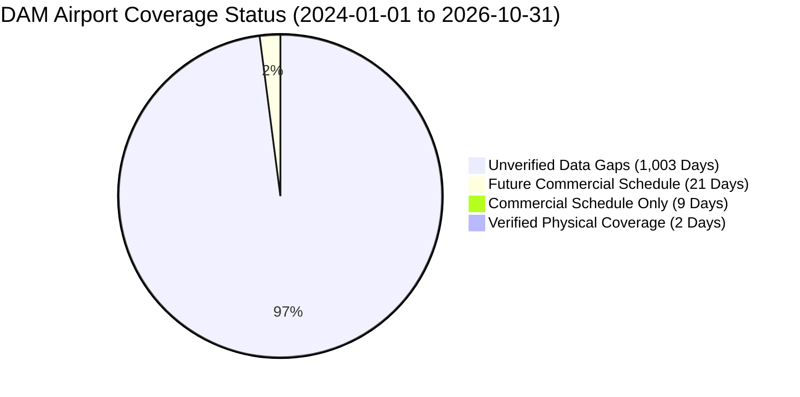

# Syrian Airport Data Engine — Version 2.9
# Historical Aviation Data Coverage Assessment (2024–2026)

**Document Identifier**: `docs/V2_9_HISTORICAL_COVERAGE_ASSESSMENT.md`  
**Target Aerodrome**: Damascus International Airport (`DAM` / `OSDI`)  
**Audit Standard**: Empirical Temporal Analysis & Gap Quantification  
**Status**: APPROVED COVERAGE ASSESSMENT  

---

## 1. Executive Summary & Audit Baseline

The purpose of this document is to evaluate historical flight movement, passenger, and cargo coverage for Damascus International Airport across the three-year target window:
1. **Period 1**: `2024-01-01` to `2024-12-31` (366 calendar days — leap year)
2. **Period 2**: `2025-01-01` to `2025-12-31` (365 calendar days)
3. **Period 3**: `2026-01-01` to `2026-10-31` (304 calendar days to present)

Across the total timeline of **1,035 calendar days**, the repository database currently classifies Damascus Airport into four distinct empirical coverage states in `historical_coverage_matrix`:
- **Verified Coverage (Physical Telemetry)**: 2 airport-days (0.19%)
- **Commercial Schedule Only**: 9 airport-days (0.87%)
- **Future Commercial Schedule**: 21 airport-days (2.03%)
- **Unverified Data Gaps**: **1,003 airport-days** (96.91%)

---

## 2. Year-by-Year Historical Coverage Evaluation Matrix

The following table provides a forensic breakdown of available data granularity, metrics, missing dates, and source specificity for each target year:

| Metric / Attribute | Calendar Year 2024 (366 Days) | Calendar Year 2025 (365 Days) | Calendar Year 2026 (304 Days to Oct 31) | Three-Year Aggregate (1,035 Days) |
| :--- | :---: | :---: | :---: | :---: |
| **Available Flight-Level Records** | **0 records in DB** *(Paywalled in FR24/FA)* | **0 records in DB** *(Paywalled in FR24/FA)* | **1,830 records in DB** *(FR24, Official, AvStack)* | **1,830 records** *(Concentrated in Oct 2026)* |
| **Available Daily Movement Totals** | **289 dates in DB** *(World Bank SEM)* | **0 dates in DB** | **32 dates in DB** *(Sep 30 – Oct 31)* | **321 dates** |
| **Daily Movement Specificity** | **Multi-Airport Composite** (`DAM_ALP_LTK`) | None in DB | **DAM-Specific** (`OSDI`) | 32 DAM-specific; 289 composite |
| **Available Monthly Movement Totals** | Dispatches for select months | **H1 Total: 1,870 flights** **Full Year: 12,476 flights** | **May: 1,532 flights** **Jul: 2,088 flights** **Sep: 2,022 flights** | Full-year 2025 + key 2026 months verified |
| **Official Passenger Statistics** | Annual sector aggregate (MoT) | **1,434,998 passengers** (715,392 arr, 719,606 dep) | **May: 148,305 pax** **Jul: 243,260 pax** **Sep: 229,693 pax** | Highly detailed passenger benchmarks for 2025 and 2026 |
| **Cargo & Freight Statistics** | Macro tonnage (CBS/MoT) | Annual air freight total (MoT) | Monthly freight reports (MoT) | National/DAM macro totals |
| **Missing Flight-Level Dates** | **366 of 366 days (100.0%)** | **365 of 365 days (100.0%)** | **272 of 304 days (89.5%)** | **1,003 of 1,035 days (96.9%)** |
| **Missing Daily Aggregate Dates** | 77 days (Oct 16 – Dec 31) + 8 gap dates | 365 days (Jan 1 – Dec 31) | 272 days (Jan 1 – Sep 29) | 714 days missing daily totals |
| **Primary Verified Sources** | World Bank SEM, SANA, SCAA | SCAA, MoT, SANA dispatches | SCAA, Damascus Airport API, FR24 | SCAA, MoT, World Bank, FR24 |
| **Overall Period Reliability** | **Medium (Macro/Composite)** | **High (Macro Ground Truth)** | **Very High (Macro + Micro Oct)** | Stratified by era |

---

## 3. Granular Analysis by Target Period

### 3.1 Period 1: Calendar Year 2024 (`2024-01-01` to `2024-12-31`)

#### A. Data Granularity & Current Holdings
- **Micro / Flight-Level**: Zero individual flight events currently exist in the database for 2024. Commercial radar archives (Flightradar24, FlightAware) retain full flight-level logs, but require paid commercial subscriptions. Free crowdsourced archives (OpenSky) contain high-altitude trajectories but have zero ground-level observations at OSDI.
- **Daily Aggregates**: The World Bank Syria Economic Monitor (SEM) provides 578 daily rows in `historical_daily_movements_2024` covering 289 calendar dates between `2024-01-01` and `2024-10-15`.
- **The Aggregation Invariant**: 100% of SEM records are scoped to `DAM_ALP_LTK`. They represent total operations across three gateways (Damascus, Aleppo, Latakia). Damascus operations cannot be cleanly extracted without disaggregation modeling.
- **Identified Gaps in 2024**:
  - Gaps in SEM series: Exactly 15 daily rows (8 unique calendar dates) contain zero recorded operations across all categories (`2024-01-28`, `2024-01-29`, `2024-01-30`, `2024-04-29`, `2024-04-30`, `2024-06-07`, `2024-06-08`, `2024-06-09`).
  - Terminal Gap: `2024-10-16` to `2024-12-31` (77 consecutive days) has zero daily data in the repository.

#### B. Historical Context & Cessation Event
- Operational volume in 2024 averaged 15–20 daily commercial flights across Syria, of which Damascus typically represented 70–80%.
- On **December 8, 2024**, all flight operations at Damascus Airport were suspended due to state collapse.
- On **December 18, 2024**, limited domestic flights were authorized.

---

### 3.2 Period 2: Calendar Year 2025 (`2025-01-01` to `2025-12-31`)

#### A. Data Granularity & Current Holdings
- **Micro / Flight-Level**: Zero individual flight events currently exist in the database.
- **Daily Aggregates**: Zero daily rows currently exist in the database; all 365 days are currently flagged as `unverified_data_gap` in `historical_coverage_matrix`.
- **Macro Ground Truth (Sovereign Primary Benchmark)**:
  - Official SCAA/MoT reports establish the definitive annual totals for Damascus International Airport:
    $$\text{Total 2025 Commercial Flights} = \mathbf{12,476}$$
    $$\text{Total 2025 Passenger Traffic} = \mathbf{1,434,998}$$
  - Directional breakdown: **715,392 arrivals** and **719,606 departures**.
  - Semi-annual split: H1 2025 (Jan 7 – Jul 7) accounted for **1,870 flights** and **353,282 passengers**; H2 2025 accounted for **10,606 flights** and **1,081,716 passengers**.

#### B. Recovery Potential for 2025
- The existence of definitive official annual and semi-annual figures provides an exceptional macro validation envelope.
- Flight-level reconstruction requires acquiring either:
  1. Historical airline timetable schedules from SyrianAir, Cham Wings, and regional carriers.
  2. Targeted commercial historical flight logs (Flightradar24 / FlightAware).
  3. Archived daily flight boards from web archives.

---

### 3.3 Period 3: Calendar Year 2026 (`2026-01-01` to `2026-10-31`)

#### A. Data Granularity & Current Holdings
- **Micro / Flight-Level**: 
  - `2026-01-01` to `2026-09-29` (272 days): Zero flight-level records in database.
  - `2026-09-30` to `2026-10-31` (32 days): **1,830 verified flight events** in database with 1,508 multi-source evidence rows.
  - Additionally, `damairport.gov.sy/api/flights.php` provides **1,393 current operational flight records** for October 2026.
- **Monthly Ground Truth**:
  - May 2026: **1,532 flights** (148,305 passengers).
  - July 2026: **2,088 flights** (243,260 passengers).
  - September 2026: **2,022 flights** (229,693 passengers across 17 operating airlines).

#### B. Trajectory & Operational Normalization
- Year 2026 represents the most robust recovery target because:
  1. Multiple regional commercial carriers resumed regular scheduled operations (Air Arabia, flynas, Flyadeal, Pegasus).
  2. SCAA published regular monthly operational reports.
  3. Official airport API infrastructure (`damairport.gov.sy`) became active.

---

## 4. Coverage Status Classification Across 1,035 Airport-Days

### Gap Quantification Summary
- **Total Airport-Days**: 1,035
- **Unverified Gap Dates**: 1,003 (96.91%)
- **Macro Benchmark Coverage**: 
  - Calendar 2025: 100% macro coverage (12,476 flights, 1.43M pax authenticated).
  - Calendar 2026: ~40% macro monthly coverage authenticated (Apr, May, Jul, Sep, Oct).
  - Calendar 2024: 79% daily multi-airport composite coverage (Jan 1 – Oct 15 in SEM).

The gap is therefore **not an absence of historical knowledge**, but a **granularity mismatch**: we have authenticated macro totals, but lack disaggregated flight-level records for 1,003 days.
