# Syrian Airport Data Engine — Version 2.9
# Comprehensive Historical Aviation Source Discovery & Inventory

**Document Identifier**: `docs/V2_9_HISTORICAL_SOURCE_DISCOVERY.md`  
**Target Aerodrome**: Damascus International Airport (`DAM` / `OSDI`)  
**Temporal Focus**: Calendar Years 2024, 2025, and 2026  
**Investigation Standard**: Forensic Source Authentication, Provenance Tracking & Non-Fabrication  
**Status**: APPROVED SOURCE DISCOVERY INVENTORY  

---

## 1. Executive Summary & Objective

The primary objective of Version 2.9 is to break through the historical coverage bottleneck for Damascus International Airport (`DAM` / `OSDI`). 

While Versions 2.7 and 2.8 proved that free crowdsourced ADS-B networks (ADS-B.lol, ADSB.fi, OpenSky Network) can effectively track high-altitude regional overflights transiting Syrian airspace at FL310–FL380, they established with empirical certainty that **free community ADS-B networks possess zero low-altitude terminal or runway receiver coverage within 50 km of Damascus Airport**. 

Consequently, historical runway movements (arrivals, departures, actual touchdown/takeoff times, airframe registrations, and cancellations) for 2024, 2025, and 2026 cannot be reconstructed from free live telemetry alone.

This document presents a comprehensive, multi-sector investigation of available historical data sources spanning:
1. **Syrian Sovereign Civil Aviation Authorities**: Syrian Civil Aviation Authority (SCAA / GACA Syria), Ministry of Transport (MoT), and Central Bureau of Statistics (CBS).
2. **Airport Operating Entities**: Damascus International Airport official portal (`damairport.gov.sy`), flight boards, and official announcements.
3. **Commercial & Academic Flight Tracking Providers**: Flightradar24, FlightAware, OpenSky Network historical archives, ADS-B Exchange, and AviationStack.
4. **Operating Air Carriers**: Historical commercial timetables and fleet operational schedules for Syrian Arab Airlines, Cham Wings Airlines, Fly Baghdad, flynas, Air Arabia, and regional operators.
5. **Multilateral & Institutional Datasets**: World Bank Syria Economic Monitor (SEM), Arab Air Carriers Organization (AACO), and ICAO Data+.

---

## 2. Comprehensive Historical Source Comparison Table

Every source investigated has been evaluated under standardized data quality and evidence rules:

| Source Identifier | Publishing Body | Source Classification | Coverage Period | Data Granularity | Airport Specificity | Access Model | Pricing / Access Barrier | Current Acquisition Status | Evidentiary Value & Role |
| :--- | :--- | :--- | :---: | :--- | :---: | :--- | :--- | :--- | :--- |
| **SCAA / GACA Syria Monthly Bulletins** | General Authority of Civil Aviation & Air Transport | `official_primary` | 2024–2026 (Monthly) | Monthly aggregates (Movements, Pax, Cargo) | **DAM-Specific** | Free Public Dispatches (SANA / Official Media) | Zero cost | **Actually Acquired & Inspected** | High-level macro ground-truth benchmark; envelopes total monthly operations. |
| **MoT Annual Reports** | Syrian Ministry of Transport | `official_primary` | 2024–2025 (Annual) | Annual totals & sector reviews | **DAM & National** | Free Public PDF / Official statements | Zero cost | **Publicly Accessible but not yet Acquired** | Macro operational validation; cross-checks national vs aerodrome totals. |
| **CBS Statistical Abstract** | Central Bureau of Statistics (Syria) | `official_primary` | 2010–2024 (Annual) | Annual totals by transport mode | National (Historically Aerodrome) | Free Public Print / Portal (`cbssyr.sy`) | Zero cost | **Publicly Accessible but not yet Acquired** | Statutory multi-year economic benchmark; 12–24 month publication lag. |
| **Damascus Airport Official Feed** | Damascus International Airport Authority | `official_primary` | 2026-10 (Rolling Month) | Individual flights (Flight No, Airline, City, Time, Gate, Status) | **DAM-Specific** | Free Public JSON API (`damairport.gov.sy/api/flights.php`) | Zero cost | **Actually Acquired & Inspected** (1,393 flights staged) | Definitive operational flight board; lacks public multi-year historical archive. |
| **Syria Economic Monitor (SEM)** | World Bank / Data Partnership | `academic_dataset` | 2024-01-01 to 2024-10-15 | Daily operations (Active, Landed, Scheduled) | **Multi-Airport Composite** (`DAM_ALP_LTK`) | Open Research Dataset | Zero cost | **Actually Acquired & Inspected** (578 rows in DB) | Daily multi-airport envelope for 2024; cannot be directly attributed to DAM alone. |
| **OpenSky Historical Trino Archive** | OpenSky Network | `academic_dataset` | 2013–Present | Raw state vectors & derived flight tables | Aerodrome Bounding Box | Academic Research Agreement | Non-commercial research approval required | **Available only through an Application** (Spec ready) | Excellent for regional trajectories; zero terminal runway coverage at OSDI. |
| **Flightradar24 Developer / Historical API** | Flightradar24 AB | `provider_historical` | May 2016–Present | Flight-level records with actual sensor timestamps | **DAM-Specific** | Paid Commercial API | ~$0.01–$0.05 per flight query / $400+ mo | **Paid** (Documented, not subscribed) | Highest-fidelity flight records (Mode-S hex, tail, actual touchdown/wheels-off). |
| **FlightAware AeroAPI v4** | FlightAware LLC / Collins Aerospace | `provider_historical` | 2011–Present | Flight-level records via terrestrial + Aireon space ADS-B | **DAM-Specific** | Paid Commercial API | $100/mo base tier + $0.005–$0.02 per query | **Paid** (Documented, not subscribed) | Space-based ADS-B bypasses Damascus terrain shadowing; captures arrivals/departures. |
| **ADS-B Exchange Historical** | ADS-B Exchange | `provider_historical` | 2016–Present | Raw 1-second state vector traces (JSON tarballs) | Spatial Bounding Box | Commercial Enterprise via RapidAPI | $100–$1,000/mo enterprise | **Paid** (Documented, not subscribed) | High raw precision; coverage at OSDI constrained by lack of local feeder station. |
| **AviationStack Historical** | APILayer Inc. | `provider_historical` | 2020–Present (3-mo free rolling) | Flight-level schedule & radar aggregator | **DAM-Specific** | Commercial Subscription | $49.99–$149.99/mo | **Paid / Disqualified** | High codeshare duplication, relies heavily on schedules, UTC/local date ambiguities. |
| **SyrianAir Timetables** | Syrian Arab Airlines | `secondary_publication` | 2024–2026 | Scheduled commercial timetable (Routes, Days, Times) | **DAM-Specific** | Free Public Timetables / Official announcements | Zero cost | **Publicly Accessible but not yet Acquired** | Baseline commercial schedule; indicates planned operations, not physical flights. |
| **Cham Wings Timetables** | Cham Wings Airlines | `secondary_publication` | 2024–2026 | Scheduled commercial timetable (Routes, Days, Times) | **DAM-Specific** | Free Public Timetables / Booking portal | Zero cost | **Publicly Accessible but not yet Acquired** | Baseline commercial schedule for Syria's primary private carrier. |
| **AACO Annual Statistical Bulletin** | Arab Air Carriers Organization | `secondary_publication` | Annual (Up to 2024/2025) | Annual carrier movements, fleet, and airport totals | **DAM & Carrier** | Institutional Publication | Member / Paid access | **Unavailable / Paid** | Macro airline-level traffic verification for Arab carriers. |
| **ICAO Data+ / Form IS** | International Civil Aviation Organization | `official_primary` | Annual (Up to 2024) | Annual aerodrome commercial movements, pax, cargo | **DAM-Specific** | Institutional / Government reporting | Paid / Academic subscription | **Unavailable / Paid** | Official sovereign reporting under Chicago Convention Art. 67. |

---

## 3. Discovered Source Characteristics & Deep-Dive Evaluation

### 3.1 Sovereign Primary Statistical Sources (SCAA & MoT)

Official government reporting represents the definitive ground-truth for macro-level passenger and aircraft movement counts:

1. **Syrian Civil Aviation Authority (SCAA / الهيئة العامة للطيران المدني والنقل الجوي)**:
   - **Legal Mandate**: Sole statutory regulator of civil air navigation in the Syrian Arab Republic (Civil Aviation Law No. 33 of 2007).
   - **Reporting Cadence**: Regular monthly operational bulletins released to state news agency SANA and ministerial archives.
   - **Key Metrics Provided**:
     - Total commercial aircraft movements (departures and arrivals).
     - Disaggregated passenger volumes (arriving passengers, departing passengers, transit passengers).
     - Operating carrier counts (e.g., 17 active airlines documented in September 2026).
   - **Evidentiary Limitations**: SCAA releases are strictly **aggregate monthly and annual figures**. They do not publish granular flight logs (individual flight numbers, airframe tail numbers, or minute-by-minute runway timestamps).

2. **Ministry of Transport (MoT / وزارة النقل)**:
   - **Reporting Scope**: Synthesizes air, maritime, railway, and road transport performance in annual follow-up reports.
   - **Evidentiary Role**: Serves as cross-validation for SCAA releases. High reliability for verifying whether reported figures represent Damascus alone or national aggregates across all five Syrian operational gateways (DAM, ALP, LTK, KAC, DEZ).

---

### 3.2 Operating Carrier Timetables (SyrianAir & Cham Wings)

Damascus International Airport's commercial passenger volume is dominated by two home carriers:
1. **Syrian Arab Airlines (SyrianAir)**: National flag carrier operating Airbus A320, A340-300, and ATR-72 airframes.
2. **Cham Wings Airlines**: Syria's largest private commercial carrier operating Airbus A320 airframes.

#### Evidentiary Protocol for Timetable Data
Under project quality rules, commercial timetables represent **scheduled intentions, not confirmed physical movements**:
$$\text{Timetable Flight} \neq \text{Physical Movement}$$

- **Utility**: Timetables provide exact flight numbers (e.g. `RB435`, `6Q511`), destination airports (e.g., DXB, SHJ, BEY, BGW, NJF, CAI, KWI), scheduled departure/arrival times, and operating day-of-week patterns.
- **Limitation**: Timetables do not account for ad-hoc cancellations, unscheduled maintenance, airspace diversions, or military NOTAM suspensions.
- **Recommended Processing**: Timetable records must be ingested into a decoupled `scheduled_timetables` baseline table and used strictly to corroborate physical observations, never as stand-alone proof of flight execution.

---

### 3.3 Commercial & Space-Based ADS-B Providers

The physical receiver deficit identified at Damascus Airport in V2.7/V2.8 can technically be addressed by two commercial providers:

1. **FlightAware (AeroAPI v4)**:
   - **Technological Advantage**: Through its partnership with **Aireon**, FlightAware ingests 1090 MHz Mode-S ADS-B signals received by space-based payloads hosted on the Iridium NEXT satellite constellation.
   - **Impact on Damascus**: Space-based reception eliminates terrestrial mountain shadowing from the Anti-Lebanon range. Aircraft broadcasting 1090 MHz extended squitter are tracked throughout their descent into the Damascus basin regardless of ground receiver availability.
   - **Cost Structure**: AeroAPI operates on a tiered model ($100/month standard tier + per-query fees). Free evaluation keys provide rolling 7-day data only.

2. **Flightradar24 (Developer / Business API)**:
   - **Coverage Model**: Global terrestrial ADS-B receiver network supplemented by satellite ADS-B.
   - **Airport Endpoint**: Provides comprehensive historical logs for `OSDI` / `DAM` including actual runway timestamps (wheels-down / wheels-up), airframe registrations (e.g. `YK-AKB`, `YK-BAA`), aircraft types (e.g., `A320`, `A340`), and callsigns.
   - **Cost Structure**: Historical queries require paid commercial plans or enterprise contracts ($400+/month).

---

## 4. Multi-Airport Aggregate Separation: Syria Economic Monitor (SEM)

The existing repository database contains 578 daily rows in `historical_daily_movements_2024` derived from the World Bank Syria Economic Monitor.

### Methodological Rule Enforced:
- The SEM dataset covers the period `2024-01-01` to `2024-10-15`.
- **Scope**: Explicitly tagged as `DAM_ALP_LTK` (a 3-airport gateway composite covering Damascus, Aleppo, and Latakia).
- **Prohibition**: These daily totals **must not be treated as Damascus-specific numbers**.
- **Disaggregation Opportunity**: When official SCAA/MoT annual or monthly reports establish the historical ratio of Damascus traffic relative to total Syrian traffic (historically 70%–80% of national volume), SEM daily numbers can serve as a bounded control envelope, but never as raw Damascus flight movements.

---

## 5. Summary of Investigated Sources

```mermaid
flowchart TD
    subgraph Macro Official Statistics
        SCAA[SCAA Monthly Bulletins\nMovements & Pax\nOfficial Ground Truth]
        MoT[MoT Annual Reports\nSector Performance]
        CBS[Central Bureau of Statistics\nStatistical Abstract]
    end

    subgraph Operational Flight Boards
        DAM_API[damairport.gov.sy/api\nLive Rolling Flights\n1,393 Flights Staged]
        ARCHIVE[Web Archive / Wayback\nHistorical Flight Boards]
    end

    subgraph Commercial Timetable Baselines
        SYR[SyrianAir Schedules\nRoutes & Frequencies]
        CHAM[Cham Wings Schedules\nRoutes & Frequencies]
    end

    subgraph Satellite & Terrestrial ADS-B
        FA[FlightAware / Aireon\nSpace-Based ADS-B\nSolves Terrain Shadowing]
        FR24[Flightradar24 API\nActual Runway Times\nAirframe Hex & Tail]
        OS[OpenSky Network\nAcademic Trino Archive\nHigh-Altitude Overflights]
    end

    SCAA -->|Macro Envelope| BENCHMARK[Macro Benchmarks Database]
    MoT -->|Validation| BENCHMARK
    DAM_API -->|Operational Truth| FLIGHTS[Flight Events Ledger]
    SYR -->|Scheduled Baseline| SCHEDULES[Scheduled Timetable Baseline]
    CHAM -->|Scheduled Baseline| SCHEDULES
    FA -.->|Commercial Path| FLIGHTS
    FR24 -.->|Commercial Path| FLIGHTS
    OS -->|Airspace Trajectories| OVERFLIGHTS[Upper Airspace Overflights]
```

This comprehensive inventory establishes the factual baseline for researching sovereign official statistics in Deliverable 2.
